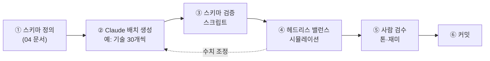

# 01. 지식 DB 범위 — Claude가 바로 제공할 수 있는 것

"구현 가능한 디자인"의 전제는 **데이터와 규칙을 실제로 채울 수 있느냐**다.
이 문서는 Claude의 내장 지식(2026년 6월까지 학습)으로 채울 수 있는 영역과, 외부 DB가 필요한 영역을 구분한다.

## 1. 분야별 제공 범위와 신뢰도

신뢰도 기준
- **높음** — 교과서·정설 수준. 게임에 그대로 써도 된다.
- **중간** — 수치가 근사이거나 최신 연구로 바뀔 수 있다. 출시 전 검증 권장.
- **낮음** — 최근 발견이거나 학계 논쟁 중. 반드시 원 출처 확인.

| 분야 | 제공 가능한 내용 (예) | 신뢰도 | 게임 활용 |
|---|---|---|---|
| 항성 물리 | 분광형별 질량·광도·온도·수명, 질량-광도 관계, 항성 진화(주계열 → 거성 → 백색왜성·중성자별·블랙홀) | 높음 | 절차적 항성 생성, 장기 이벤트(적색거성화, 초신성) |
| 근거리 항성 | 25광년 안 주요 항성 약 25개의 거리·분광형·다중성·알려진 행성 | 중간~높음 (수치는 근사) | 실제 이웃 별 지도 ([시드 데이터](examples/nearby_stars.json)) |
| 외계행성 | 대표 행성계 약 30개(트라피스트-1, 프록시마 b 등)의 특징과 발견사 | 중간 (최신 발견 누락 가능) | 중반 목표지, 과학 이벤트 |
| 태양계 | 행성·위성·소행성의 중력·대기·온도·방사선·자원, 탐사 역사 | 높음 | 도시 부지 ([03 §1](03-content-samples.md#1-태양계-도시-부지)) |
| 우주공학 | 로켓 방정식, 추진 방식별 비추력, 궤도역학·Δv, 회전 중력, 방사선 차폐, 생명유지 소비량 | 높음 (근사) | 물류·도시 건설 규칙 |
| 미래기술·메가구조물 | 오닐 실린더, 다이슨 스웜, 우주 엘리베이터, 핵펄스·반물질 추진, 알큐비에르 드라이브 등과 각각의 과학적 타당성 | 높음 (개념 수준) | 기술 트리, 현실성 등급 |
| 천체생물학 | 거주가능영역, 대체 생화학, 생명 지표(바이오시그니처), 극한 미생물 | 중간~높음 | 외계 생명 생성 규칙 |
| 사회과학 | 정치 체제, 경제 모델, 인구학, 문화 확산·표류 모델, 게임이론 | 높음 (모델링용) | 인구·정치·외교 시스템 |
| SF·게임 레퍼런스 | 4X·시뮬레이션 장르의 메커닉 비교, 고전 SF 개념(아시모프, 클라크, 니븐, 류츠신, 익스팬스 등) | 높음 | 디자인 레퍼런스 (개념만 차용) |
| 콘텐츠 대량 생성 | 기술 200+, 이벤트 100+, 지명·인명·종족명, 백과사전 텍스트, 한/영/일 현지화 | 높음 | 콘텐츠 파이프라인 (§5) |
| 코드 | 생성 알고리즘, 시뮬레이션 루프, ECS, 데이터 스키마, 툴 (Python / TypeScript / C# / GDScript / Rust) | 높음 | 프로토타입·툴 |
| 최신 동향 | 2025년 이후의 발견·탐사 임무 | 낮음~중간 | 웹 검색으로 보강 |

## 2. 지금 바로 만든 산출물

| 산출물 | 위치 | 설명 |
|---|---|---|
| 근거리 항성 시드 DB | [examples/nearby_stars.json](examples/nearby_stars.json) | 33개 계, 행성 55개. 항목마다 `status`(확인·후보·반박)와 `confidence`, `game_hook` 포함 |
| 공식 라이브러리 | [examples/formulas.py](examples/formulas.py) | 항성·행성·문명·이동·공학 공식 함수 27개. 실행하면 문서에 인용한 값을 출력 |
| 항성계 생성기 | [examples/system_generator.py](examples/system_generator.py) | 시드 기반 결정론적 생성. 실제 항성 데이터에 같은 공식을 적용한 보고서도 출력 |

생성기가 실제 데이터에 같은 공식을 적용했을 때 문헌 결과와 맞는지 확인했다.
프록시마 b(평형온도 231 K, 거주가능영역 안), 트라피스트-1 e·f·g(거주가능영역 안) 등이 문헌과 일치한다
([05 §1](05-formulas.md#1-항성) 참고).

## 3. 외부 DB가 필요한 영역

| 필요 | 추천 소스 | 비고 |
|---|---|---|
| 수만~수십억 개의 항성 | HYG Database(약 12만 개), Gaia DR3(약 18억 개 광원) | 라이선스·출처 표기 조건 확인 |
| 외계행성 전체 목록 | NASA Exoplanet Archive (2025년 하반기 기준 확인된 행성 6,000개 이상) | 주기적으로 갱신됨 |
| 소행성·혜성 궤도 | JPL Small-Body Database, Minor Planet Center | 실제 궤도 요소로 채굴 대상 생성 가능 |
| 근거리 항성의 정밀 수치 | SIMBAD, RECONS | 시드 DB 검증용 |
| 태양계 이미지·텍스처 | NASA/JPL 공개 이미지 (대부분 퍼블릭 도메인, 예외 확인) | 1970년대 NASA 에임스 우주 식민지 일러스트는 아트 레퍼런스로도 좋다 |
| 학습 시점(2026년 6월) 이후의 발견 | 웹 검색 | 이벤트 콘텐츠 갱신용 |

## 4. 데이터 신뢰도 관리 규칙 (제안)

1. 모든 콘텐츠 항목에 `confidence`(데이터 신뢰도), `plausibility`(과학적 현실성 등급), `science_note`(실제 근거) 필드를 둔다.
2. 실제 천체 수치는 게임 표시용으로 **유효숫자 2~3자리**만 쓴다.
3. 논쟁 중인 발견은 **그 자체를 게임 이벤트로** 만든다.
   예: 글리제 581 d의 '거주 가능 행성' 오보, K2-18 b의 생명 신호 논쟁.
4. 저작권: 다이슨 스피어, 오닐 실린더, '어두운 숲' 가설 같은 **개념**은 자유롭게 쓰되,
   특정 작품의 고유 명칭·문장·캐릭터·설정은 쓰지 않는다.

## 5. Claude와 함께하는 콘텐츠 제작 파이프라인 (제안)

초기 콘텐츠 규모 예상 (MVP 이후 1차 콘텐츠 완성 기준)

| 콘텐츠 | 수량 | 비고 |
|---|---|---|
| 실제 항성계 | 30~50 | 25광년 이내 + 유명 행성계 + 랜드마크 |
| 태양계 도시 부지 | 15~20 | 부지마다 고유 퍼즐 |
| 기술 | 120~200 | 시대 5개 × 분야 8개 |
| 거주·산업 모듈 | 60~100 | |
| 법령 카드 | 40~60 | |
| 이벤트 | 100~150 | 실제 사건 오마주 30% 이상 |
| 외계 종족 생성 테이블 | 8축 × 축당 5~8개 값 | 조합으로 수천 종 |
| 백과사전(코덱스) 항목 | 300+ | 모든 항목에 '실제 과학 노트' |
