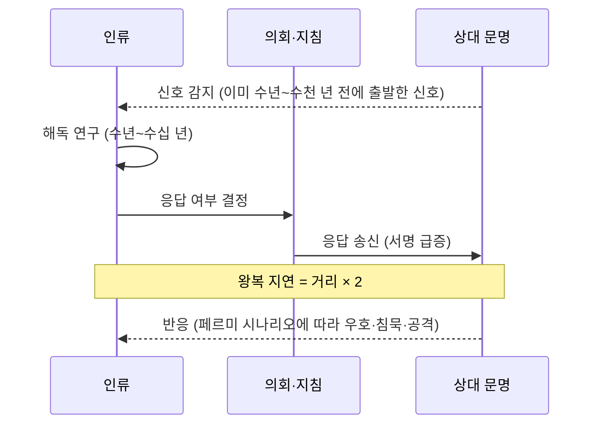

# 02. 핵심 시스템 — 디자인 옵션과 예시

## 0. 읽는 법

시스템마다 **목적 → 옵션 → 추천 → 예시 → 다른 시스템과의 연결** 순서로 정리했다.
수치는 [examples/formulas.py](examples/formulas.py)와 [examples/system_generator.py](examples/system_generator.py)로 직접 계산한 값이다.
"게임 규칙"이라고 표시한 부분은 실제 물리를 단순화한 밸런스 초안이다.

| # | 시스템 | 핵심 질문 |
|---|---|---|
| 1 | [시간과 스케일](#1-시간과-스케일) | 하루와 천 년을 한 게임에 어떻게 담나 |
| 2 | [우주 생성](#2-우주-생성--실제--절차적-하이브리드) | 어떤 별과 행성이 어디에 있나 |
| 3 | [행성·거주성·테라포밍](#3-행성거주성테라포밍) | 어디에 어떻게 살 수 있나 |
| 4 | [기술](#4-기술-trl과-현실성-등급) | 무엇을, 얼마나 믿을 만하게 만들 수 있나 |
| 5 | [에너지와 카르다쇼프](#5-에너지와-카르다쇼프-척추) | 문명의 크기를 무엇으로 재나 |
| 6 | [자원·산업·Δv 물류](#6-자원산업δv-물류) | 무엇을 어디서 캐서 어떻게 옮기나 |
| 7 | [인구·사회·정치](#7-인구사회정치--광속-지연-거버넌스) | 빛보다 느린 명령으로 어떻게 다스리나 |
| 8 | [도시 건설](#8-도시-건설--spacecity의-심장) | 우주 도시는 어떻게 숨 쉬나 |
| 9 | [이동·탐사](#9-이동탐사) | 얼마나 걸리고, 가보기 전엔 무엇을 아나 |
| 10 | [외계 생명·문명](#10-외계-생명문명과-페르미-시나리오) | 은하는 왜 조용한가 |
| 11 | [이벤트와 스토리텔러](#11-이벤트와-스토리텔러) | 이야기는 어떻게 생기나 |
| 12 | [위기·엔드게임](#12-위기엔드게임승리-조건) | 어떻게 끝나나 |

---

## 1. 시간과 스케일

**목적** — 하루 단위의 생명유지와 천 년 단위의 성간 정치를 한 게임에 담는다.

| 레이어 | 플레이어가 다루는 것 | 기본 틱 | 시뮬레이션 상세도 | 해금 조건 (예) |
|---|---|---|---|---|
| 도시 | 모듈 배치, 생명유지, 인구 배치 | 1일 | 개별 모듈·인구 그룹 | 시작 |
| 항성계 | 채굴지, 궤도 물류, 메가프로젝트 | 1주 | 거점별 집계 | 두 번째 부지 개척 |
| 성간 | 식민선, 지침, 외교 | 1년 | 식민지별 통계 모델 | 첫 성간 탐사선 발사 |
| 은하 | 문명 간 관계, 페르미 미스터리 | 사건 단위 도약 | 문명별 추상 모델 | 첫 외계 신호 또는 K 1.5 |

> **상세 디자인에서 바뀜** — 틱을 레이어마다 한 단계씩 잘게 나눴다 (도시 1시간, 항성계 1일, 성간 1주, 은하 1년).
> 그림자·CO₂ 축적처럼 몇 시간 안에 닥치는 위기를 표현하기 위해서다. 배속별 체감 속도는 [상세 디자인 02 §4](../design/02-structure-progression.md#4-시간-시스템).

**옵션**

| 옵션 | 설명 | 장점 | 단점 |
|---|---|---|---|
| A. 고정 틱 실시간 + 일시정지 | Paradox 게임 방식 | 익숙함 | 수십 년 항해 구간이 지루하다 |
| B. 턴제 | Civilization 방식, 턴 길이 고정 | 숙고형 플레이 | 도시 레이어의 연속감이 사라진다 |
| **C. 적응형 시간** | 보고 있는 레이어가 틱 길이를 정하고, 기다릴 일만 남으면 '다음 사건까지 도약' | 모든 스케일에서 밀도 유지 | 시간 감각을 전달할 UI가 필요 |

**추천: C**
- 배속 1× / 3× / 10× + "다음 사건까지 도약" (Aurora 4X의 자동 진행과 비슷)
- 도약은 도착·위기·결정 필요 같은 **중요 사건에서 자동 정지**
- 날짜는 항상 실제 연도로 표시(2061.03.17) — 시간의 무게를 체감시킨다

**인구 단위 가변 스케일** — 시대가 바뀌면 인구 1단위(pop)의 크기를 키워 엔티티 수를 수천 개 이하로 유지한다.
병합할 때 문화·이념 분포는 가중 평균으로 보존한다.

| 시대 | 1 pop | 예상 총 pop 수 |
|---|---|---|
| 0 행성 시대 | 100명 | 수십 |
| 1 항성계 시대 | 1만 명 | 수백 |
| 2 항성계 산업화 | 100만 명 | 수백~수천 |
| 3 이후 | 1억 명 | 수천 |

> **상세 디자인에서 바뀜** — 시대 0의 1 pop은 10명(작업반), 시대 1은 1,000명이다. 120명 기지를 100명 단위로 나누면 너무 거칠다
> ([상세 디자인 03 §10](../design/03-city-layer.md#10-인구), [04 §1](../design/04-system-layer.md#1-개요)).

**시뮬레이션 LOD** — 플레이어가 보고 있는 도시만 상세하게 돌리고, 나머지는 입출력 비율과 안정도만 갖는
'집계 모델'로 돌린다. 다시 보면 집계 상태에서 상세 상태를 복원한다. ([04 §3](04-architecture-roadmap.md#3-틱스케줄러lod))

---

## 2. 우주 생성 — 실제 + 절차적 하이브리드

**목적** — 친숙한 출발점과 끝없는 바깥을 동시에 준다.

| 옵션 | 설명 | 장점 | 단점 |
|---|---|---|---|
| A. 완전 실제 | HYG·Gaia 카탈로그 수십만 개 항성 | 고증·교육적 가치 | 데이터 처리 부담, 대부분 적색왜성이라 단조로움 |
| B. 완전 절차적 | 시드 기반 생성 | 무한한 리플레이 | '우리 이웃'이라는 감성이 사라짐 |
| **C. 하이브리드** | 태양 주변 25광년은 실제 데이터, 바깥은 절차적 생성 | 친숙한 시작 + 무한한 바깥 | 경계의 이음새 처리 필요 |

**추천: C** — 실제 데이터는 [03 §2](03-content-samples.md#2-실제-근거리-항성-시드-db)의 시드 DB, 바깥은 아래 생성기.

### 분광형 분포 — 실제 vs 게임 보정

| 분광형 | 질량 (M☉) | 표면온도 (K) | 실제 주계열 비율 | 게임 보정안 | 게임 속 성격 |
|---|---|---|---|---|---|
| O | 16 이상 | 30,000 이상 | 0.00003% | 0.5% | 수백만 년 만에 초신성이 되는 위험한 랜드마크 |
| B | 2.1–16 | 10,000–30,000 | 0.13% | 1.5% | 강한 자외선, 생명 불가, 에너지원 |
| A | 1.4–2.1 | 7,500–10,000 | 0.6% | 4% | 수명이 짧음(수억~20억 년), 에너지 기지 |
| F | 1.04–1.4 | 6,000–7,500 | 3% | 9% | 넓은 거주가능영역, 수명 수십억 년 |
| G | 0.8–1.04 | 5,200–6,000 | 7.6% | 18% | 태양형 — 최고의 정착지 |
| K | 0.45–0.8 | 3,700–5,200 | 12.1% | 25% | 오래 살고 안정적인 숨은 명당 |
| M | 0.08–0.45 | 2,400–3,700 | 76.45% | 42% | 흔함, 플레어, 조석 고정 |

실제 비율을 쓰면 별 4개 중 3개가 적색왜성이다. 고증 모드와 게임 모드를 설정으로 고르게 하자.

### 생성 파이프라인

```
시드 ─▶ ① 분광형 (가중 추첨) ─▶ ② 질량 (분광형 범위 안에서 로그 균등)
     ─▶ ③ 광도·반지름·온도·수명·나이 (질량-광도 관계, 슈테판-볼츠만)
     ─▶ ④ 영역: 거주가능영역(온도 보정, Kopparapu 2014), 설선 2.7√L AU
     ─▶ ⑤ 궤도 배치: 적색왜성은 촘촘하게(간격 비 1.3~1.7), 그 외는 넓게(1.4~2.0)
     ─▶ ⑥ 유형: 설선 안쪽 = 암석·용암·소행성대, 바깥쪽 = 거대행성·얼음 천체
     ─▶ ⑦ 물리량: 질량·반지름·중력·대기·온실효과·표면온도·수권
     ─▶ ⑧ 거주성·ESI·자원 풍부도·생명 판정·위성
```

### 예시 1 — 실제 비율 (`--seed 2061`)

`python3 system_generator.py --seed 2061` 의 결과다. 별 Kelvos: M7V, 0.132 M☉, 0.00217 L☉, 3,102 K, 나이 74억 년.
거주가능영역 0.048–0.096 AU, 설선 0.126 AU.

| 행성 | 유형 | a (AU) | 주기 (일) | 질량 (M⊕) | 중력 (g) | 대기 | 표면 (K) | ESI | 거주성 | 특징 |
|---|---|---|---|---|---|---|---|---|---|---|
| b | 불모 암석 행성 | 0.021 | 3.0 | 0.07 | 0.35 | 없음 | 405 | 0.63 | 0 | 조석 고정 |
| c | 미니 해왕성 | 0.027 | 4.6 | 13.6 | 3.0 | 수소 외피 | 326 | – | 0 | 조석 고정 |
| **d** | **지구형 행성** | 0.042 | 8.7 | 1.23 | 1.1 | **지구형** | **300** | **0.95** | **50** | 조석 고정 |
| e | 불모 암석 행성 | 0.068 | 18.0 | 0.04 | 0.29 | 없음 | 223 | 0.64 | 0 | **HZ**, 조석 고정 |
| f | 불모 암석 행성 | 0.113 | 38.1 | 0.14 | 0.45 | 없음 | 173 | 0.58 | 0 | 조석 고정 |
| g | 얼음 왜행성 | 0.191 | 83.9 | 0.02 | 0.12 | 없음 | 116 | – | 0 | 휘발성 4 |
| h | 불모 암석 행성 | 0.256 | 130 | 0.27 | 0.59 | 없음 | 115 | 0.42 | 0 | 얼음 (휘발성 4) |
| i | 얼음 왜행성 | 0.364 | 221 | 0.005 | 0.07 | 없음 | 84 | – | 0 | 휘발성 4 |

읽을거리
- **HZ 안의 e는 너무 작아** 대기를 붙잡지 못했고, HZ 바로 안쪽의 d가 지구형 대기 덕에 300 K다.
  "거주가능영역 = 살 수 있음"이 아니라는 걸 플레이로 배운다.
- d는 ESI 0.95로 지구와 아주 닮았지만, **조석 고정(×0.8)과 플레어(×0.7)** 감점으로 거주성은 50이다.
  망원경 단계에서는 ESI만 보이므로, 직접 가 보기 전까지 이 차이를 모른다 (→ §9 과학의 안개).
- 트라피스트-1처럼 촘촘한 계라서 행성 간 Δv가 작다 → '다행성 도시 국가' 시나리오가 자연스럽다.

### 예시 2 — 게임 보정 (`--seed 1707 --preset game`)

별 Quosa: G8V, 0.825 M☉, 0.464 L☉, 5,194 K, 나이 62억 년. 거주가능영역 0.669–1.203 AU, 설선 1.84 AU.

| 행성 | 유형 | a (AU) | 주기 (일) | 질량 (M⊕) | 중력 (g) | 대기 | 표면 (K) | ESI | 거주성 | 특징 |
|---|---|---|---|---|---|---|---|---|---|---|
| b | 미니 해왕성 | 0.226 | 43 | 5.9 | 1.3 | 수소 외피 | 434 | – | 0 | 조석 고정 |
| c | 슈퍼지구 | 0.413 | 107 | 2.2 | 1.44 | 없음 | 327 | 0.86 | 1 | 금속·규산염 |
| **d** | **바다 행성** | 0.810 | 293 | 2.06 | 1.15 | **지구형** | **271** | **0.90** | **81** | **HZ**, 수권 99% |
| e | 소행성대 | 1.601 | 815 | – | – | – | 177 | – | – | 희귀원소 4, 금속 3 |
| f | 가스 거대행성 | 2.653 | 1,737 | 107 | 1.22 | 수소 외피 | 127 | – | – | 위성 4: 지하 해양 얼음 위성, 화산 위성 |
| g | 얼음 거대행성 | 4.147 | 3,396 | 15.8 | 1.23 | 수소 외피 | 103 | – | – | 위성 3: 두꺼운 대기 위성, 지하 해양 얼음 위성 |

읽을거리
- **생명이 없는 바다 행성 d** — "지구 생명을 이식할 것인가?"라는 윤리 이벤트와 해양 도시 시나리오가 나온다.
- 소행성대(e)가 금속·희귀원소를, 거대행성(f·g)이 핵융합 연료를, 얼음 위성이 물을 준다.
  **생성 규칙만으로 자원 동선과 개척 순서가 생긴다.**
- 지하 해양 위성 두 곳은 미생물 탐사 목표 → 과학 이벤트 후보.

### 분포 점검

항성계 3,000개씩 생성해 본 결과

| 지표 | 실제 비율 | 게임 보정 |
|---|---|---|
| 적색왜성(M형) 비율 | 75% | 40% |
| 거주성 60 이상 행성을 가진 항성계 | 1.3% | 2.9% |
| 미생물 이상 생명이 있는 행성 | 약 0.7% | 약 0.8% |

"희귀하지만 찾을 수는 있는" 수준이다. 확률은 [system_generator.py](examples/system_generator.py) 상단 상수로 조정한다.

---

## 3. 행성·거주성·테라포밍

**목적** — "어디에 살 것인가"를 의미 있는 선택으로 만든다.

### 행성 유형

| 유형 | 실제 예 | 핵심 자원 | 개척 방식 |
|---|---|---|---|
| 용암 행성 | 게자리 55 e | 금속·희귀원소 | 궤도 정련소, 무인 채굴 |
| 불모 암석 행성 | 수성, 달 | 규산염·금속 (극지 얼음) | 돔·지하 도시 |
| 지구형 행성 | 지구, 금성(고밀도 대기) | 균형형 | 돔 → 테라포밍 → 개방 거주 |
| 슈퍼지구 | 글리제 667 Cc | 금속 | 고중력 → 아종 분화 |
| 바다 행성 | LHS 1140 b (후보) | 휘발성·중수소 | 해상·수중 도시 |
| 미니 해왕성 | K2-18 b | 휘발성 | 부유 기지, 대기 채취 |
| 가스 거대행성 | 목성, 토성 | 핵융합 연료 (He-3·중수소) | 위성 도시, 대기 채취선 |
| 뜨거운 목성 | 페가수스자리 51 b | – | 관측·연구 |
| 얼음 거대행성 | 천왕성, 해왕성 | 휘발성·핵융합 연료 | 위성 기지 |
| 얼음 왜행성 | 명왕성, 에리스 | 물·유기물 | 저중력 채굴 |
| 소행성대 | 태양계 소행성대 | 금속·희귀원소 | 채굴 함대, 궤도 거주구 |

### 거주성 지수 (게임 규칙)

"돔이나 우주복 없이 맨몸으로 살 수 있는 정도". 지구 = 100.

```
거주성 = 100 × T × √G × A × W × F × L

T  온도    exp(−((표면온도 − 288 K) / 40)²)
G  중력    exp(−((중력 − 1 g) / 0.6)²)
A  대기    없음 0.05 · 희박 0.35 · 지구형 1.0 · 고밀도 0.1
W  물      0.3 + 0.7 × min(1, 수권 비율 / 0.7)
F  플레어  적색왜성 0.7 · 그 외 1.0
L  조석    조석 고정 0.8 · 아니면 1.0
```

| 행성 | 거주성 | 이유 |
|---|---|---|
| 지구 | 100 | 기준 |
| 화성 | 0 | 210 K, 희박 대기, 물 없음 → 테라포밍 대상 |
| Kelvos d (예시 1) | 50 | 지구형이지만 조석 고정 + 적색왜성 플레어 |
| Quosa d (예시 2) | 81 | 271 K로 약간 춥고 중력이 약간 큼 |

**ESI와의 차이** — ESI(지구 유사도 지수)는 반지름·밀도·탈출속도·온도만 본다. 망원경으로 알 수 있는 값이다.
거주성은 대기·물·플레어·조석 고정까지 본다. 직접 가 봐야 알 수 있는 값이다. 이 차이가 §9 '과학의 안개'의 재료다.

### 개척 방식

| 방식 | 조건 | 비용 | 특징 |
|---|---|---|---|
| 개방 거주 | 거주성 70 이상 | 최저 | 인구 상한 최대, 행복 보너스 |
| 돔·여압 거주구 | 고체 표면 | 중 | 표준. 균열·감압 사고 이벤트 |
| 지하 (용암동굴·얼음 아래) | 동굴 지형, 두꺼운 얼음 | 중 (굴착) | 방사선·미소운석 차폐를 공짜로 얻지만 확장이 느림 |
| 궤도 거주구 | 어디든 | 고 (재료 수입) | 회전 중력 설계 자유, Δv 물류 허브 |
| 부유 도시 | 짙은 대기 (금성, 가스 행성) | 고 | 1기압 고도에 '공기 풍선' 도시 |

### 테라포밍 — 단계형 메가프로젝트 (화성 예)

| 단계 | 내용 | 기간 (게임 기본값) |
|---|---|---|
| 1 온난화 | 극관 승화, 인공 온실가스 공장, 온난화 입자 살포 | 수백 년 |
| 2 대기 증가 | 혜성·얼음 소행성의 휘발성 물질 투하 | 수백~수천 년 |
| 3 생물 단계 | 극한 미생물 → 이끼·지의류 → 식물 | 수천 년 |
| 4 개방 거주 | 거주성 70 이상 달성 | – |

- **과학 노트**: 2018년 연구는 화성에 남은 CO₂를 모두 풀어도 지구 수준의 온난화는 불가능하다고 결론 내렸다.
  그래서 게임에서도 '외부 휘발성 물질 수입'을 필수 단계로 둔다. 자기장 대신 화성-태양 L1 지점에
  인공 자기 방패를 두자는 구상(2017년 NASA 워크숍 발표)은 '이론적' 등급 기술로 넣을 수 있다.
- **윤리 분기**: 토착 미생물이 있는 행성의 테라포밍은 그 생명을 지울 수 있다 → '행성 보호 협약' 법령과 연결.

---

## 4. 기술: TRL과 현실성 등급

**목적** — 기술을 '해금 버튼'이 아니라 성숙해 가는 과정으로 만들고, 과학적 타당성을 게임 설정으로 고를 수 있게 한다.

### TRL (기술 성숙도, NASA 1~9단계)을 3단계로 압축

| 단계 | TRL | 의미 | 게임 처리 |
|---|---|---|---|
| 연구 | 1–3 | 원리 확인 | 연구 포인트 소모, 실패 없음 |
| 시제품 | 4–6 | 시험 모델 | 자원 투입 + 시험 이벤트 (실패하면 사고·지연, 성공하면 데이터 보너스) |
| 배치 | 7–9 | 실전 운용 | 생산 가능. 많이 만들수록 비용 하락 (학습 곡선) |

### 현실성 등급 — 모든 기술·이벤트에 태그

| 등급 | 정의 | 예 |
|---|---|---|
| 검증됨 | 이미 실현·운용 중 | 재사용 로켓, ISS 생명유지 |
| 공학적 | 물리적으로 가능. 공학·비용의 문제 | 핵열 추진, 오닐 실린더, 매스 드라이버 |
| 이론적 | 알려진 물리와 모순은 없지만 규모나 공학이 미지의 영역 | 다이슨 스웜, D-He3 핵융합, 반물질 추진 |
| 사변적 | 아직 모르는 물리가 필요 | 알큐비에르 드라이브, 통과 가능한 웜홀, 의식 업로드 |

> **상세 디자인에서 바뀜** — 의식 업로드는 '이론적'(뇌가 계산 가능하다는 가정)으로 옮겼다. 모르는 물리가 아니라
> 극단적인 공학과 철학적 가정의 문제이기 때문이다 ([상세 디자인 07 §4](../design/07-society-tech-events.md#4-기술)).

**현실성 슬라이더** (게임 설정): 하드 = 이론적까지 / 표준 = 사변적 중 웜홀 게이트만 추가 / 소프트 = 전부.

### 트리 구조

| 옵션 | 설명 | 장점 | 단점 |
|---|---|---|---|
| A. 고정 트리 | Civilization 방식 | 계획 가능 | 반복 플레이가 단조로움 |
| B. 카드 뽑기 | Stellaris 방식 (후보 3장 중 택1) | 변주 | 계획성이 떨어짐 |
| **C. 골격 + 돌파 카드** | 시대별 핵심 기술은 고정, '돌파'는 탐사·이벤트로 획득 | 계획성과 변주를 함께 | 설계량이 많음 |

### 시대 구성

| 시대 | K | 이름 | 대표 기술 |
|---|---|---|---|
| 0 | 0.73–0.8 | 행성 시대 | 재사용 로켓, 현지 자원 활용(ISRU), 우주용 원자로, 레골리스 3D 프린팅 |
| 1 | 0.8–1.0 | 항성계 시대 | 핵열 추진, D-T 핵융합, 매스 드라이버, 회전 거주구 |
| 2 | 1.0–1.5 | 항성계 산업화 | D-He3 핵융합, 다이슨 스웜 1단계, 레이저 돛, 유전자 환경 적응 |
| 3 | 1.5–2.1 | 성간 시대 | 핵융합 펄스 추진, 세대우주선, 폰 노이만 탐사선, 다이슨 스웜 완성 |
| 4 | 2.1 이상 | 은하 시대 | 항성 엔진, 스타 리프팅, 마트료시카 브레인, (웜홀 게이트) |

### 예시 — 기술 노드 데이터

```json
{
  "id": "tech_ntr",
  "name": "핵열 추진 (NTR)",
  "era": 1,
  "category": "propulsion",
  "plausibility": "engineering",
  "prerequisites": ["tech_space_reactor", "tech_cryogenic_storage"],
  "research_cost": 1200,
  "prototype": { "cost": { "alloys": 300, "fissiles": 40 }, "failure_chance": 0.15 },
  "unlocks": ["module_ntr_engine"],
  "effects": [{ "stat": "ship.isp_s", "set": 900 }],
  "science_note": "1960~70년대 NERVA 계획에서 지상 시험까지 마쳤다. 비추력은 화학 로켓의 약 2배.",
  "flavor": "불이 아니라 원자를 태워 날아간다."
}
```

전체 샘플 목록은 [03 §3](03-content-samples.md#3-기술-샘플).

---

## 5. 에너지와 카르다쇼프 척추

**목적** — 문명의 크기를 한 숫자로 보여 주고, 그 숫자가 시대·해금·점수를 관통하게 한다.

카르다쇼프 지수 (칼 세이건의 연속식, 1973): **K = (log₁₀ P − 6) / 10**, P는 와트 단위 총 에너지 사용량.

| 기준점 | 전력 | K |
|---|---|---|
| 현대 인류 | 약 19 TW | 0.73 |
| 지구가 받는 햇빛 전체 | 1.74 × 10¹⁷ W | 1.12 |
| 태양 광도 전체 (다이슨 스웜 완성) | 3.83 × 10²⁶ W | 2.06 |
| 우리 은하 전체 | 약 10³⁷ W | 3.10 |

K는 로그라서 0.1 오를 때마다 에너지가 10배다. 후반에도 성장의 체감이 유지되고, 화면 맨 위에 늘 떠 있는 '문명의 점수'가 된다.

> **상세 디자인에서 바뀜** — K는 시대 1부터 HUD에 나온다. 시대 0에는 우주 전력이 인류 전체의 0.01%도 안 돼서
> K가 0.743→0.758로 거의 움직이지 않기 때문이다 ([상세 디자인 02 §5](../design/02-structure-progression.md#5-진행-곡선-목표)).

### 에너지원

| 에너지원 | 현실성 | 장점 | 단점 / 게임 규칙 |
|---|---|---|---|
| 태양광 (표면·궤도) | 검증됨 | 단순, 무연료 | 거리 제곱에 반비례 (화성 43%, 목성 3.7%), 밤·먼지 |
| 핵분열 | 검증됨 | 밤·외행성에서도 안정 | 연료 채굴, 사고 이벤트 |
| D-T 핵융합 | 공학적 | 고출력 | 삼중수소 증식 필요, 중성자 손상 |
| D-He3 핵융합 | 이론적 | 중성자가 적어 깨끗함 | He-3는 달 레골리스·가스 행성 대기에서 |
| 다이슨 스웜 | 이론적 | 항성 출력 전체 | 막대한 재료(수성 해체급), 탐지 서명 폭증 |
| 반물질 | 이론적 | 최고의 에너지 밀도 | 생산 효율이 극히 낮아 '배터리' 역할만 |
| 블랙홀 (펜로즈 과정) | 이론적 | 우주 최강의 에너지원 | 은하 시대 전용 |

### 폐열 규칙 (게임 규칙)

쓴 에너지는 결국 모두 열이 된다. 방열판 면적 **A = P / (εσT⁴)**.

| 1 GW를 버리는 방열판 온도 | 필요 면적 |
|---|---|
| 600 K | 0.15 km² |
| 300 K | 2.42 km² |
| 50 K | 3,135 km² |

뜨거운 방열판은 작고 싸지만 적외선으로 밝게 빛난다. 차가운 방열판은 거대하지만 우주 배경에 섞여 숨기 좋다.
**산업 효율 vs 은신**이라는 선택이 물리 법칙에서 나온다 (→ §10 탐지 서명).

---

## 6. 자원·산업·Δv 물류

**목적** — "어디서 캐서 어떻게 옮기나"를 거리가 아닌 **중력 우물**의 문제로 만든다.

### 자원 체계

| 계층 | 자원 | 주요 산지 |
|---|---|---|
| 원자재 | 휘발성 물질 (H₂O, CO₂, NH₃, CH₄) | 얼음 위성, 혜성, 탄소질 소행성, 극지 크레이터 |
| | 규산염·레골리스 | 어디든 (건축재, 방사선 차폐) |
| | 금속 (Fe, Ni, Al, Ti) | 금속 소행성(16 프시케), 암석 행성 |
| | 희귀원소 (백금족, 희토류) | 소행성 |
| | 핵분열 연료 (U, Th) | 암석 행성 지각 |
| | 핵융합 연료 (중수소, He-3) | 물(중수소), 달 레골리스·가스 행성(He-3) |
| | 유기물 (C, N, P) | 탄소질 소행성, 타이탄 |
| 가공품 | 합금, 전자부품, 추진제, 식량, 산소, 의약품, 반물질 | 산업 모듈 |
| 추상 | 에너지, 연구, 문화, 영향력, 신뢰 | 사회 시스템 |

### 생산 체인 예

```
얼음 ──채굴──▶ 물 ──전기분해 (산소 1 kg당 약 5~7 kWh)──▶ 산소 (호흡) + 수소
                                                     └──액화──▶ 추진제 (LOX/LH₂)
레골리스 ──용융 전기분해──▶ 금속 + 산소
CO₂ (화성 대기) ──고체 산화물 전해 (MOXIE, 2021~2023 화성에서 시연)──▶ 산소
CO₂ + H₂ ──사바티에 반응──▶ 메탄 (추진제) + 물
```

### Δv 물류 (게임 규칙)

운송비 ∝ 화물 질량 × (질량비 − 1), 질량비 = exp(Δv / (Isp · g₀)) — 치올코프스키 로켓 방정식.

| 구간 | Δv (km/s, 근사) | 질량비 (화학, Isp 450 s) | 화물 1톤당 추진제 |
|---|---|---|---|
| 지구 표면 → 저궤도 | 9.4 | 8.42 | 약 7.4 t |
| 화성 표면 → 저궤도 | 4.1 | 2.53 | 약 1.5 t |
| 저궤도 → 화성 천이궤도 | 3.6 | 2.26 | 약 1.3 t |
| 달 표면 → 달 저궤도 | 1.9 | 1.54 | 약 0.54 t |

(구조 질량을 뺀 이상값이다. 실제로는 더 나쁘다.)

- 같은 화물이라도 **달에서 올리는 것이 지구에서 올리는 것보다 추진제 기준 약 14배 싸다.**
  1970년대 오닐이 "우주 건설 재료는 달에서"라고 결론 내린 이유이며, 게임에서는 중반에
  **우주 산업이 지구를 추월하는 '역전' 이벤트**로 이어진다.
- **매스 드라이버**는 추진제 없이 전기로 쏜다. 달 탈출속도(2.38 km/s)까지 1 kg당 2.83 MJ = 0.79 kWh (효율 100% 가정).

### 시장 모델

| 옵션 | 설명 | 적합 |
|---|---|---|
| A. 중앙 배급 | 계획 경제 | 단순, 도시 초반 |
| B. 가격 시장 | Victoria 3 방식 | 창발적 경제 |
| **C. 레이어별 혼합** | 도시 = 배급, 항성계 = 시장, 성간 = 무역 협정 | 성간 무역은 **가격 정보도 광속 지연** → 수년 전 시세로 거래하는 투기·실패 이벤트 |

---

## 7. 인구·사회·정치 — 광속 지연 거버넌스

**목적** — 이 게임의 대표 메커닉. 멀리 있는 식민지를 '조작'하는 대신 '다스리게' 만든다.

### Pop 모델

| 필드 | 예 |
|---|---|
| 크기 | 시대별 단위 (§1) |
| 종·아종 | 인류 / 저중력 적응 아종 / 디지털 인격 |
| 문화 벡터 | 5차원 값 (아래 문화 거리 모델) |
| 이념 | 확장주의, 보존주의, 기술 진보주의 … |
| 계층 | 노동 / 전문가 / 엘리트 |
| 욕구 상태 | 아래 4계층 |

### 욕구 4계층

| 계층 | 욕구 | 충족 수단 | 미충족 시 |
|---|---|---|---|
| 1 생존 | 산소, 물, 식량, 기압·온도 | 생명유지 모듈 | 사망, 즉시 위기 |
| 2 안전 | 방사선 차폐, 의료, 구조 안전 | 차폐, 의료 모듈, 대피소 | 건강 악화, 이주 욕구 |
| 3 소속 | 1인당 공간, 여가, 공동체, 녹지 | 거주 면적, 공원, 여가 시설 | 불만, 파업 |
| 4 자아실현 | 교육, 자유, 목적의식 | 교육, 법령, 메가프로젝트 참여 | 이념 급진화, 이탈 |

게임 규칙: 하위 계층 충족률이 90% 미만이면 상위 계층의 행복 기여를 절반으로 제한한다.

```python
def stability(settlement):
    needs = weighted_needs(settlement.pops)          # 0~1, 계층 게이트 적용
    legitimacy = government_legitimacy(settlement)   # 정부 형태 × 이념 일치도, 0~1
    drift = settlement.cultural_distance             # 본국과의 문화 거리 (아래)
    score = 100 * needs * legitimacy - 15 * max(0.0, drift - 1.0) - crowding(settlement)
    return max(0.0, min(100.0, score))
```

### 정부 — 4개 축과 형태 예

| 축 | 한쪽 끝 | 다른 끝 |
|---|---|---|
| 권력 | 중앙집권 | 분권·연방 |
| 경제 | 계획 | 시장 |
| 가치 | 집단 | 개인 |
| 인간관 | 인본주의 (생물학적 인간 보존) | 포스트휴먼 (개조·업로드) |

| 정부 형태 | 축 조합 | 보너스 | 페널티 |
|---|---|---|---|
| 궤도 공화국 | 분권·시장·개인·인본 | 혁신, 이민 유입 | 위기 대응이 느림 |
| 기술관료 위원회 | 중앙·계획·집단 | 연구, 효율 | 정당성이 낮음 |
| 기업 헤게모니 | 중앙·시장·개인·포스트휴먼 | 산업, 물류 | 불평등 불만 |
| 세대선 함장제 | 중앙·계획·집단·인본 | 항해 중 안정 | 도착 후 체제 전환 위기 |
| 알고리즘 통치 | 중앙·계획·집단·포스트휴먼 | 광속 지연에도 일관된 판단 | AI 신뢰 위기 |
| 느슨한 성간 연방 | 분권·시장·개인 | 문화 거리 허용치 증가 | 공동 사업이 어려움 |

법령 카드(Frostpunk의 법전처럼 시대마다 하나씩 서명)는 [03 §5](03-content-samples.md#5-법령-카드) 참고.

### 광속 지연 거버넌스

1. **지령** — 발령하면 거리(광년)만큼의 해가 지나서 도착한다. 도착했을 때 현지 상황과 맞지 않을 수 있다.
2. **보고** — 식민지 상태도 같은 시간만큼 늦게 도착한다. 화면의 모든 원거리 정보는 과거의 모습이다.
3. **표준 지침** — 조건→행동 규칙을 미리 보내 두면, 현지 총독 AI가 그에 따라 대응한다.
   플레이어의 역할이 **조작자에서 헌법 작성자로** 바뀐다.
4. **문화 거리** — 교류가 늦을수록 문화가 멀어진다 (아래 모델).
5. **자치 단계** — 직할 → 자치령 → 연방 회원 → 독립. 문화 거리·충성도·자급률로 전이한다.

**정보 연령 UI** (목업)

| 프록시마 b · 터미네이터 시티 | |
|---|---|
| 📡 정보 연령 | **4.2년 전** (2097.06 발신) |
| 인구 | 18,400 ▲ |
| 안정도 | 71 ▼ |
| 문화 거리 | 1.3 ▲ (경고선 1.5) |
| 진행 중 지령 | "제2 대피소 증설" → 2099.11 도착 예정 |
| 표준 지침 | 4개 적용 중 |

**표준 지침 예**

```yaml
standing_orders:
  - when: alien_signal_detected
    do: report_and_wait            # 응답 금지, 본국에 보고하고 대기
  - when: life_support_margin < 0.1
    do: emergency_rationing
  - when: stellar_flare_warning
    do: shelter_all
  - when: independence_vote_requested
    do: offer_dominion_status      # 독립 대신 자치령 승격을 제안
```

**문화 거리 모델** (게임 규칙)

- 사회의 문화 = 5차원 가치 벡터 (집단↔개인, 전통↔혁신, 인본↔포스트휴먼, 개방↔은둔, 지구 정체성↔현지 정체성)
- 매년 `c_식민지 += 노이즈(σ) + κ · (c_본국(t − d) − c_식민지)`, 여기서 교류 강도 `κ = κ₀ / (1 + d/τ)`
  (d = 광속 지연 연수, τ = 교류 반감기 약 5년, 본국 문화도 d년 전 것만 보인다)
- 이 평균 회귀 과정의 정상 상태에서 **기대 문화 거리는 √(1 + d/τ)에 비례**한다.

| 식민지 | 광속 지연 | 문화 거리 배율 |
|---|---|---|
| 화성 | ≈ 0 | ×1.00 |
| 프록시마 | 4.25년 | ×1.36 |
| 타우 세티 | 11.9년 | ×1.84 |
| 트라피스트-1 | 40.7년 | ×3.02 |

대응 수단: 문화 사절단(세대선), 공동 축제·방송, 헌법 자유도 상향(허용치 증가), 강압(수십 년 걸리는 원정).

**종 분화** — 저중력·고방사선·폐쇄 환경에 '유전자 적응 허용' 법령이 겹치면 아종 특성이 쌓인다
(예: 저중력 골격, 방사선 내성). 아종 간 권리 문제가 후반 정치의 축이 된다.

---

## 8. 도시 건설 — SpaceCity의 심장

**목적** — 숫자가 빠듯한 생명유지 퍼즐로, 도시가 '살아 있다'는 감각을 준다.

### 생명유지 수지 (1인 1일, NASA 생명유지 설계 기준 근사)

| 항목 | 양 | 비고 |
|---|---|---|
| 산소 소비 | 0.84 kg | 물 전기분해로 만들면 약 5~7 kWh |
| 이산화탄소 배출 | 1.0 kg | 제거하거나 사바티에 반응으로 재활용 |
| 물 (음용·조리) | 약 3 kg | 위생용은 별도 (방식에 따라 수~수십 kg) |
| 식량 (건조 중량) | 약 0.6 kg | |

재활용률이 보급 부담을 바꾼다 — 인구 1,200명, 음용·조리수 하루 3.6 t 기준

| 물 재활용률 | 하루 보충량 |
|---|---|
| 70% | 1,080 kg |
| 90% | 360 kg |
| 98% (ISS가 2023년에 달성한 수준) | 72 kg |

**과학 노트** — 폐쇄 생태계 실험 바이오스피어 2(1991~1993)에서는 산소 농도가 20.9%에서 약 14.5%까지 떨어졌다.
토양 미생물이 산소를 쓰고 만든 CO₂를 노출된 콘크리트가 흡수해서 원인을 찾기 어려웠다.
→ '보이지 않는 누수' 미스터리 이벤트의 좋은 소재다.

### 회전 중력

| 1g를 만드는 조건 | 반지름 |
|---|---|
| 1 rpm | 894 m |
| 2 rpm | 224 m |
| 4 rpm | 56 m |

쾌적 한계는 흔히 약 2 rpm으로 본다 (적응하면 더 빨라도 된다는 연구도 있다).
게임 규칙: 작은 회전 거주구는 멀미로 행복 감소, 큰 거주구는 비싸다 → **크기가 곧 쾌적도**.

### 거주구 유형

| 유형 | 규모 | 수용 인원 | 고증 | 게임 위치 |
|---|---|---|---|---|
| 여압 모듈 | 수십 m | 수십 명 | ISS 모듈 | 시작 |
| 레골리스 차폐 돔 | 수십~수백 m | 수백 명 | 레골리스 3D 프린팅 시연 | 표면 표준 |
| 용암동굴 도시 | 수백 m~수 km | 수천 명 | 달·화성의 용암동굴 입구(구멍) 관측 | 자연 차폐 |
| 버날 구 (아일랜드 원) | 지름 약 500 m, 약 1.9 rpm | 약 1만 명 | 1970년대 오닐 구상 | 첫 대형 궤도 도시 |
| 스탠퍼드 토러스 | 지름 1.8 km, 약 1 rpm | 약 1만 명 | 1975년 NASA·스탠퍼드 여름 연구 | 시대 1 |
| 오닐 실린더 (아일랜드 3) | 지름 8 km, 길이 32 km, 약 0.5 rpm | 수백만 명 | 1970년대 오닐 구상 | 시대 2 메가프로젝트 |
| 금성 부유 도시 | 고도 50~55 km | 수천 명 이상 | 해당 고도는 약 0.5~1기압, 27~75 °C | 공기 자체가 부력 기체 (1 m³당 약 0.5 kg 부양) |

### 방사선

| 환경 | 선량 | 비고 |
|---|---|---|
| 지구 자연방사선 | 연 약 2.4 mSv | 기준 |
| 달 표면 | 하루 약 1.4 mSv | 창어 4호 측정 (2020년 보고) |
| 화성 표면 | 하루 약 0.7 mSv | 큐리오시티 RAD 측정 |
| 칼리스토 표면 | 하루 약 0.1 mSv | 목성 주 방사선대 바깥 |
| 가니메데 표면 | 하루 약 80 mSv | |
| 유로파 표면 | 하루 약 5.4 Sv | 며칠이면 치사량 |

NASA 우주비행사 경력 한도는 600 mSv(2022년 기준). 지구 대기의 차폐 효과는 1 m²당 약 10 t의 질량에 해당한다.
게임 규칙: 누적 피폭 → 건강·수명 감소. 차폐 질량(레골리스·물), 자기 차폐(이론적), 폭풍 대피소로 대응.

### 도시 화면 목업 (수치는 예시)

```
[2061.03.17 · 섀클턴 시드 시티 · 인구 1,200]
산소    생산 1,050 kg · 소비 1,008 kg → +42 kg (여유 4%)      ⚠ 여유 10% 미만
물      회수 3,528 kg (98%) · 보충 72 kg ← 얼음 채굴 210 kg/일
식량    생산 610 kg · 소비 720 kg → −110 kg                   ⚠ 비축분 23일
전력    생산 6.0 MW · 소비 5.6 MW (농업 3.1 · 생명유지 1.2 · 산업 0.9 · 기타 0.4)
방사선  평균 피폭 0.3 mSv/일 (차폐율 78%)
```

모듈 샘플은 [03 §4](03-content-samples.md#4-거주산업-모듈-샘플).

---

## 9. 이동·탐사

**목적** — 거리의 무게를 체감시키고, "가 보기 전에는 모른다"를 게임으로 만든다.

### 추진 방식

| 방식 | 현실성 | 성능 (대략) | 게임 역할 |
|---|---|---|---|
| 화학 로켓 (LOX/LH₂) | 검증됨 | 비추력 약 450 s | 지표 이륙 |
| 이온·홀 추진 | 검증됨 | 비추력 1,500~3,000 s 이상, 추력은 미약 | 화물 순환선 |
| 핵열 추진 (NTR) | 공학적 | 비추력 약 900 s | 시대 1 행성 간 수송 |
| 레이저 돛 | 공학적~이론적 | 그램급 탐사선 0.2c (브레이크스루 스타샷, 2016) | 첫 성간 탐사선 |
| 핵펄스 (오리온) | 공학적 | 고추력·고비추력 (1958~1965 연구) | 대형 함선, 정치적 비용 |
| 핵융합 펄스 (다이달로스) | 이론적 | 약 0.12c 무인 플라이바이 (1973~1978 연구) | 성간 탐사선 |
| 반물질 | 이론적 | 0.1c 이상 유인 | 성간 유인선 |
| 버사드 램제트 | 사변적 (항력이 추력을 넘는 문제) | – | 소프트SF 전용 |
| 알큐비에르 드라이브 | 사변적 (음의 에너지 필요) | 초광속 | 소프트SF 전용 |

### FTL 정책

| 옵션 | 이동 | 통신 | 효과 |
|---|---|---|---|
| 없음 (하드) | 광속 이하 | 광속 | 광속 지연 메커닉이 가장 강함 |
| **후반 웜홀 게이트** (추천) | 게이트 쌍 사이 순간 이동 | 게이트를 지나는 '택배 통신'만 가능 | 게이트망이 곧 정보망 → 요충지 전략 |
| 하이퍼레인 | 고정 항로 | 빠름 | Stellaris형 |
| 워프 | 자유 | 빠름 | 소프트SF |

과학 노트: 양자 얽힘으로는 정보를 보낼 수 없다(무신호 정리). 그래서 '앤서블'이 없는 쪽이 하드SF의 정답이다.

### 이동 시간 (프록시마 센타우리 4.25광년)

| 수단 | 지구 기준 시간 | 비고 |
|---|---|---|
| 보이저 1호 속도 (17 km/s) | 약 75,000년 | |
| 0.01c | 425년 | |
| 0.05c (세대우주선) | 85년 | |
| 0.12c (다이달로스급) | 35년 | |
| 0.2c (레이저 돛) | 21년 | 탐사 결과 수신까지 +4.25년 |
| 1g 가속 → 중간 반전 → 1g 감속 | 5.9년 | 함내 시간 3.5년, 최고 0.95c |

같은 1g 항해로 트라피스트-1(40.7광년)은 지구 42.6년 / 함내 7.3년, 은하 중심(26,000광년)은 지구 약 2만 6천 년 / 함내 19.8년이다.
**상대론적 함선의 승무원은 시간 여행자**다. 출발 당시의 정치·문화를 품은 채 도착해 '과거에서 온 사람들' 이벤트가 된다.

### 과학의 안개 — 탐사 단계별 정보 공개

| 단계 | 수단 | 공개되는 정보 |
|---|---|---|
| 0 | 미관측 | 항성 위치·밝기 |
| 1 | 망원경 (시선속도·통과 관측) | 행성 존재, 공전주기, 최소질량, 평형온도, ESI |
| 2 | 대형 망원경 분광 | 대기 성분 일부, 생명 지표 '후보' |
| 3 | 무인 탐사선 플라이바이 | 표면 지도, 대기·자기장, 위성 |
| 4 | 궤도선·착륙선 | 정밀 자원, 생명 확정, 위험 요소 |

생성기는 처음부터 모든 값을 만들지만, 플레이어에게는 단계별로만 공개한다.
예: 단계 1에서 ESI 0.95로 보였던 행성이 단계 3에서 "대기 대부분이 플레어에 벗겨진 상태"로 드러난다 (게임 내 생성 결과의 예).

---

## 10. 외계 생명·문명과 페르미 시나리오

**목적** — "은하는 왜 조용한가"를 캠페인 전체를 관통하는 미스터리로 만든다.

### 생명 피라미드 (드레이크 방정식 → 게임 파라미터)

| 단계 | 게임 기본 확률 | 플레이 의미 |
|---|---|---|
| 미생물 | 거주성 25 이상·나이 10억 년 이상 행성의 약 35% | 과학 이벤트, 행성 보호 딜레마 |
| 복합 생명 | 그중 나이 30억 년 이상이면 약 5% | 생태계 연구, 테라포밍 금지 압력 |
| 지성 | 극히 드묾 (페르미 시나리오가 결정) | 유적·관찰·접촉 |
| 우주 문명 | 페르미 시나리오가 결정 | 외교·위협 |

드레이크 방정식 `N = R* · fp · ne · fl · fi · fc · L` 을 설정 슬라이더로 노출한다.
낙관 프리셋 N ≈ 300,000 / 희귀 지구 프리셋 N ≈ 0.015 ([05 §3](05-formulas.md#3-문명)).

### 외계 종족 생성 — 8개 축

| 축 | 값 예시 | 규칙 연결 예 |
|---|---|---|
| 생화학 | 탄소–물 / 탄소–암모니아(저온) / 규소 기반(고온, 사변적) / 후생물(기계·디지털) | 거주 가능 환경이 달라 영토 경쟁이 줄거나 늘어남 |
| 서식지 | 지표 / 해양 / 지하 해양 / 대기 부유 / 조석 고정 행성의 명암 경계 | 지하 해양 종족은 천문학 −50%, 전파 송신 없음 |
| 체형 | 좌우대칭 / 방사대칭 / 군체 / 균사 네트워크 | 군체는 개체 손실에 강함 |
| 주 감각 | 시각 / 전기 감각 / 반향정위 / 화학 감각 | 소통 해독 난이도 |
| 번식 전략 | r-전략(다산·단명) / K-전략(소산·장수) | 인구 성장 vs 장기 계획 보너스 |
| 사회 구조 | 개체 / 무리 / 계급 / 하이브 | 정부 형태 후보 |
| 인지 성향 | 호기심 / 보존 / 확장 / 조화 / 지배 | 외교 성향 |
| 소통 방식 | 음성 / 빛 / 전기장 / 화학 / 직접 신경 | 첫 접촉 해독 기간 |

예시 종족 3개는 [03 §8](03-content-samples.md#8-외계-종족-예시).

### 탐지 서명 — 성장 = 노출

| 채널 | 원천 | 줄이는 법 |
|---|---|---|
| 전파 누출 | 방송·레이더. 인류는 이미 반경 약 100광년까지 누출 중 | 무선 침묵법, 지향성 레이저 통신 |
| 적외선 폐열 | 모든 에너지 사용 (§5) | 저온 방열, 방열 방향 제어 |
| 추진 플룸 | 핵융합·반물질 엔진 | 저속 항해, 항로 은폐 |
| 의도적 송신 (METI) | 메시지 | 송신 금지 |

탐지 거리는 방출 에너지의 제곱근에 비례한다 (역제곱 법칙). 에너지 사용이 100배면 탐지 거리는 10배.
타입 II 문명(태양 전체)은 현대 인류보다 **약 450만 배 먼 곳**에서도 보인다.

### 첫 접촉 흐름



### 페르미 시나리오 — 캠페인마다 숨겨진 '은하의 진실'

| 시나리오 | 한 줄 요약 |
|---|---|
| 희귀 지구 | 우리뿐이다 — 개척 경쟁은 자연과의 싸움 |
| 어두운 숲 | 모두 숨어 있다 — 들키면 끝 |
| 동물원 | 지켜보고 있다 — 자격을 증명하라 |
| 위대한 필터 (앞에 있음) | 아무도 통과하지 못했다 — 위기가 몰려온다 |
| 버서커 | 오래된 기계가 문명을 지운다 |
| 초월 | 모두 떠났다 — 남은 건 유적과 길 |
| 첫 세대 | 우리가 처음이다 — 동시에 깨어나는 이웃들 |
| 시뮬레이션 (비밀) | 누군가 이 우주를 돌리고 있다 |

상세 규칙·단서·엔딩은 [03 §7](03-content-samples.md#7-페르미-시나리오-프리셋).

---

## 11. 이벤트와 스토리텔러

**목적** — 시스템이 만든 상황을 이야기로 바꾼다.

| 옵션 | 장점 | 단점 |
|---|---|---|
| A. 고정 스크립트 | 연출이 강함 | 리플레이가 약함 |
| B. 조건 + MTTH(평균 발생 시간) 확률 | Paradox식 창발 | 리듬 제어가 어려움 |
| C. 스토리텔러 AI | RimWorld식 긴장 곡선 | 설계가 복잡 |

**추천: B + C** — 이벤트 풀은 조건과 MTTH로 정의하고, 스토리텔러가 현재 긴장도를 보고 가중치를 조정한다.

| 스토리텔러 페르소나 (난이도 겸용) | 성격 |
|---|---|
| 관측자 | 잔잔함, 과학 발견 위주 |
| 엔지니어 | 고장·사고 위주의 퍼즐형 |
| 역사가 | 정치·문화 갈등 위주 |
| 어둠 | 위기 빈도 증가 (어두운 숲·필터 강조) |

### 이벤트 데이터 예

```json
{
  "id": "evt_kessler_cascade",
  "title": "케슬러 연쇄 붕괴",
  "layer": "system",
  "era": [0, 1],
  "trigger": {
    "all": [
      { "stat": "orbit.leo.debris_index", "op": ">=", "value": 0.7 },
      { "stat": "orbit.leo.launches_per_year", "op": ">=", "value": 200 }
    ]
  },
  "mtth_years": 8,
  "options": [
    {
      "id": "cleanup",
      "text": "궤도 청소 프로그램을 가동한다",
      "cost": { "energy": 500, "alloys": 200 },
      "effects": [{ "stat": "orbit.leo.debris_index", "add": -0.4, "over_years": 5 }]
    },
    {
      "id": "move_up",
      "text": "지구 발사를 줄이고 달 매스 드라이버로 전환한다",
      "requires": { "tech": "tech_mass_driver" },
      "effects": [
        { "stat": "launch.earth.capacity", "mul": 0.3, "over_years": 6 },
        { "flag": "space_industry_inversion" }
      ]
    },
    {
      "id": "ignore",
      "text": "위험을 감수하고 계속 발사한다",
      "effects": [{ "event_weight": "evt_station_impact", "mul": 3.0 }]
    }
  ],
  "science_note": "1978년 NASA의 도널드 케슬러는 궤도 파편 밀도가 임계값을 넘으면 충돌이 연쇄적으로 파편을 만들어 특정 궤도를 오랫동안 쓸 수 없게 될 수 있다고 경고했다.",
  "tags": ["hard-sf", "orbital", "early"]
}
```

이벤트 구성 비율 제안: 자연 25% · 기술 25% · 사회 25% · 실제 사건 오마주 15% · 외계·미스터리 10%.
모든 이벤트에 `science_note`를 붙여 '읽는 재미'와 교육적 가치를 함께 준다. 샘플은 [03 §6](03-content-samples.md#6-이벤트-샘플).

---

## 12. 위기·엔드게임·승리 조건

### 위대한 필터 위기 (중후반)

| 위기 | 주된 원인 | 대응 |
|---|---|---|
| AI 정렬 실패 | 알고리즘 통치, AI 자율도 상승 | AI 권리 헌장, 정렬 연구 |
| 합성 생물 팬데믹 | 유전공학 연구, 밀집한 폐쇄 거주구 | 검역, 생물 보안 |
| 자기복제 기계 폭주 | 폰 노이만 기술 | 킬 스위치 표준 |
| 케슬러 연쇄 | 궤도 혼잡 | 궤도 청소 |
| 상대론적 충돌체 위협 | 성간 갈등 | 행성 방어, 분산 거주 |

1톤짜리 물체를 0.1c로 던지면 운동 에너지가 약 4.5 × 10¹⁷ J, TNT 약 108 Mt(차르 봄바의 약 2배)다.
성간 전쟁은 곧 행성 파괴라는 공포의 균형이 '어두운 숲'에 설득력을 준다.

### 엔딩

| 엔딩 | 조건 | 성격 |
|---|---|---|
| 타입 II 문명 | 다이슨 스웜 완성 (K ≥ 2.06) | 표준 승리 |
| 은하 공동체 | 첫 접촉 후 연합 결성 | 외교 |
| 침묵의 생존 | 어두운 숲에서 수천 년간 탐지되지 않음 | 은신 |
| 지식의 방주 | 은하 아카이브 완성 | 문화 |
| 초월 | 업로드·승화 경로 완주 | 철학 |
| 진실 규명 | 페르미 시나리오의 정답을 증명 | 미스터리 (메타 진행) |
| 필터 (패배) | 위기로 문명 붕괴 | 실패도 이야기 |

**레거시 옵션** — 붕괴한 문명은 다음 캠페인에서 **선행 문명의 유적**으로 남는다.
로그라이트식 메타 진행과 '우리가 누군가의 유적일 수도 있다'는 서사를 동시에 얻는다.
