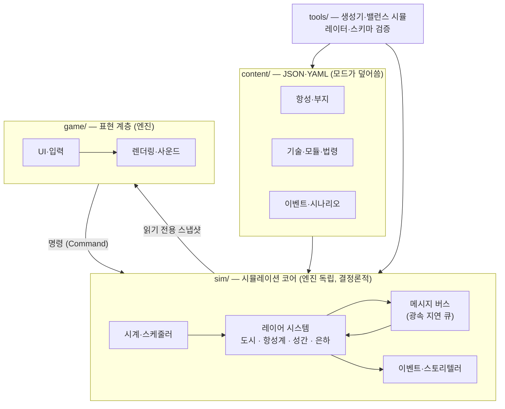

# 04. 아키텍처·로드맵

엔진을 정하기 전에도 결정할 수 있는 구조와, 각 단계에서 **무엇을 검증할지**를 정리했다.

## 1. 설계 원칙

1. **시뮬레이션 코어는 엔진과 분리한다.** 화면 없이(헤드리스) 돌아가야 테스트·밸런스 시뮬레이션·엔진 교체가 쉽다.
2. **결정론적으로 만든다.** 같은 시드 + 같은 명령 = 같은 결과. 리플레이, 버그 재현, 세이브 크기 절약에 필요하다.
3. **데이터 주도.** 기술·모듈·이벤트·항성은 코드가 아니라 JSON/YAML 데이터다. Claude가 대량 생성하고 모드가 덮어쓴다.
4. **레이어마다 다른 상세도.** 보고 있는 곳만 자세히, 나머지는 통계 모델로 (LOD).
5. **광속 지연은 메시지 버스로.** 모든 원거리 상호작용은 '도착 시각'이 붙은 메시지로만 오간다.

## 2. 구조



## 3. 틱·스케줄러·LOD

```ts
// 의사코드 — 언어는 엔진 결정 후 확정
function advance(world: World, untilYear: number): void {
  while (world.year < untilYear) {
    const dt = world.focusTick();                  // 보고 있는 레이어의 틱: 1일 / 1주 / 1년
    simulateDetailed(world.focusedSettlements, dt);
    if (world.isDue("system", dt)) simulateSystems(world);
    if (world.isDue("interstellar", dt)) simulateColonies(world);  // 식민지는 통계 모델
    deliverMessages(world);                        // 도착 시각이 된 지령·보고만 전달
    pollEvents(world);                             // 조건 + MTTH, 스토리텔러 가중치
    world.year += dt;
    if (world.nothingPending()) {
      world.year = world.nextScheduledEventYear(); // 다음 사건까지 도약
    }
  }
}
```

| 대상 | 상세 모델 (보고 있을 때) | 집계 모델 (안 볼 때) |
|---|---|---|
| 도시 | 모듈 단위 입출력, pop 배치, 고장 | 도시 전체 입출력 비율 + 안정도 |
| 항성계 | 운송선 단위 물류 | 구간별 처리량 |
| 성간 식민지 | (원거리라 원래 집계) | 인구·생산·안정도·문화 벡터 |
| 외계 문명 | 접촉 시 외교 상태 | K 지수 성장률·성향·서명 |

## 4. 데이터 스키마

TypeScript 표기를 썼지만 어떤 언어로도 옮길 수 있다. 시간은 모두 '게임 연도'(소수)로 저장한다.

```ts
type Id = string;
type ResourceId = "volatiles" | "silicates" | "metals" | "rare" | "fissiles" | "fusion" | "organics"
  | "oxygen" | "water" | "food" | "alloys" | "electronics" | "propellant" | "antimatter";
type Plausibility = "proven" | "engineering" | "theoretical" | "speculative";
type DiscoveryLevel = 0 | 1 | 2 | 3 | 4;        // 02 §9 '과학의 안개' 단계

interface StarSystem {
  id: Id;
  name: { ko: string; en: string };
  positionLy: [number, number, number];        // 태양 기준 좌표
  source: "real" | "procedural";
  seed?: number;
  stars: Star[];
  bodyIds: Id[];
  discovery: DiscoveryLevel;
}

interface Planet {
  id: Id;
  systemId: Id;
  type: string;                                // "ocean", "gas_giant" …
  aAu: number;
  massEarth: number;
  radiusEarth: number;
  atmosphere: "none" | "thin" | "earthlike" | "thick" | "envelope";
  surfaceTempK: number;
  hydrosphere: number;
  habitability: number;                        // 0~100
  esi?: number;
  resources: Partial<Record<ResourceId, number>>;            // 풍부도 0~5
  revealedAt: Partial<Record<keyof Planet, DiscoveryLevel>>; // 어느 단계에서 공개되는가
}

interface Settlement {
  id: Id;
  bodyId: Id;
  kind: "pressurized" | "dome" | "lava_tube" | "torus" | "oneill" | "aerostat";
  modules: { moduleId: Id; condition: number }[];
  popIds: Id[];
  stocks: Partial<Record<ResourceId, number>>;
  simLevel: "detailed" | "aggregate";
}

interface Pop {
  id: Id;
  size: number;                                // 시대별 단위
  species: Id;                                 // 인류, 아종, 디지털 인격 …
  culture: number[];                           // 5차원 가치 벡터
  ideology: Id;
  stratum: "worker" | "specialist" | "elite";
}

interface Colony {
  id: Id;
  systemId: Id;
  status: "direct" | "dominion" | "federated" | "independent";
  delayYears: number;                          // 본국과의 광속 지연
  lastReport: { snapshot: unknown; sentAtYear: number };  // 정보 연령 = 현재 − sentAtYear
  standingOrders: { when: string; do: Id; priority: number }[];
  culturalDistance: number;
}

interface Message {                            // 지령·보고·외교 신호 모두
  id: Id;
  from: Id;
  to: Id;
  sentYear: number;
  arrivesYear: number;                         // sentYear + 거리(광년) / 속도
  payload: unknown;
}

interface Tech {
  id: Id;
  era: 0 | 1 | 2 | 3 | 4;
  category: string;
  plausibility: Plausibility;
  prerequisites: Id[];
  researchCost: number;
  prototype?: { cost: Partial<Record<ResourceId, number>>; failureChance: number };
  effects: Effect[];
  scienceNote: string;
}

interface GameEvent {
  id: Id;
  layer: "city" | "system" | "interstellar" | "galaxy";
  trigger: Condition;
  mtthYears?: number;
  options: { id: Id; text: string; requires?: Condition; cost?: object; effects: Effect[] }[];
  scienceNote?: string;
  tags: string[];
}

type Condition = Record<string, unknown>;      // all / any / stat 비교 / tech / scenario …
type Effect = Record<string, unknown>;         // stat add·mul·set, flag, law, event_weight …
```

## 5. 콘텐츠 폴더와 모딩

제안하는 레포 구조 (엔진 결정 후 생성):

```
SpaceCity/
├─ docs/concept/          컨셉 문서 (이 문서들)
├─ content/               데이터 주도 콘텐츠
│  ├─ stars/  sites/  techs/  modules/  laws/  events/  scenarios/  species/
│  └─ locale/ko/  locale/en/
├─ schema/                JSON Schema — CI에서 content/ 검증
├─ sim/                   엔진 독립 시뮬레이션 코어 + 단위 테스트
├─ game/                  엔진 프로젝트 (표현 계층)
└─ tools/                 항성계 생성기, 헤드리스 밸런스 시뮬레이터, 콘텐츠 린터
```

모드는 `content/` 와 같은 구조의 폴더를 얹어 같은 `id` 를 덮어쓰거나 새 `id` 를 추가하는 방식으로 지원한다.

## 6. 엔진·기술 스택 비교

| 선택지 | 장점 | 단점 | 어울리는 경우 |
|---|---|---|---|
| Godot 4 (GDScript / C#) | 무료·오픈소스, 2D·UI에 강함, 가벼움 | 대규모 3D·콘솔 이식은 상대적으로 약함 | 2D/2.5D 전략 시뮬레이션, 소규모 팀 |
| Unity (C#, DOTS) | 거대한 생태계와 에셋, 3D, 멀티 플랫폼 | 라이선스 정책 변경 이력 (2023년 런타임 요금 발표 → 2024년 철회) | 3D 비주얼이 중요할 때 |
| Unreal 5 | 최고 수준의 3D | UI 중심 시뮬레이션에는 과함, C++ | 시네마틱 연출 |
| 웹 (TypeScript + PixiJS / Three.js) | 배포·공유가 쉽고 반복이 빠름 | 대규모 시뮬레이션 성능 한계 (Web Worker·WASM으로 보완) | 프로토타입, 브라우저 인디 게임 |
| Rust + Bevy | ECS 기반, 성능 | 생태계·에디터가 미성숙 | 시뮬레이션 코어 성능이 최우선일 때 |

**추천**
- 프로토타입(M0~M1): 팀이 가장 익숙한 것. 특별한 선호가 없으면 **웹(TypeScript)** — 링크 하나로 공유하며 빠르게 검증.
- 본편: 2D/2.5D 전략 시뮬레이션이라면 **Godot 4 + C#**. 시뮬레이션 코어를 C# 클래스 라이브러리로 분리하면 헤드리스 테스트와 밸런스 시뮬레이션을 그대로 돌릴 수 있다.
- 어느 쪽이든 §1 원칙대로 코어를 분리해 두면 나중에 엔진을 바꿀 수 있다.

## 7. MVP 로드맵

각 단계는 '무엇을 만들까'보다 **'무엇을 증명할까'** 로 정의한다. 다음 단계로 넘어가는 기준은 검증 질문이다.

| 단계 | 범위 | 검증 질문 |
|---|---|---|
| M0 종이 프로토타입 | 스프레드시트 + [formulas.py](examples/formulas.py): 생명유지·전력·인구 공식 | 숫자만으로도 빠듯한 선택이 생기는가? |
| M1 도시 수직 슬라이스 | 달 남극 부지 1곳, 모듈 12종, 자원 8종, 인구 욕구 2계층, 이벤트 10개 | 생명유지 퍼즐이 30분 동안 재미있는가? |
| M2 항성계 | 태양계 부지 6곳, Δv 물류, 기술 30개, 법령 8개 | 중력 우물 물류가 의미 있는 선택을 만드는가? 도시 자동화로 넘어가는 순간이 매끄러운가? |
| M3 성간 | 실제 항성 10곳, 식민선, 광속 지연 메시지 버스, 표준 지침, 문화 거리 | 직접 조작을 내려놓고 헌법을 쓰는 것이 재미있는가? |
| M4 은하·페르미 | 외계 종족 생성기, 탐지 서명, 시나리오 3개, 엔딩 3개 | 숨겨진 진실이 다시 플레이할 이유가 되는가? |
| M5 콘텐츠·밸런스 | 콘텐츠 1차 완성분 ([01 §5](01-knowledge-db.md#5-claude와-함께하는-콘텐츠-제작-파이프라인-제안)), 모드 지원, 현지화 | 30~60시간 캠페인이 늘어지지 않는가? |

## 8. 리스크와 대응

| 리스크 | 대응 |
|---|---|
| 레이어가 늘수록 복잡도 폭발 | 상위 레이어가 열릴 때 하위 레이어를 자동화·위임하는 기능을 먼저 설계한다 |
| 하드SF의 지루함 (수십 년 항해) | 사건 단위 도약, 함내 시간 서사, 도착 전에 결정할 거리(표준 지침) |
| 밸런스 | 헤드리스 시뮬레이션으로 수천 판을 돌려 분포를 본다 (생성기 분포 점검처럼) |
| 과학 오류 | `confidence` 필드, 출시 전 외부 DB 교차 검증, 논쟁 중인 발견은 이벤트로 |
| 범위 초과 | M1 수직 슬라이스가 재미있기 전에는 M2로 넘어가지 않는다 |
| 정보 과부하 (정보 연령, 지침, 문화 벡터) | 기본 화면은 요약 지표 3개, 상세는 펼쳐 보기 |
