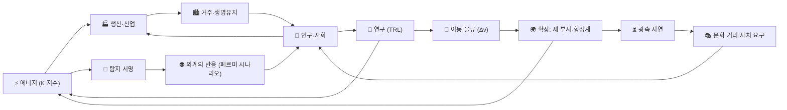

# SpaceCity — 컨셉 디자인 카탈로그 v0.1

> 달 남극의 작은 기지에서 별을 감싸는 문명까지.
> **물리 법칙이 곧 게임 규칙인** 우주 문명 시뮬레이터.

이 문서 묶음은 상세 컨셉을 확정하기 **전 단계의 선택지 카탈로그**다.
Claude의 내장 지식(천문학·우주공학·사회과학·게임 디자인 레퍼런스)만으로 **지금 바로 구현할 수 있는**
디자인과 예시를 모았다. 시스템마다 `옵션 → 추천 → 예시(데이터·공식·의사코드)` 순서로 정리했으니,
마음에 드는 조합을 고르면 다음 단계에서 상세 기획서로 확장한다.

## 문서 구성

| 문서 | 내용 |
|---|---|
| [01 지식 DB 범위](01-knowledge-db.md) | Claude가 제공할 수 있는 데이터·콘텐츠의 범위와 신뢰도, 외부 DB가 필요한 영역 |
| [02 핵심 시스템](02-core-systems.md) | 12개 시스템별 디자인 옵션·추천안·예시 |
| [03 콘텐츠 샘플](03-content-samples.md) | 태양계 도시 부지, 실제 근거리 항성, 기술·모듈·법령·이벤트·외계 종족, 플레이 일지 |
| [04 아키텍처·로드맵](04-architecture-roadmap.md) | 시뮬레이션 구조, 데이터 스키마, 엔진 비교, MVP 단계 |
| [05 공식 모음](05-formulas.md) | 게임에 쓰는 물리·밸런스 공식과 검증된 예시 값 |
| [examples/](examples/) | 실행 가능한 레퍼런스 코드(Python 표준 라이브러리만)와 근거리 항성 시드 데이터 |

---

## 1. 한 줄 피치 후보

1. **"달 남극의 작은 기지에서 태양을 감싸는 문명까지."** — 스케일의 쾌감
2. **"명령이 도착하는 데 12년이 걸린다면, 당신은 어떤 헌법을 쓰겠는가?"** — 광속 지연 거버넌스
3. **"은하는 왜 이렇게 조용한가? 커질수록, 보이게 된다."** — 페르미 역설과 '어두운 숲'

## 2. 컨셉 방향 3가지

| | A. 궤도 도시 빌더 | B. 카르다쇼프 사다리 (하드SF 4X) | C. 은하 관찰자 (갓 게임) |
|---|---|---|---|
| 핵심 판타지 | 생명유지가 빠듯한 우주 도시를 키운다 | 인류를 K 0.73 문명에서 타입 II 문명으로 이끈다 | 수천 개 문명의 흥망을 지켜보며 살짝 개입한다 |
| 플레이어 | 도시 행정관 | 문명의 의지 (지도부 또는 관리 AI) | 관찰자·조율자 |
| 주 시간 단위 | 일~월 | 년~세기 | 천 년~백만 년 |
| 레퍼런스 | Surviving Mars, Ixion, Frostpunk, Oxygen Not Included | Stellaris, Terra Invicta, Aurora 4X, Civilization | WorldBox, Universe Sandbox, Dwarf Fortress(전설 모드), Spore |
| 강점 | 손에 잡히는 재미, 짧은 피드백 | 스케일의 쾌감, 깊은 전략 | 높은 리플레이성, 창발적 서사 |
| 약점 | 문명 단위의 감각이 약함 | 복잡도·밸런스 비용이 큼 | 플레이어 주도성이 약함 |
| 구현 규모 | 중 | 대 | 중 (시뮬레이션 깊이에 따라 대) |

### 추천: A → B "스케일 줌" 하이브리드

레포 이름(SpaceCity)과도 맞는 구조다. **도시 빌더로 시작해, 문명이 커질수록 시야가 줌아웃**된다.
하위 레이어는 정책·총독·자동화로 위임되고, 플레이어가 내리는 결정의 단위가 점점 커진다.

```
 [도시]               [항성계]              [성간]                  [은하]
 모듈·생명유지·인구 →  Δv 물류·채굴·메가구조 → 식민선·광속 지연·자치 →  페르미 미스터리·엔드게임
 1틱 = 1일            1틱 = 1주             1틱 = 1년               사건 단위 도약
 K 0.73~0.8           K 0.8~1.5             K 1.5~2.1               K 2.1+
```

A의 즉각적인 재미로 진입 장벽을 낮추고, B의 스케일로 장기 목표를 준다.
C의 '관찰' 요소는 은하 레이어의 페르미 미스터리로 흡수한다.

## 3. 디자인 필러 — 모든 결정의 기준

1. **과학이 곧 규칙** — Δv, 광속, 폐열, 방사선 같은 실제 제약이 전략을 만든다. 숫자에는 출처가 있다.
2. **규모의 도약** — 산소 탱크 하나에서 다이슨 스웜까지. 줌아웃할수록 세부는 자동화되고 결정은 무거워진다.
3. **시간의 무게** — 수년~수천 년의 지연이 정치·문화·서사를 만든다.
4. **조용한 은하** — 페르미 역설의 답을 플레이로 발견한다. 커질수록 눈에 띈다.

## 4. 핵심 루프



성장(에너지↑)이 곧 노출(서명↑)이고, 확장(거리↑)이 곧 분열(문화 거리↑)이다.
이 두 개의 **음의 피드백**이 "무조건 크게"를 막고 선택을 만든다.

## 5. 차별화 포인트

기존 우주 4X·시뮬레이션에서 보기 드물거나 깊게 다루지 않은 메커닉이다.

| # | 메커닉 | 한 줄 설명 | 상세 |
|---|---|---|---|
| 1 | 광속 지연 거버넌스 | 명령도 보고도 빛의 속도로 오간다. 먼 식민지는 헌장과 '표준 지침'으로 다스린다 | [02 §7](02-core-systems.md#7-인구사회정치--광속-지연-거버넌스) |
| 2 | 정보 연령 UI | 원거리 정보마다 "몇 년 전 정보인지"가 표시된다 | [02 §7](02-core-systems.md#7-인구사회정치--광속-지연-거버넌스) |
| 3 | 카르다쇼프 척추 | 총 에너지 사용량(K 지수)이 시대·해금·점수를 관통한다 | [02 §5](02-core-systems.md#5-에너지와-카르다쇼프-척추) |
| 4 | 성장 = 노출 | 폐열·전파·추진 플룸이 탐지 서명이 되어 '어두운 숲' 위험을 키운다 | [02 §10](02-core-systems.md#10-외계-생명문명과-페르미-시나리오) |
| 5 | 숨겨진 페르미 시나리오 | 은하의 '진실'(희귀 지구·어두운 숲·동물원 …)이 캠페인마다 숨겨져 있다 | [03 §7](03-content-samples.md#7-페르미-시나리오-프리셋) |
| 6 | Δv 물류 | 거리가 아니라 중력 우물의 깊이가 운송비를 정한다 → 우주 산업이 지구를 추월하는 역전 | [02 §6](02-core-systems.md#6-자원산업δv-물류) |
| 7 | TRL 기술 성숙 | 연구 완료 ≠ 실전 배치. 시제품 단계의 실패 위험과 현실성 등급 | [02 §4](02-core-systems.md#4-기술-trl과-현실성-등급) |
| 8 | 과학의 안개 | 망원경으로 본 ESI와 직접 가서 본 현실이 다르다 | [02 §9](02-core-systems.md#9-이동탐사) |
| 9 | 실제 이웃 별 | 25광년 안의 실제 항성·행성으로 시작하고, 바깥은 절차적으로 생성 | [03 §2](03-content-samples.md#2-실제-근거리-항성-시드-db) |

## 6. 플레이어 정체성 옵션

| 옵션 | 장점 | 단점 |
|---|---|---|
| **관리 AI '시드(SEED)'** (추천) | 수천 년을 살아도 어색하지 않다. 인간의 신뢰가 자원이 되고, 'AI 권리' 이벤트가 곧 주인공의 이야기가 된다 | AI 서사의 톤 관리가 필요 |
| 지도자 가문·왕조 | 인물 드라마 (Crusader Kings식) | 수천 년 시간 스케일과 충돌 |
| 추상적인 '문명의 의지' | 단순하고 장르 관습에 맞음 | 감정 이입이 약함 |

## 7. 다음 단계에서 정할 것

상세 컨셉으로 넘어가기 위해 아래 항목을 고르면 된다. 괄호 안은 이 문서의 추천안이다.

- [ ] **컨셉 방향**: A / B / C / A→B 하이브리드 *(A→B)*
- [ ] **현실성 수준**: 하드SF(FTL 없음) / 후반 제한적 FTL / 소프트SF *(후반 웜홀 게이트만 허용, 통신 FTL은 불가)*
- [ ] **시간 진행**: 일시정지 가능한 실시간 / 턴제 *(실시간 + 사건 단위 도약)*
- [ ] **시점·비주얼**: 2D 다이어그램형 / 2.5D / 3D *(도시는 2.5D, 우주 지도는 2D 다이어그램)*
- [ ] **플레이어 정체성**: 관리 AI / 가문 / 추상 *(관리 AI '시드')*
- [ ] **톤**: 낙관(스타트렉) / 건조한 현실(익스팬스) / 어두움(삼체) *(건조한 현실 + 경이감)*
- [ ] **외계 문명**: 없음 / 희귀 / 다수, 페르미 시나리오 공개 여부 *(희귀 + 숨김)*
- [ ] **플랫폼·엔진·팀 규모, 싱글/멀티** *(PC 싱글플레이 우선 — [04 §6](04-architecture-roadmap.md#6-엔진기술-스택-비교) 참고)*
- [ ] **세션·캠페인 길이** *(세션 1~3시간, 캠페인 30~60시간)*
