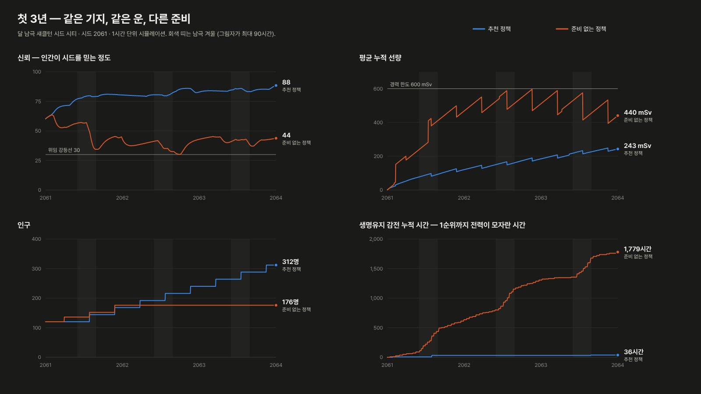

# 03. 도시 레이어 — 시대 0 상세 규칙

시대 0(약 6시간)의 전부이자, 이후 모든 도시가 따르는 기본 규칙이다. MVP 수직 슬라이스의 범위이기도 하다.
수치는 [data/city_modules.json](data/city_modules.json)·[data/city_techs.json](data/city_techs.json)이 단일 출처이고,
[sim/city_balance.py](sim/city_balance.py)가 같은 데이터로 돌아간다.

## 1. 개요

**핵심 질문** — 첫해에는 "오늘 밤을 넘길 수 있는가?", 3년차부터는 "여기가 집이 될 수 있는가?"

| 긴장 | 무엇이 빠듯한가 | 플레이어의 도구 |
|---|---|---|
| 공기 | CO₂ 제거 용량, 산소 비축 | 제거기 여분, 농장, 전기분해기 |
| 전력 | 그림자와 남극 겨울의 긴 밤 | 축전, 원자로, 절전 정책 |
| 방사선 | 태양 양성자 폭풍, 누적 선량 | 대피소, 레골리스 피복, 돔, 선량 기준 법령 |
| 식량 | 지구 화물선 의존 | 농장, 배급, 긴급 보급선 |
| 부품 | 지구 화물선 의존, 고장 | 화물 구성, 현지 부품 제조 |

## 2. 시작 부지 — 섀클턴 크레이터 가장자리

달 남극의 섀클턴 크레이터(지름 약 21 km)와 이웃 드 게를라슈 크레이터를 잇는 능선이다. 태양이 늘 지평선 근처에 머물러
높은 봉우리는 거의 늘 햇빛을 받고(연구에 따라 시간의 약 80~90%), 크레이터 바닥은 수십억 년 동안 햇빛이 들지 않아 약 40 K로 얼어 있다.
**햇빛과 얼음이 수 km 안에 함께 있는 곳** — 그래서 이곳에서 시작한다.

| 지역 | 타일 | 쓰임 | 제약 |
|---|---|---|---|
| 능선 봉우리 | 일조 A 8칸, B 10칸, C 20칸 | 수직 태양광 타워 | A 출력 100%, B 85%, C 70% |
| 완경사 평지 | 넓음 | 거주구·생명유지·산업 | 경사 타일은 건설 작업량 +50% |
| 영구음영 사면 | 크레이터 안쪽 | 얼음 채굴기 | 극저온 — 채굴기 고장 간격 250일 |
| 착륙장 구역 | 능선 아래 | 착륙장 | 착륙장 없이 내리면 분사 먼지로 반경 200 m 설비 고장률 2배 |

### 기본 도시의 구획 — 길이 먼저, 블록이 그다음

실제 도시처럼 **길이 땅을 나누고, 길이 둘러싼 블록마다 용도(구획)를 정한다** ([base_layout.gd](../../game/ui/base_layout.gd),
[city_plan.gd](../../game/ui/city_plan.gd), 자료 [city_layout.json](data/city_layout.json)).
기본 도시는 기지 평지에 길 격자를 깐다 — 블록 한 변 46 m, 두 블록마다 대로(폭 13 m), 그 사이 도로(7 m), 대로 둘이 만나는
거주 구역 한가운데에 광장. 길 그물에서 길이 둘러싼 면(평면 그래프의 면)을 찾아 블록으로 삼고, 길 반폭 + 보도 1.5 m만큼 안쪽이
지을 수 있는 땅이다. 블록마다 용도가 있고, 건물 자리는 블록 안에 길을 마주 보게 줄지어 선다 (두 줄마다 뒷길).
우주항(착륙장 둘레 30 m를 비운다)과 얼음 분화구는 블록이 아니라 따로 두고 길로 잇는다.
플레이어가 길을 새로 내거나 지우면 블록이 다시 셈해지고, 블록의 용도는 그 블록 안의 '씨앗' 점이 이어받는다 (길이 바뀌어도 구획이 남는다).
자리를 고르지 않은 건물(처음 기지, 자동 운영)은 그 계열의 구획 블록에서 빈자리를 찾는다.

| 구획 | 기본 자리 | 들어서는 것 | 둘레 길 |
|---|---|---|---|
| 거주 구역 | 36 | 거주 모듈 — 한가운데로 대로가 지나고, 대로가 만나는 곳에 광장 | 대로 |
| 시민 광장·연구 단지 | 17 | 공원·연구소·의무실·통신 센터 | 도로 |
| 돔·대피소 | 12 | 레골리스 돔, 폭풍 대피소 | 도로 |
| 생명유지 단지 | 29 | 전기분해기·CO₂ 제거기·사바티에·물 재활용기·저장 탱크 | 도로 |
| 축전·방열 단지 | 76 | 배터리·연료전지·방열판 | 도로 |
| 농업 구역 | 54 | 수경 농장·조류 반응기·식량 창고 | 도로 |
| 산업 단지 | 16 | 로봇 정비소·부품 공장·굴착기·레골리스 프린터·용융 전해·추진제 공장 | 대로 |
| 상업·금융 지구 | 6 | 우주 은행·교역소·우주 호텔 계열 — 지구 지원 점수와 부품을 번다 | 대로 |
| 첨단 산업 지구 | 3 | 첨단 제조동·데이터센터·로봇공학 연구소 | 도로 |
| 교통 지구 | 3 | 환승 센터·로버 차고지·자기부상 터미널 — 건설이 빨라진다 | 대로 |
| 원자로 구역 | 15 | 원자로 (사람이 머무는 건물과 60 m 떨어진다) | 도로 |
| 얼음 채굴장 | 3 | 얼음 채굴기 (영구 그늘 분화구, 평지형은 얼음 매장지) | 흙길 |
| 우주항 | 2 | 착륙장 (분사 먼지 때문에 둘레 30 m를 비운다) | 대로 |

3D 기지에는 블록마다 다진 바닥판(구획 색이 옅게 섞인 판), 구획 색 테두리(밤에는 경계등처럼 빛난다), 필지 금, 줄 사이 뒷길이 깔린다.
기지를 내려다보면(0.2~2 km) 구획마다 이름 · 지어진 건물 수 · 블록 수 · 필지 수가 뜬다.
다른 도시와 땅길로 이어지면 그 도시 쪽으로 고속도로가 뻗고 들머리에 표지(→ 도시 · 거리 · 탈것)가 선다.
**우주항과 활주로는 길 격자에 맞춘다.** 우주항 땅(착륙장 줄 + 둘레 30 m)은 블록 칸(56 m)의 배수로 잡아 격자에 붙이고, 들머리 대로는 그 둘레를 돈다.
지구·화성 기지의 활주로(지구 2.4 km × 45 m, 화성 700 m × 24 m)는 격자 축(x 또는 y)과 나란히, 우주항이 있는 쪽 기지 바깥의
땅 구역 한 줄에 놓인다 — 기지 끝에서 40 m 떨어진 줄부터 바깥으로 네 줄까지, 빈 줄을 찾는다. 그 줄의 땅 구역은 살 수 없고("활주로 자리다"),
유도로는 격자선을 따라 가장 가까운 길에서 활주로 가운데까지 대로로 깔린다. 자리는 저장된다
([04 §5](04-system-layer.md#프로토타입의-도시-사이-교통-transportjson)).

### 기지 넓히기 — 땅 구역 사기

처음 기지는 지도 끝(화면 기준 470 × 530 m, 능선형은 능선 마루 아래)까지다. 그 밖은 **땅 구역**을 사서 넓힌다
([city_layout.json](data/city_layout.json)의 `land`, [city_plan.gd](../../game/ui/city_plan.gd)).

- 구역은 길 격자를 따른 **대로로 둘러싸인 블록 2×2** (한 변 약 112 m)다. 가진 땅(처음 기지와 겹치는 구역, 산 구역)에 변으로 붙은 구역만 산다.
- 값: 첫 구역 부품 15 · 지원 40, 하나 살 때마다 1.12배 + 깔릴 길의 자재. 고른 식민지가 낸다.
- 사면 구역의 블록 둘레에 격자 그대로 대로·도로가 깔리고 (기존 길과 이어지지 않으면 가장 가까운 길까지 연결로), 빈 블록이 생긴다 — '구획'으로 용도를 정한다.
- 살 수 없는 구역: 기지 가운데에서 구역 가운데까지 950 m 넘게, 자연 비탈 28% 넘게, 물이 30% 넘게, 능선형 부지의 능선 너머(크레이터 안쪽).
- 새 땅은 자연 지형 그대로다. 건물은 바닥의 가장 높은 곳에 앉고 비탈이면 아래에 기초를 쌓는다. 바닥 비탈이 20% 넘거나 물 위면 짓지 못한다 — '땅'(평탄화·쌓기)으로 고친다.
  땅 고치기가 닿는 반지름도 산 땅 끝 + 40 m로 넓어진다.
- **자동 운영**은 기본 자리와 그 구획 블록이 다 차면 먼저 **가진 땅 안의 빈 블록**(구획이 없는 600 m² 넘는 블록) 가운데 그 구획 블록들에
  가장 가까운 것을 그 구획으로 정하고, 빈 블록이 없을 때만 그 구획 가까이의 구역을 사서 블록을 그 구획으로 정한다 (부품 60 · 지원 250은 남긴다).
  여기에 **도시 발전 모드**(아래)가 사흘마다 땅을 따져 구획이 찬 만큼 넓히고, 도시가 비면 빈 산 구역을 돌려준다.
- **돌려주기**: 건물이 없는 산 구역은 돌려줄 수 있다 — 남은 땅이 처음 기지와 이어져 있어야 한다. 그 구역 안의 길(이웃 땅과 나눠 쓰는 둘레 길은 남는다)과
  구획이 지워지고 값의 절반(부품·지원)을 돌려받는다.
- '확장' 도구(X): 살 수 있는 구역은 초록, 없는 구역은 옅은 빨강, 산 구역은 청록 테두리로 보이고, 가리키면 값·깔릴 길·비탈이 막대에 뜬다.

### 도시 발전 모드 — 자동 운영이 도시를 키우는 방향

'개척' 탭에서 고른 도시의 **발전 모드**를 열한 가지(균형 + 열 가지 방향) 가운데 고른다 ([city_dev.gd](../../game/ui/city_dev.gd),
자료 [city_layout.json](data/city_layout.json)의 `dev_modes`). 모드를 고르면 그 도시의 자동 운영이 켜진다.
시드의 추천 운영이 살림(생명유지·전력·집·식량)을 꾸리고, 모드는 그 도시의 하루가 끝날 때마다 그 위에 얹힌다 — 시뮬레이션 밖의 규칙이라
두 시뮬레이터의 일치에는 들어가지 않는다 (메트로 모드와 같다).

- **건물**: 모드의 목표 수(기본 수 + 정착민 100명마다 더하는 수)에 못 미친 첫 건물을 하루 하나 대기열에 넣는다 —
  연구가 됐고, 대기열이 6개보다 짧고, 넣어도 부품이 모드의 여유분(60~80)만큼 남을 때만.
  목표를 다 채웠고 부품이 여유분의 3배 넘게 쌓였으면 **20일마다 그 모드 구획의 건물을 하나 더** 짓는다 (목표에 견줘 가장 적은 것,
  목표의 두 배 + 1까지, 쓸모가 있을 때만 — 집이 이미 정착민의 두 배를 넘으면 거주는, 연구원이 모자라면 연구동은 짓지 않는다).
  정착민이 적은 도시도 남는 자재로 그 방향대로 자라고, 그 구획이 차면 아래의 규칙으로 땅이 넓어진다.
- **연구**: 모드의 기술을 연구 차례의 둘째 자리로 당긴다 (추천 운영이 고른 맨 앞 기술은 먼저 끝낸다 — 살림 연구와 번갈아).
- **땅 넓히기**: 사흘마다 (도시마다 다른 날에) 구획마다 건물 땅 ÷ 그 구획 블록 땅(×0.7)을 셈해, 모드의 구획이 '넓히기' 비율만큼
  (다른 구획은 95%) 차면 먼저 가진 땅 안의 빈 블록을 그 구획으로 정하고 (구획 자동 확장 — 값이 들지 않는다), 빈 블록이 없으면
  그 구획 가까이의 땅 구역을 사서 그 구획으로 정한다. 넓게 퍼지는 모드(무역·교통·주거·산업·자원·에너지)는
  도시가 30% 넘게 찼으면 정해진 날수마다 첫 구획에 한 구역씩 더 산다. 최대 구역 수를 넘지 않는다.
- **땅 줄이기**: 도시 전체가 '줄이기' 비율 아래로 비었으면 30일 넘게 빈 산 구역을 기지 가운데에서 먼 것부터 하나 돌려준다
  (남은 땅이 이어져 있을 때만). 그래서 연구·금융처럼 촘촘한 모드는 땅이 작게, 교통·주거처럼 퍼지는 모드는 넓게 자란다.
- 자동 운영을 끄면 아무것도 하지 않는다 (모드는 남아 있다가 다시 켜면 이어진다). 모드·빈 구역의 날짜·재건축 중인 곳은 저장된다.

### 재건축 — 도시가 자라면 낮은 건물이 고층 타워로

자동 운영 도시(모드와 상관없이)는 정착민이 120명을 넘으면 12일마다 계열마다 **촘촘한 건물의 몫**을 본다 — 정착민 100명마다 8%씩
(85%까지) 계열 값(집·연구원 자리·지원 점수)을 촘촘한 건물이 맡아야 한다. 몫이 모자라거나 그 계열의 구획이 붐비면(건물 땅이 구획 땅의
85% 넘게) **땅 넓이당 값이 낮은 건물을 헐고 그 자리에 값이 가장 높은 종류**를 짓는다 ([city_dev.gd](../../game/ui/city_dev.gd)의
`redevelop`, 자료 [city_layout.json](data/city_layout.json)의 `redevelop`). 자동 운영은 구획이 차면 땅을 넓히므로 구획이 붐비는
일은 드물다 — 도시가 자라는 만큼 차례로 높아진다 (4년 자란 섀클턴 675명: 거주 몫 목표 44%). 시뮬레이션 밖의 규칙이다 —
두 시뮬레이터의 자동 운영은 헐지 않는다.

| 계열 | 값 (땅 m²마다) | 헐리는 것 → 짓는 것 (예) |
|---|---|---|
| 거주 모듈 | 집 (사람) | 여압 거주 모듈 0.16 · 공동 주택 블록 0.33 → 고층 주거 타워 1.2 |
| 연구동 | 연구원 자리 | 연구동 0.10 · 종합 연구원 0.07 → 연구 타워 0.37 |
| 우주 은행 | 날마다 버는 지원 점수 | 우주 은행 0.013 · 증권거래소 0.021 → 금융 타워 0.049 |
| 우주 호텔 | 날마다 버는 지원 점수 | 우주 호텔 0.010 · 우주 박물관 0.003 → 고층 호텔 0.021 |

- 짓는 종류: 그 계열에서 값이 가장 높고 지금 지을 수 있는 것 (연구가 됐고 부품이 모드의 여유분만큼 남는다). 금속이 모자라면
  **지구에서 들여온다** — 1 t마다 지원 점수 25 (`earth_import`, 지원 점수가 모드의 여유분 250만큼은 남을 때만 — 아니면 공동 주택 블록처럼
  한 단계 낮은 것). 부품 공장이 금속을 다 써 버리는 큰 도시도 그래서 고층이 선다. 헐리는 것은 그보다 1.5배 넘게 성겨야 한다 — 그래서 여압 거주 모듈 → 공동 주택 블록 → 고층 주거
  타워로 차례로 높아진다. 모드의 구획이면 먼저 (이득 × 1.5), 붐비는 구획이면 더 먼저 (× 2). 헐면 정착민이 다 살 수 없는 거주,
  연구할 사람이 남지 않는 연구동(연구원 자리가 일손의 30%를 넘는다)은 두고, 오래된 건물부터 계열마다 24채까지 본다.
- 자리: 헌 건물 자리 그대로, 돌려서, 넓어진 만큼 네 쪽으로 밀어서 본다. 겹치는 이웃이 같은 계열의 낮은 건물이면 **둘까지 함께 헐어** 자리를 낸다.
- 헐면 지은 값의 부품·금속 30%를 돌려받고, 새 건물은 보통 공사처럼 대기열에 들어가 로봇이 짓는다. 한 도시에 한 번에 한 곳 — 공사가 끝나야 다음.
- **보이는 과정**: 공정의 앞 20%는 헌 건물이 위에서부터 낮아지며 헐리고, 그 뒤 새 건물의 공사 현장이 선다. 다 지으면 20 m가 넘는 건물
  (고층 타워, 태양광 타워, 전망 타워)은 바닥을 그 건물 크기에 맞춘 **높은 비계**가 다 지은 높이의 12%부터 공정만큼 올라간다.
  '개척' 탭에 "재건축 중: 여압 거주 모듈 → 고층 주거 타워 (철거 중 / 공정 45%)"가 보이고 기록에 남는다.

| 모드 | 더 짓는 것 (기본 + 정착민 100명마다) | 먼저 연구 | 넓히는 구획 | 넓히기 · 줄이기 · 최대 |
|---|---|---|---|---|
| 균형 | – (추천 운영 그대로) | – | 모든 구획 | 80% 차면 · 돌려주지 않음 · 8구역 |
| 연구 중심 | 연구동 2 + 1.2, 종합 연구원 1 + 0.5, 전파 망원경 배열 1 + 0.2, 데이터센터 0 + 0.4, 지구 교신 센터 1 | 우주 기상 예보, 자율 건설 로봇 II, 시드 분산 처리 | 시민 광장·연구 단지 | 85% 차면 · 35% 아래면 돌려줌 · 6구역 |
| 무역 중심 | 교역소 2 + 0.6, 보세 창고 1 + 0.4, 우주 시장 1 + 0.3, 착륙장 2, 식량 저장고 1 + 0.3 | 자율 건설 로봇 II | 상업·금융 지구 | 70% 차면 · 75일마다 한 구역 더 · 25% 아래면 돌려줌 · 10구역 |
| 기술 중심 | 로봇공학 연구소 1 + 0.5, 첨단 제조동 2 + 0.4, 데이터센터 1 + 0.3, 부품 공장 1 + 0.3 | 자율 건설 로봇 II, 레골리스 소결 건축, 용융 레골리스 전해, 현지 부품 제조, 시드 분산 처리 | 첨단 산업 지구, 산업 단지 | 75% 차면 · 30% 아래면 돌려줌 · 10구역 |
| 금융 중심 | 우주 은행 2 + 0.6, 우주 증권거래소 1 + 0.3, 우주 보험회관 1 + 0.3 | 우주 기상 예보 | 상업·금융 지구 | 90% 차면 · 40% 아래면 돌려줌 · 4구역 |
| 교통 중심 | 환승 센터 2 + 0.4, 로버 차고지 2 + 0.4, 자기부상 터미널 1 + 0.2, 착륙장 2, 로봇 정비고 1 + 0.2 | 자율 건설 로봇 II, 레골리스 소결 건축, 용융 레골리스 전해, 현지 부품 제조 | 교통 지구 | 55% 차면 · 40일마다 한 구역 더 · 15% 아래면 돌려줌 · 16구역 |
| 주거 중심 | 공동 주택 블록 1 + 0.6, 계단식 주거동 1 + 0.3, 레골리스 차폐 돔 1 + 0.3, 녹지 공원 1 + 0.4, 의료실 1 + 0.3 | 레골리스 소결 건축, 자연광 도입, 저중력 의학 | 거주 구역, 돔·대피소 | 60% 차면 · 60일마다 한 구역 더 · 20% 아래면 돌려줌 · 14구역 |
| 산업 중심 | 레골리스 굴착기 2 + 0.3, 레골리스 채석장 1 + 0.3, 레골리스 3D 프린터 1 + 0.2, 용융 레골리스 전해조 1 + 0.3, 부품 공장 1 + 0.4, 조립 공장 1 + 0.2, 로봇 정비고 1 + 0.2 | 레골리스 소결 건축, 용융 레골리스 전해, 현지 부품 제조 | 산업 단지 | 60% 차면 · 60일마다 한 구역 더 · 20% 아래면 돌려줌 · 14구역 |
| 자원 중심 | 얼음 채굴기 1 + 0.3, 레골리스 굴착기 2 + 0.4, 레골리스 채석장 1 + 0.4, 용융 레골리스 전해조 1 + 0.3, 광석 정련소 1 + 0.2, 저장 탱크 2 + 0.3 | 극지 자원 탐사, 레골리스 소결 건축, 용융 레골리스 전해 | 산업 단지, 생명유지 단지 | 65% 차면 · 60일마다 한 구역 더 · 25% 아래면 돌려줌 · 12구역 |
| 에너지 중심 | 소형 핵분열로 2 + 0.4, 배터리 뱅크 2 + 0.4, 대용량 축전소 1 + 0.3, 재생 연료전지 1 + 0.3, 방열판 2 + 0.3, 태양광 패널 밭 1 + 0.3, 메가와트급 원자로 0 + 0.1 | 재생 연료전지, 수직 태양광 타워 II, 레골리스 소결 건축, 용융 레골리스 전해, 현지 부품 제조, 메가와트급 원자로 | 축전·방열 단지, 원자로 구역 | 60% 차면 · 75일마다 한 구역 더 · 25% 아래면 돌려줌 · 12구역 |
| 관광·문화 중심 | 우주 호텔 2 + 0.5, 우주 박물관 1 + 0.3, 전망 타워 1 + 0.2, 식물원 돔 1 + 0.2, 녹지 공원 1 + 0.3 | 레골리스 소결 건축, 조류 생물반응기 | 상업·금융 지구, 시민 광장·연구 단지 | 70% 차면 · 30% 아래면 돌려줌 · 8구역 |

### 길 재건축 — 도시가 자라면 길도 넓어지고 높아진다

자동 운영 도시(모드와 상관없이)는 정착민이 늘면 길 그물을 고쳐 짓는다 ([road_works.gd](../../game/ui/road_works.gd), 자료
[city_layout.json](data/city_layout.json)의 `road_works`). 한 도시에 한 번에 한 곳, 값(그 길의 100 m마다 자재 × 길이)을 먼저 내고
날마다 나아간다. 시뮬레이션 밖의 규칙이다 — 두 시뮬레이터의 일치에 들어가지 않는다.

- **통행량**: 엿새마다 건물마다 (1 + 집 16명마다 1 + 일손 8명마다 1)을 그 건물에 가장 가까운 길과, 그 길에서 기지 가운데까지 가장 빠른 길
  (길 종류의 속력으로 잰 다익스트라)의 토막마다 더한다 — 가운데로 모이는 간선이 가장 붐빈다.
- **넓히기** (정착민 150명부터): 문턱을 넘는 길 가운데 가장 붐비는 것과, 그 길과 한 줄로 이어진 같은 종류의 붐비는 길(문턱의 60%)을
  네 토막까지 한 단계 넓힌다 — 흙길 → 도로 (통행량 6), 도로 → 대로 (24), 대로 → 고속도로 (140). 넓어진 폭이 건물에 닿으면 다음 길.
  100 m마다 5일 (적어도 3일). 공사 동안 넓어질 폭의 두 가장자리에 차단막과 고깔이 선다.
- **노선** (차례대로, 그 종류의 길이 이미 있으면 다음): 고가 대로 (300명), 모노레일 (450명), 고가 고속도로 (700명), 자기부상 궤도
  (1,000명, 현지 부품 제조). 기지 가운데 꼭짓점(다 쓰였으면 한두 칸 옆의 대로 줄)에서 격자 네 방향으로 곧게 — 가진 땅 안, 끝이 길 그물의
  꼭짓점, 건물·다른 높은 길에 걸리지 않는 가장 긴 줄(2~6칸, 112~336 m), 같은 길이면 산 땅이 많은 쪽. 고가는 대로 위로 지나고
  끝에서 내려앉는다 (고가 고속도로·자기부상 궤도의 비탈은 9% — 블록 한 칸 떨어진 길 위로 4.5 m 넘게 지난다). 100 m마다 9일. 공정의 앞 60%에 기둥이 시작점부터 차례로 올라가고, 뒤 40%에 덱 판이 놓이며, 공사의 앞머리에
  크레인이 선다. 다 되면 길 그물에 들어가고, 모노레일·자기부상 궤도에는 열차 한 편(3량·4량)이 끝에서 끝까지 오간다.
- 공사 자리(넓어질 폭, 노선 줄)에는 건물을 놓지 않는다. 그새 길이 막혔으면 공사를 접고 값의 절반을 돌려받는다.
- 노선의 금속도 모자라면 지구에서 들여오고 (재건축과 같다), 그래도 값을 낼 수 없으면 그동안 넓히기를 한다.
- 4년 자란 저장으로 90일: 섀클턴(700명)에 고가 대로·모노레일, 나로 우주항(1,900명)에 네 노선이 모두 놓이고 도로가 여러 번 대로로 넓어졌다.
  통행량은 건물마다 가장 가까운 길을 기억해 두고 (길 모양이 그대로면 — 넓히기처럼 종류만 바뀌면 그대로) 새 건물만 찾는다 — 도시의 하루에 1 ms 안팎.
- '개척' 탭에 "길 공사: 도로 → 대로 넓히기 112 m (공정 40%)"가 보이고, 시작·완공이 기록에 남는다. 공사는 저장된다.

### 도시 기능의 자리 — 시설 영향 범위·통근·도시 안 물류

모든 도시(직접 운영도)는 엿새마다 배치 계획의 자리로 세 가지를 잰다 ([city_services.gd](../../game/ui/city_services.gd), 자료
[city_layout.json](data/city_layout.json)의 `services`). 시뮬레이션 밖의 규칙이라 결과를 **보정**으로 건넨다 — `CitySim.ext`
(사기 더하기, 일하는 효율·만드는 효율 곱하기)는 기본값이면 파이썬 밸런스 시뮬레이터와 같은 셈이 된다 (일치 검사는 기본값으로 돈다).

| 잰다 | 어떻게 | 보정 |
|---|---|---|
| 영향 범위 | 집마다 (사는 사람 = 집 × 정착민 ÷ 집 수) 둘레에 의료 300 m · 여가(사기를 주는 시설, 교신 계열 빼고) 220 m · 대피 260 m 안의 시설이 있나 | 사기: 의료가 닿지 않는 몫 × −6, 대피가 닿지 않는 몫 × −4, 여가가 닿는 몫 × +3 |
| 통근 | 일터(일손이 있는 건물)를 가장 가까운 길 꼭짓점마다 모아 일손이 많은 8곳 — 집마다 그곳들까지 가는 시간을 일손 몫으로 평균한다. 길까지 걷고(1.4 m/s) 길은 탈것으로(4 m/s × 길의 속력 — 고가·궤도 노선이 빠르다), 환승 시설이 150 m 안이면 ×0.75 | 일하는 효율(연구원의 연구, 상업의 지원 점수) = 1 + (1.5분 − 평균) ÷ 10분, 0.88~1.05 |
| 물류 | 만드는 건물(산업)마다 가장 가까운 저장 시설까지 길 거리, 로버 차고지가 200 m 안이면 ×0.8 | 만드는 효율(3순위 산업 — 얼음·레골리스·금속·부품, 교역의 부품) = 1 + (0.3 km − 평균) × 0.2, 0.9~1.04 |

- 4년 자란 저장의 일곱 도시: 사기 −0.3~+3, 일하는 효율 ×0.98~1.05 (나로 우주항 1,800명은 통근 1.7분), 만드는 효율 ×0.99~1.02.
  도시 하나를 재는 데 6~21 ms.
- '개척' 탭의 **도시 기능** 카드에 닿는 사람의 몫, 통근 시간, 물류 거리, 시뮬레이션에 건넨 보정이 보인다. 3D 지도의 **범위** 단추는
  시설마다 그 반지름의 원(의료 빨강 · 여가 초록 · 대피 파랑)을 땅 위에 그린다.
- 출근 시간(7~9시)에는 집 → 일터, 퇴근 시간(17~19시)에는 일터 → 집으로 통근 탈것 여섯 대가, 일하는 시간(8~18시)에는 만드는 건물 →
  저장 시설로 화물 탈것 두 대가 길을 따라 다닌다 (보여 주기만 한다).

### 시대·이정표·메가프로젝트 — 도시가 이룬 것

모든 도시(직접 운영도)는 날마다 이정표를 보고, 처음 이루면 지구 지원 점수를 받는다 ([city_progress.gd](../../game/ui/city_progress.gd),
자료 [city_progress.json](data/city_progress.json)). 다음 시대에 필요한 이정표를 다 이루면 **시대**가 오른다 — 도시 이름 옆과 '개척' 탭에 보인다.
시뮬레이션 밖의 규칙이다 (메가프로젝트의 효과는 `CitySim.ext`의 보정으로 건넨다 — 기본값이면 두 시뮬레이터가 같다).

| 이정표 | 조건 | 상 |
|---|---|---|
| 백 명의 도시 | 정착민 100명 | 지원 80 |
| 정착 도시 | 정착민 250명 | 지원 150 |
| 오백 명 | 정착민 500명 | 지원 300 |
| 천 명의 도시 | 정착민 1,000명 | 지원 600 |
| 연구 기반 | 기술 8가지 | 지원 100 |
| 기술 도시 | 기술 16가지 | 지원 250 |
| 부품 자급 | 부품 공장 계열 2기 | 지원 120 |
| 넓어지는 땅 | 산 땅 구역 5곳 | 지원 100 |
| 도시권 | 산 땅 구역 10곳 | 지원 200 |
| 첫 고층 타워 | 고층 타워 1기 (재건축) | 지원 150 |
| 첫 고가 노선 | 고가 대로·고가 고속도로 | 지원 120 |
| 궤도 열차 | 모노레일·자기부상 궤도 | 지원 200 |
| 무사고 한 해 | 사망자 없이 365일 | 지원 200 |
| 첫 메가프로젝트 | 메가프로젝트 하나를 다 짓는다 | 지원 400 |

| 시대 | 뜻 | 필요한 이정표 |
|---|---|---|
| 시대 0 · 전초기지 | 살아남는 것이 먼저다 | — |
| 시대 1 · 정착 도시 | 사람이 늘고 연구가 쌓인다 | 백 명의 도시, 연구 기반 |
| 시대 2 · 자립 도시 | 부품을 스스로 만들고 땅이 넓어진다 | 정착 도시, 부품 자급, 넓어지는 땅 |
| 시대 3 · 궤도 도시 | 고층과 궤도가 도시를 바꾼다 | 오백 명, 기술 도시, 첫 메가프로젝트 |

**메가프로젝트**: 그 시대가 되고 기술이 있으면 빈 산 땅 구역 하나(건물·길 공사가 없는 구역 — 기지 가운데에서 가까운 것)에 짓는다.
구역 안쪽의 길(구역을 네 블록으로 나누는 길)은 걷어 내고 둘레 길은 남는다. 단계마다 값을 먼저 내고 정해진 날수만큼 — 다음 단계의 값이
모자라면 기다린다. 짓는 동안·다 지은 뒤 그 자리에는 건물·길을 놓지 않고, 돌려줄 수도 없다. 한 도시에 한 번에 하나, 같은 것은 한 번.
직접 운영 도시는 '개척' 탭의 **짓기** 단추로, 자동 운영 도시는 열흘마다 부품·금속이 첫 단계 값의 세 배 넘게 있으면 스스로 고른다
(빈 구역이 없으면 가장 가까운 살 수 있는 구역을 산다). 다 지으면 효과가 그 도시에 남는다.

| 메가프로젝트 | 시대 · 기술 | 단계 | 효과 |
|---|---|---|---|
| 대형 돔 공원 | 시대 1 · 레골리스 소결 건축 | 기초와 링(부품 120 + 금속 4 t, 20일) → 돔 껍질(부품 180 + 금속 6 t, 30일) → 숲과 호수(부품 80, 15일) | 집 +80 · 사기 +6 |
| 심우주 전파 접시 | 시대 2 · 우주 기상 예보 | 받침과 회전대(부품 150 + 금속 8 t, 25일) → 접시 판(부품 200 + 금속 10 t, 30일) → 수신기(부품 100, 10일) | 연구 +40 RP/일 |
| 질량 투사기 | 시대 2 · 매스 드라이버 | 레일 기초(부품 200 + 금속 12 t, 30일) → 코일과 축전(부품 260 + 금속 16 t, 35일) → 시험 발사(부품 60, 10일) | 지원 점수 +14/일 |
| 회전 거주 고리 | 시대 3 · 회전 거주구 | 중심축(부품 220 + 금속 14 t, 30일) → 고리 마디(부품 320 + 금속 20 t, 45일) → 회전 시험(부품 80, 12일) | 집 +240 · 사기 +4 |
| 궤도 승강기 지상국 | 시대 3 · 궤도 조립 | 닻 기초(부품 260 + 금속 18 t, 35일) → 승강 탑(부품 300 + 금속 20 t, 40일) → 줄 잇기(부품 120 + 금속 6 t, 20일) | 지원 점수 +18/일 · 로봇 작업량 ×1.1 |

3D에서는 땅 구역 가운데에 단계마다 그 부분이 공정만큼 자라고 (앞 단계는 다 서 있다) 둘레에 크레인 둘이 선다 — 돔은 기초 링 → 껍질이
아래에서부터 → 안의 숲과 호수, 질량 투사기는 레일 기둥이 차례로 → 코일 → 시험 발사(코일이 빛난다), 궤도 승강기는 닻 → 탑 → 하늘로 3 km 줄.

### 연구 갈림길·돌파 카드 — 같은 기술, 다른 도시

연구가 쌓이면 도시마다 다른 길을 고른다 ([city_research.gd](../../game/ui/city_research.gd), 자료 [city_research.json](data/city_research.json)).
효과는 그 도시의 시뮬레이션 보정(`CitySim.ext`, 연구 배율 `rp_k` 포함 — 기본값이면 두 시뮬레이터가 같다)으로 건넨다.

| 언제 | 갈림길 | 하나 | 다른 하나 |
|---|---|---|---|
| 기술 4가지 | 일손 | 자동화 우선 — 로봇 작업량 ×1.12 · 사기 −1 | 사람 우선 — 사기 +3 · 일하는 효율 ×1.03 |
| 기술 9가지 | 지구와의 관계 | 닫힌 순환 — 만드는 효율 ×1.06 · 사기 +1 | 지구와 함께 — 지원 점수/일 +6 · 연구 RP/일 +2 |
| 기술 14가지 | 도시의 성격 | 연구 도시 — 연구 ×1.12 · 연구 RP/일 +4 | 산업 도시 — 만드는 효율 ×1.08 · 로봇 작업량 ×1.06 |

- 한 번 고르면 바꾸지 않는다. 직접 운영 도시는 갈림길이 열리면 한 번 알리고 **연구 탭**에서 고를 때까지 기다린다. 자동 운영 도시는 발전 모드의
  무게(연구 중심은 연구, 산업 중심은 생산·로봇, 금융·무역은 지원 점수 …)로 효과를 셈해 스스로 고른다.
- **돌파 카드**: 기술 하나를 알아낼 때마다 35%의 확률로 아직 없는 카드 셋을 뽑아 하나를 고른다 (도시와 기술 수로 정해지는 난수 — 다시 해도
  같은 셋이다). 고를 때까지 다음 카드는 뽑지 않는다. 카드 14장: 전해조 촉매 개선(만드는 효율 ×1.03) · 로봇 관절 표준화(로봇 작업량 ×1.05) · 실험실 자동화(연구 ×1.05) · 거주 모듈 방음(사기 +1.5) · 현지 식단(사기 +1 · 일하는 효율 ×1.01) · 지구 홍보 영상(지원 점수/일 +2.5) · 통근 셔틀 시간표(일하는 효율 ×1.03) · 자재 재활용(만드는 효율 ×1.02 · 로봇 작업량 ×1.02) · 관측 자료 압축(연구 RP/일 +3) · 공동 주방(사기 +2) · 레골리스 벽돌 규격(로봇 작업량 ×1.04) · 접이식 침실(집 +12) · 해돋이 모임(사기 +1 · 지원 점수/일 +1) · 작업 배치 인공지능(로봇 작업량 ×1.03 · 일하는 효율 ×1.02).
- 갈림길·카드는 저장된다.

### 길 — 종류, 잇기, 땅 위에 보이게

| 길 | 폭 | 차로 | 속력 | 100 m마다 | 가장 가파른 기울기 | 굽는 반지름 | 겉모습 |
|---|---|---|---|---|---|---|---|
| 흙길 | 4 m | 1 | ×0.6 | 무료 | 18% | 4 m | 다진 흙, 바퀴 자국 |
| 도로 | 7 m | 2 | ×1.0 | 부품 1 | 12% | 7 m | 가운데 노란 점선, 흰 가장자리선, 가로등 |
| 대로 | 13 m | 4 | ×1.4 | 부품 3 | 8% | 12 m | 차로 넷, 가운데 겹 노란 선 |
| 고속도로 | 18 m | 4 | ×2.0 | 부품 5 | 5% | 30 m | 넓은 갓길, 가운데 분리대 |
| 가압 통로 | 6 m | 0 | ×0.8 | 부품 2·금속 0.2 t | 12% | 6 m | 굽은 판의 원통, 옆구리 창 (대기가 없는 천체: 달·화성·수성·세레스·칼리스토·타이탄) |
| 화물 철도 | 5 m | 0 | ×1.6 | 부품 3·금속 0.3 t | 4% | 40 m | 자갈·침목·레일 |

**높은 길 24종** — 고가 10종, 다리 14종. 땅 위의 길과 같은 도구로 내고, 아래 '도로' 막대의 갈래 단추(땅 · 고가 · 다리)로 고른다.

| 높은 길 | 갈래 | 폭 | 덱 높이 | 비탈 | 받침 간격 | 100 m마다 | 노면 | 받침 모양 |
|---|---|---|---|---|---|---|---|---|
| 고가 도로 | 고가 | 9 m | 7 m | 10% | 24 m | 부품 4·금속 0.2 t | 도로 | 외기둥 + 기둥머리 |
| 고가 대로 | 고가 | 15 m | 8 m | 9% | 30 m | 부품 9·금속 0.5 t | 대로 | T형(망치머리) 교각 |
| 고가 고속도로 | 고가 | 20 m | 10 m | 8% | 36 m | 부품 14·금속 0.8 t | 고속도로 | 문형 교각 (기둥 둘 + 가로보) |
| 2층 고가도로 | 고가 | 15 m | 14 m | 8% | 30 m | 부품 18·금속 1.2 t | 대로 | 기둥 둘 사이에 두 층 덱 |
| 고가 보행로 | 고가 | 4 m | 6 m | 12% | 20 m | 부품 3·금속 0.15 t | 보행 타일 | 가는 기둥, 유리 지붕·벽 |
| 모노레일 | 고가 | 3 m | 8 m | 10% | 26 m | 부품 6·금속 0.4 t | 모노레일 빔 | T자 기둥 위 빔 |
| 자기부상 궤도 | 고가 | 6 m | 9 m | 8% | 30 m | 부품 12·금속 0.8 t | 자기부상 궤도 | Y자 기둥, 코일 줄 |
| 고가 가압 통로 (대기 없는 천체) | 고가 | 6 m | 6 m | 12% | 18 m | 부품 5·금속 0.4 t | 가압 통로 | A형 받침 |
| 화물 컨베이어 | 고가 | 4 m | 5 m | 20% | 12 m | 부품 4·금속 0.3 t | 고무 띠 | 비계형 트레슬 |
| 아치 고가교 | 고가 | 10 m | 9 m | 10% | 18 m | 부품 6·금속 0.2 t | 도로 | 돌 아치 열주 |
| 거더교 | 다리 | 10 m | 6 m | 6% | 40 m | 부품 6·금속 0.6 t | 도로 | 거더 + 교각 |
| 상자형 교량 | 다리 | 15 m | 8 m | 5% | 60 m | 부품 10·금속 1 t | 대로 | 상자형 거더 + 교각 |
| 트러스교 | 다리 | 10 m | 7 m | 6% | 50 m | 부품 7·금속 1.2 t | 도로 | 철골 트러스 옆벽 |
| 상로 아치교 | 다리 | 12 m | 10 m | 5% | 80 m | 부품 9·금속 0.8 t | 도로 | 덱 밑 아치 |
| 타이드 아치교 | 다리 | 15 m | 8 m | 5% | 90 m | 부품 12·금속 1.4 t | 대로 | 덱 위 아치 + 행어 |
| 현수교 | 다리 | 18 m | 12 m | 4% | 200 m | 부품 20·금속 2 t | 고속도로 | 주탑 둘 + 주케이블 + 행어 |
| 사장교 | 다리 | 18 m | 12 m | 4% | 150 m | 부품 16·금속 1.6 t | 고속도로 | 주탑에서 부채꼴 케이블 |
| 엑스트라도즈드교 | 다리 | 15 m | 9 m | 5% | 110 m | 부품 13·금속 1.2 t | 대로 | 낮은 주탑 + 완만한 케이블 |
| 캔틸레버교 | 다리 | 12 m | 10 m | 5% | 120 m | 부품 11·금속 1.4 t | 도로 | 받침에서 깊은 보가 양쪽으로 |
| 라멘교 | 다리 | 12 m | 8 m | 6% | 50 m | 부품 8·금속 0.6 t | 도로 | 기둥과 덱이 한 몸 (라멘) |
| 부교 (물이 있는 천체: 지구·타이탄) | 다리 | 8 m | 0.8 m | 8% | 12 m | 부품 4·금속 0.3 t | 도로 | 물에 뜬 부함 |
| 도개교 | 다리 | 12 m | 6 m | 6% | 60 m | 부품 12·금속 1 t | 도로 | 양쪽 탑 + 들리는 판 |
| 여압 다리 | 다리 | 7 m | 7 m | 8% | 40 m | 부품 8·금속 0.8 t | 도로 | 지붕·벽 덮인 여압 다리 |
| 트레슬교 | 다리 | 6 m | 9 m | 4% | 10 m | 부품 6·금속 0.6 t | 철도 | 철 트레슬 (철도) |

- **사슬과 비탈**: 이어진 높은 길 토막들이 한 사슬이다. 사슬 끝은 땅에 닿고, 덱은 끝에서부터 그 종류의 비탈로 올라 덱 높이까지 뜬다
  (높이 = min(덱 높이, 비탈 × 끝까지 거리)). 고가는 땅을 따라 뜨고, 다리는 두 끝의 땅 높이를 곧게 잇는 선 위에 뜬다 — 골짜기·물·파낸 구덩이를 건넌다.
- **엇갈림**: 높은 길은 밑의 길과 잇지 않는다 — 사슬 가운데에는 교차로가 생기지 않고, 블록은 땅 위의 길로만 나뉜다 (고가를 놓아도 구획이 그대로다).
  밑을 지나는 땅 위의 길은 덱이 4.5 m 넘게 뜬 곳에서만 엇갈린다 ("고가 밑을 지나기엔 낮다 — 오르는 비탈 밖에서 엇갈린다"),
  높은 길끼리 겹치면 막는다. 땅 위의 길은 물을 건너지 못한다 ("물을 건넌다 — '다리' 종류로 건넌다"); 높은 길은 두 끝만 뭍이면 된다.
- **탈것**: 길찾기는 사슬 끝에서만 땅 위의 길과 갈아타고, 높은 길 위에서는 덱 높이로 떠서 간다.
- **3D**: 덱 판(콘크리트 옆·밑면, 4 m 이음), 난간(밤에 띠 불빛), 노면 무늬(보행 타일·모노레일 빔·코일 줄·고무 띠 …),
  받침은 덱이 2 m 넘게 뜬 곳에만 종류마다 다른 모양으로 선다 ([road_structs.gd](../../game/ui/world/road_structs.gd)). 받침은 상자 하나를
  여러 번 그리는 MultiMesh라 수천 개여도 한 번에 그린다.

- **길 내기 도구**(아래 '도로', G): 종류를 고르고 점을 차례로 누른다. 끝점은 6 m 안의 꼭짓점·길에 붙고, 붙지 않으면 방향을
  15°마다 맞춘다 ('각도 맞춤' — 기본 격자의 축 45°도 그 배수). '곡선'을 켜면 이어 가던 길 끝의 방향에서 원호로 매끄럽게 굽고
  (10 m마다 토막), 반지름이 길 종류의 한도보다 작으면 막는다. 이미 난 길 위에 다른 종류로 다시 내면 그 종류로 바뀐다 (도로 → 대로).
  자재는 놓을 때 고른 식민지의 비축에서 빠진다. 건물을 지나가거나 기지 밖이거나 물에 잠긴 땅이면 막는다.
- **자연스럽게 잇기**: 길이 셋 이상 모이는 곳은 이웃 길의 가장자리가 만나는 데까지 물러나 교차로 판을 깔고 (끝에서 3 m 안은 건널목),
  둘이 꺾이는 곳은 종류의 반지름으로 둥글게 돌고, 막다른 곳은 둥근 끝을 둔다 ([road_mesh.gd](../../game/ui/world/road_mesh.gd),
  [road_net.gd](../../game/ui/road_net.gd)).
- **땅에 묻히지 않게**: 길은 두께(옆면)와 땅 속으로 내려가는 치마를 갖고, 셰이더가 꼭짓점을 카메라 쪽으로 조금 당겨(화면 위치는
  그대로) 깊이에서 땅보다 앞선다. 길 밑의 땅은 **길을 따라 고른다** — 2 m마다 땅 높이를 재어 고르게 하고 기울기를 길 종류의 한도로
  자른 뒤, 길 폭 + 어깨 3 m 안의 지형 꼭짓점을 그 높이로 깎고 메운다 (평평한 기지 평지에서는 건너뛴다).

### 구획 정하기

'구획' 도구(Z)로 블록을 누르면 고른 용도(거주·시민·돔·생명유지·축전·농업·산업·원자로·상업·첨단 산업·교통·얼음·우주항, 또는 '비우기')가 된다.
가리키는 블록이 그 구획의 색으로 칠해져 보이고, 막대에 그 블록의 지금 용도와 넓이가 뜬다. 자리를 고르지 않은 건물은 그 계열의 구획 블록에 선다.

### 땅 고치기와 침수

'땅' 도구(T)는 굴착기나 로봇 정비소가 있어야 쓴다 ([city_layout.json](data/city_layout.json)의 `terrain`).

| 방법 | 하는 일 |
|---|---|
| 파기 | 붓 가운데(반지름의 55%)를 누를 때마다 1 m 더 판다 — 60 m까지 |
| 쌓기 | 누를 때마다 1 m 더 쌓는다 — 12 m까지 |
| 평탄화 | 붓 가운데의 높이로 고른다 |
| 되돌리기 | 고친 땅을 처음 높이로 |

- 붓은 6 · 12 · 24 m. 고친 높이는 2 m 칸마다 적고 (저장된다), 둘레는 비탈이다 — **깊을수록 비탈이 안식각(기울기 0.8, 약 39°)보다
  가파르지 않게 넓어진다** (45 m를 파면 지름 200 m쯤의 노천 구덩이). 비탈이 건물·길 밑에 닿으면 더 깊이 팔 수 없다 (막대가 까닭을 말한다).
  마우스를 누르고 있으면 0.3초마다 한 번 더 고친다.
- 고친 땅은 지형 조각의 높이 지도에 바로 들어간다 (달은 16비트 높이 + 구운 법선에 고친 기울기를 더한 법선, 다른 천체는 24비트 높이 —
  법선은 셰이더가 이웃 꼭짓점으로 셈한다). 건물·길·탈것은 새 높이에 선다.
- **침수**: 바다·호수가 있는 천체(지구·타이탄)에서 **해수면 아래로 판 땅에는 물이 찬다**. 해수면은 지형 조각 안의 바다 꼭짓점 높이의
  가운데값 (조각 안에 바다가 없는 지구 도시는 해발 0 m). 물낯은 해수면 높이에서 평평하게 그린다 (구덩이 벽을 타고 오르지 않는다).
  물에 잠긴 칸에는 건물을 짓거나 길을 낼 수 없고, 그 위의 건물은 날마다 물에 잠겨 멈춘다 (고장 — 고쳐도 다음 날 다시).
  쌓기로 메우면 물이 빠지고, 바다를 해수면 위로 메우면 뭍이 된다 (간척). 파는 동안 막대가 "해수면 아래 n m — 물이 찬다"고 알린다.
  나로 우주항은 해발 약 42 m라 40 m 넘게 파야 물이 찬다.

## 3. 시작 상태 — 2061년 1월 1일

로봇 선발대가 남겨 둔 '1단계 기지'에 정착민 120명이 막 도착했다.

| 구분 | 내용 |
|---|---|
| 인구 | 120명 (작업반 12개), 사기 70, 신뢰 60 |
| 거주·안전 | 여압 거주 모듈 15 (120명), 폭풍 대피소 2 (80명), 의료실 1 |
| 생명유지 | 물 전기분해기 2, CO₂ 제거기 1, 사바티에 반응기 1, 물 재활용기 1, 저장 탱크 2 |
| 식량 | 수경 농장 4, 식량 저장고 1 |
| 전력·열 | 수직 태양광 타워 6 (A 타일), 소형 핵분열로 2, 배터리 뱅크 2, 방열판 3 |
| 산업 | 얼음 채굴기 1, 레골리스 굴착기 1, 로봇 정비고 1, 착륙장 1, 로봇 8대 |
| 연구·사회 | 연구동 1, 지구 교신 센터 1 |
| 비축 | 산소 3,000 kg, 물 25 t, 식량 6 t, 수소 100 kg, 레골리스 200 t, 부품 300 |
| 지구 | 지원 점수 300. 첫 화물선 30일차, 첫 유인선 90일차 |

**첫날의 여유** — 시작 상태는 일부러 빠듯하게 맞췄다.

| 항목 | 상태 | 의미 |
|---|---|---|
| CO₂ 제거 | 하루 120 kg 배출 vs 제거기 120 + 농장 48 kg | 농장이 꺼지면 여유 0%. 첫 할 일은 제거기 추가 |
| 전력 | 수요 약 490 kW vs 낮 680 kW · 그림자 80 kW | 축전 1,000 kWh는 그림자 속에서 2.5시간. 첫 주에는 산소 탱크(75%)를 채우느라 전기분해기가 쉬지 않고, 탱크가 차면 수요가 약 450 kW로 준다 |
| 대피소 | 80석 vs 120명 | 41일차 폭풍 전에 대피소 1기가 필요하다 |
| 식량 | 자급률 33%, 비축 83일 | 화물선이 한 번 빠지면 위험 |
| 물 | 순손실 약 140 kg/일 vs 채굴 500 kg/일 | 여유. 다만 채굴기가 자주 고장 난다 |
| 선량 | 피복 안 된 모듈에서 하루 1.0 mSv | 그대로면 약 1.6년 뒤 경력 한도 600 mSv |

## 4. 자원

| 자원 | 단위 | 종류 | 비고 |
|---|---|---|---|
| 산소 | kg | 비축 | 탱크 용량까지 |
| 물 | kg | 비축 | 깨끗한 물. 폐수는 따로 |
| 식량 | kg (건조 중량) | 비축 | |
| 수소·메탄·농축 CO₂ | kg | 비축 | 넘치면 배출 |
| 레골리스 | t | 비축 | 굴착기가 생산 |
| 금속 | t | 비축 | 용융 레골리스 전해조가 생산 |
| 부품 | 단위 (≈100 kg) | 비축 | 지구 화물 또는 부품 공장 |
| 전력·열 | kW | 흐름 | 매시간 균형. 남는 전력은 축전 |
| 연구 | RP | 누적 | |
| 지원 | 점수 | 누적 | 지구 컨소시엄의 예산·정치적 지지 |
| 사기·신뢰 | 0~100 | 상태 | [07](07-society-tech-events.md) |

## 5. 시간과 틱

- 시뮬레이션은 **1시간** 단위다. 생명유지·전력·작물은 매시간 계산한다.
- 고장, 로봇 작업, 건설 완공, 연구, 지구 보급, 태양 폭풍 판정, 선량, 사기는 **하루** 단위로 처리한다.
- 배속은 [02 §4](02-structure-progression.md#4-시간-시스템)를 따른다 (도시 1× = 하루 8초).

## 6. 생명유지

### 1인 1일 소비 (NASA 생명유지 설계 기준 근사)

| 항목 | 양 |
|---|---|
| 산소 | 0.84 kg |
| CO₂ 배출 | 1.0 kg |
| 물 | 8 kg (음용·조리 3 + 위생 5) → 전부 폐수가 된다 |
| 식량 | 0.6 kg (건조 중량) |

### 공기

- **CO₂ 농도** — 기지 공기 질량은 거주 정원 1명당 120 kg으로 친다. 120명 기지에서 CO₂ 1 kg은 약 46 ppm이다.
  제거기 1기가 멈추고 농장도 꺼지면 **CO₂가 하루에 약 5,500 ppm씩 오른다.**
- 식물(농장·조류·녹지)이 먼저 CO₂를 흡수하고, 나머지를 제거기가 농축 탱크로 옮긴다. 농축 CO₂는 사바티에 반응기의 원료다.

| CO₂ 농도 | 상태 | 효과 |
|---|---|---|
| 800 ppm 이하 | 정상 (제거기 설정값) | – |
| 2,500 ppm 초과 | 경고 | 사기 −5 |
| 5,000 ppm 초과 | 나쁨 | 사기 −15, 두통·수면 장애 이벤트 |
| 20,000 ppm 초과 | 위험 | 건강 손상 |
| 40,000 ppm 초과 | 치명 | 시간당 인구의 1% 사망 |

- **산소** — 전기분해기는 필요한 만큼만 돌고, 전력도 가동률에 비례한다. 식물이 내는 산소가 많을수록 전기가 덜 든다.
  비축이 0이 되면 시간당 인구의 5%가 사망한다 (보통은 그 전에 여러 경보가 울린다).
- **닫히지 않는 고리** — 사바티에 반응(CO₂ + 4H₂ → CH₄ + 2H₂O)은 전기분해에서 나온 수소만큼만 돌 수 있다.
  수소가 모자라 CO₂를 다 되살리지 못하므로 물이 조금씩 빠져나간다. 대신 메탄은 추진제가 된다.

### 물

폐수는 재활용기가 처리해 90%(폐쇄형 생명유지 II 연구 후 98%)를 되돌린다. 손실분과 전기분해에 쓰는 물은 얼음 채굴로 메운다.

| 물 재활용률 (인구 1,200명, 하루 폐수 9.6 t) | 하루 손실 |
|---|---|
| 90% | 960 kg |
| 98% | 192 kg |

### 식량

- 수경 농장 1기 = 하루 6 kg (10명분) + 산소 10 kg, CO₂ 12 kg 흡수. 전력 60 kW로 시작 기지에서 가장 큰 전력 소비자다.
- **작물 고사** — 농장이 72시간 넘게 전력을 못 받으면 작물이 죽고, 30일 동안 다시 길러야 한다. 그동안에도 조명 전력은 그대로 든다.
- **배급** — 비축이 정책 문턱(기본 10일) 아래로 내려가면 소비를 70%로 줄인다. 사기 −10.
- **긴급 보급선** — 지원 300점으로 7일 안에 식량 10 t. 신뢰 −1 ("지구에 손을 벌렸다").
- **기아** — 식량이 0인 채로 14일이 지나면 하루에 인구의 2%가 사망한다.

## 7. 전력과 열

### 일조 모델

극지의 태양은 지평선을 따라 돈다. 능선의 봉우리도 이웃 지형의 그림자에 들어갈 때가 있다.

| 계절 | 그림자 간격 | 그림자 길이 | 평균 일조 |
|---|---|---|---|
| 평소 | 280~420시간마다 | 6~30시간 | 약 95% |
| 남극 겨울 (해마다 150~240일째) | 150~260시간마다 | 20~90시간 | 약 79% |
| 연평균 | | | 약 90% |

남극 겨울은 이 게임의 '한파'다 (Frostpunk의 폭설처럼 예고되고, 대비할 수 있다).

### 발전과 축전

| 설비 | 출력·용량 | 특징 |
|---|---|---|
| 수직 태양광 타워 | 100 kW × 일조 × 타일 계수 | 싸지만 그림자에 꺼진다. 타일이 한정 (A 8, B 10, C 20) |
| 소형 핵분열로 | 40 kW 상시 | 비싸지만 어둠을 모른다 |
| 메가와트급 원자로 | 1,000 kW 상시 | 시대 0 중반 이후 |
| 배터리 뱅크 | 500 kWh, 왕복 90% | 효율 좋고 비싸다 |
| 재생 연료전지 | 2,000 kWh, 왕복 50% | 싸고 크지만 절반을 잃는다. 전기분해기와 같은 원리 |

### 절전 정책

모든 모듈에는 절전 순위가 있다. 1순위 생존(거주·생명유지·대피소·의료), 2순위 식량, 3순위 산업·로봇, 4순위 연구·사회.

| 정책 문턱 (축전량) | 추천 기본값 | 의미 |
|---|---|---|
| 4순위를 끄는 시점 | 50% | 그림자가 시작되면 연구·사회부터 |
| 3순위를 끄는 시점 | 40% | 다음은 산업·로봇 |
| 2순위를 끄는 시점 | 20% | 마지막으로 농장 — 72시간이 넘지 않게 |

1순위는 끄지 않는다. 그래도 전력이 모자라면 1순위 모듈 전체가 비례해서 느려진다(감전) — CO₂ 제거와 산소 생산도 같이 느려진다.
문턱과 별개로, 남은 축전으로 다음 한 시간을 버틸 수 없는 순위는 낮은 순위부터 강제로 꺼진다. 시뮬레이터는 한 시간마다 문턱을 확인한다.
문턱은 플레이어가 슬라이더로 바꾼다. 문턱을 0으로 두면 '모두 유지'가 되어, 축전을 산업에 다 쓰고 농장부터 한꺼번에 꺼진다.

**시작 기지의 첫 그림자** (1월 중순, 산소 탱크가 찬 뒤) — 수요 약 450 kW, 원자로 80 kW. 아무것도 끄지 않으면 축전 1,000 kWh는
2.7시간 만에 바닥난다. 추천 문턱(50/40/20%)이어도 첫 두 시간은 모두 켜진 채 축전이 26%까지 내려가고, 그제야 4·3순위가 꺼진다.
농장(240 kW)은 남은 축전으로 한 시간을 버틸 수 없어 문턱 20%에 닿기 전에 강제로 꺼진다. 그 뒤 1순위 약 113 kW 중 80 kW를
원자로가 대서(농장 산소까지 전기분해기가 맡는다), 남은 약 260 kWh로 8시간을 더 버틴다. 그림자가 시작되고 약 10시간 뒤부터
1순위가 71%로 감전된다. 10시간 안팎의 짧은 그림자는 이렇게 넘기지만, 그보다 길면 감전이 시작되고, 겨울의 90시간 그림자는
농장을 72시간 넘게 끄게 만든다 — 작물이 죽는다.

### 열

쓴 전력은 모두 열이 된다. 방열판 1기는 250 kW를 버린다. 방열 용량을 넘으면 3순위(산업)부터 감속한다.

## 8. 모듈 — 34계열 174종

아래 34종은 **계열**의 기본 모듈이다. 처음 29계열에는 같은 일을 하는 다른 설계가 4종씩 더 있다 — 대형 팽창 거주동, 고분자막 전기분해기,
킬로파워, 매립형 원자로, 버킷휠 굴착기, 레이저 통신소 …. 도시 발전 모드와 함께 상업·금융(우주 은행·교역소·우주 호텔), 교통(환승 센터),
첨단 산업(첨단 제조동) 5계열이 2종씩의 다른 설계와 함께 들어왔고, 기존 계열에 큰 설계 10종(공동 주택 블록, 종합 연구원, 태양광 패널 밭, 레골리스 채석장 …)이
더해졌다. 재건축과 함께 고층 타워 4종(고층 주거 타워·연구 타워·금융 타워·고층 호텔)이 들어왔다 — 땅 넓이당 값이 가장 높아
붐비는 구획의 낮은 건물을 헐고 그 자리에 선다. 174종 전체와 계열 규칙은 [03a 모듈 전체 목록](03a-module-catalog.md)에 있다.

- **상업 계열**(4순위): 날마다 지구 지원 점수를 벌고(`support_day` — 은행 1.5, 증권거래소 4, 호텔 1.2 …), 교역소·보세 창고는 부품을 들여온다(`make`).
  절전으로 꺼진 시간만큼 덜 번다.
- **교통 계열**(3순위): 로봇의 하루 작업량을 늘린다(`build_boost` — 환승 센터 5%, 로버 차고지 8%, 자기부상 터미널 10%, 로봇공학 연구소 6%; 합쳐서 최대 50%).
- **첨단 산업 계열**(3순위): 첨단 제조동은 부품을 만들고(하루 0.8), 데이터센터는 연구원 없이 연구 5 RP/일을 낸다.

`python3 sim/city_balance.py --module-table` 로 데이터에서 생성한 표다.

| 모듈 | 분류 | 절전 순위 | 필요 기술 | 시작 | 비용 | 건설 (로봇·일) | 전력 (kW) | 인원 | 고장 간격 (일) | 수리 (부품 · 로봇·일) | 기능 |
|---|---|---|---|---|---|---|---|---|---|---|---|
| 여압 거주 모듈 | 거주 | 1 | – | 15 | 부품 60 | 20 | 4 | – | 3,000 | 3 · 2 | 거주 8명 |
| 레골리스 차폐 돔 | 거주 | 1 | 레골리스 소결 건축 | – | 부품 40 + 레골리스 400 t | 60 | 25 | – | 6,000 | 4 · 3 | 거주 60명 · 대피 60명 |
| 물 전기분해기 | 생명유지 | 1 | – | 2 | 부품 15 | 6 | 26 | – | 500 | 2 · 1 | 물 112.5 kg → 산소 100 kg, 수소 12.5 kg (하루) |
| CO₂ 제거기 | 생명유지 | 1 | – | 1 | 부품 5 | 3 | 5 | – | 300 | 1 · 0.5 | CO₂ 제거 120 kg/일 |
| 사바티에 반응기 | 생명유지 | 1 | – | 1 | 부품 10 | 4 | 3 | – | 600 | 1 · 1 | CO₂ 110 kg, 수소 20 kg → 메탄 40 kg, 물 90 kg (하루) |
| 물 재활용기 | 생명유지 | 1 | – | 1 | 부품 15 | 6 | 10 | – | 400 | 2 · 1 | 폐수 처리 1,000 kg/일 · 회수 90% |
| 저장 탱크 | 생명유지 | 1 | – | 2 | 부품 10 | 4 | 1 | – | 5,000 | 1 · 1 | 저장: 산소 2,000 kg, 물 20,000 kg, 수소 300 kg, 메탄 1,000 kg, 폐수 3,000 kg, CO₂ 1,000 kg |
| 수경 농장 | 식량 | 2 | – | 4 | 부품 30 | 10 | 60 | 2 | 800 | 2 · 1 | CO₂ 12 kg, 물 2 kg → 식량 6 kg, 산소 10 kg (하루) |
| 조류 생물반응기 | 식량 | 2 | 조류 생물반응기 | – | 부품 15 | 6 | 15 | 1 | 600 | 1 · 1 | CO₂ 27 kg, 물 1 kg → 산소 20 kg, 식량 2 kg (하루) |
| 식량 저장고 | 식량 | 2 | – | 1 | 부품 5 | 3 | 1 | – | 5,000 | 1 · 1 | 저장: 식량 10,000 kg |
| 수직 태양광 타워 | 전력 | – | – | 6 | 부품 25 | 12 | – | – | 1,500 | 2 · 1 | 발전 100 kW |
| 소형 핵분열로 | 전력 | – | – | 2 | 부품 60 | 30 | – | – | 4,000 | 5 · 3 | 발전 40 kW |
| 메가와트급 원자로 | 전력 | – | 메가와트급 원자로 | – | 부품 250 + 레골리스 100 t + 금속 5 t | 120 | – | 2 | 5,000 | 10 · 5 | 발전 1,000 kW |
| 배터리 뱅크 | 전력 | – | – | 2 | 부품 30 | 6 | – | – | 3,000 | 2 · 1 | 축전 500 kWh · 왕복 효율 90% |
| 재생 연료전지 | 전력 | – | 재생 연료전지 | – | 부품 20 | 10 | – | – | 1,500 | 2 · 1 | 축전 2,000 kWh · 왕복 효율 50% |
| 방열판 | 열 | – | – | 3 | 부품 10 | 4 | – | – | 5,000 | 1 · 1 | 방열 250 kW |
| 얼음 채굴기 | 산업 | 3 | – | 1 | 부품 40 | 15 | 50 | 1 | 250 | 3 · 2 | 채굴 → 물 500 kg (하루) |
| 레골리스 굴착기 | 산업 | 3 | – | 1 | 부품 30 | 10 | 20 | – | 300 | 2 · 1 | 채굴 → 레골리스 50 t (하루) |
| 레골리스 3D 프린터 | 산업 | 3 | 레골리스 소결 건축 | – | 부품 50 | 15 | 30 | 1 | 400 | 3 · 1 | 인쇄 20 t/일 |
| 용융 레골리스 전해조 | 산업 | 3 | 용융 레골리스 전해 | – | 부품 80 | 40 | 200 | 3 | 400 | 4 · 2 | 레골리스 2 t → 금속 0.6 t, 산소 500 kg (하루) |
| 부품 공장 | 산업 | 3 | 현지 부품 제조 | – | 부품 60 + 금속 2 t | 30 | 40 | 4 | 500 | 3 · 2 | 금속 0.25 t → 부품 2 (하루) |
| 로봇 정비고 | 산업 | 3 | – | 1 | 부품 20 | 20 | 10 | 2 | 2,000 | 2 · 1 | 로봇 12대 정비 |
| 추진제 공장 | 산업 | 3 | 극저온 추진제 생산 | – | 부품 40 | 20 | 90 | 2 | 500 | 3 · 1 | 산소 857 kg, 수소 143 kg → 추진제 1 t (하루) |
| 착륙장 | 물류 | 3 | – | 1 | 부품 10 + 레골리스 200 t | 20 | 2 | – | 8,000 | 2 · 2 | 착륙 슬롯 1 |
| 폭풍 대피소 | 안전 | 1 | – | 2 | 부품 10 + 레골리스 150 t | 15 | 2 | – | 8,000 | 1 · 1 | 대피 40명 |
| 의료실 | 안전 | 1 | – | 1 | 부품 20 | 10 | 10 | 3 | 2,000 | 2 · 1 | 진료 150명 |
| 연구동 | 연구 | 4 | – | 1 | 부품 25 | 15 | 15 | 6 | 1,500 | 2 · 1 | 연구 6 RP/일 |
| 녹지 공원 | 사회 | 4 | – | – | 부품 20 | 15 | 20 | 1 | 3,000 | 1 · 1 | 사기 +5 · CO₂ 2 kg → 산소 2 kg (하루) |
| 지구 교신 센터 | 사회 | 4 | – | 1 | 부품 10 | 6 | 5 | 1 | 2,000 | 1 · 1 | 연구 2 RP/일 · 사기 +5 |
| 우주 은행 | 상업 | 4 | – | – | 부품 40 | 15 | 12 | 4 | 3,000 | 2 · 1 | 지원 +1.5/일 |
| 교역소 | 상업 | 4 | – | – | 부품 35 | 14 | 8 | 3 | 3,000 | 2 · 1 | 지원 +0.4/일 · 생산: 부품 0.6 (하루) |
| 우주 호텔 | 상업 | 4 | – | – | 부품 60 | 25 | 25 | 6 | 3,000 | 2 · 1 | 사기 +2 · 지원 +1.2/일 |
| 환승 센터 | 물류 | 3 | – | – | 부품 35 | 14 | 10 | 3 | 3,000 | 2 · 1 | 사기 +1 · 건설 +5% |
| 첨단 제조동 | 산업 | 3 | 현지 부품 제조 | – | 부품 70 + 금속 1 t | 28 | 80 | 6 | 1,500 | 3 · 2 | 생산: 부품 0.8 (하루) |

**설계 메모**
- 거주 모듈은 부품 60으로 비싸다. 레골리스 돔은 부품 40에 60명 — **'레골리스 소결 건축'이 첫 연구로 가장 유력**하도록 맞췄다.
- 재생 연료전지는 부품당 축전량이 배터리의 6배지만 효율이 절반이다. "싸고 큰 것 vs 효율 좋은 것"의 고전적 선택.
- CO₂ 제거기는 싸지만 생명유지 장치 중 가장 자주 고장 난다. 여분이 생명선이다.

## 9. 건설과 로봇

- 진공 속 건설·수리는 모두 로봇이 한다. 로봇 1대 = 하루 1 로봇·일 ('자율 건설 로봇 II' 후 1.5).
- 시작 로봇 8대. 고장 간격 300일, 수리에 부품 1. 보충은 지구 화물(대당 5단위) 또는 '로봇 자가 제작'(부품 5, 4 로봇·일).
- **대기열** — 하루 작업량은 수리 → 건설 대기열 순으로 나눠 준다. 수리는 1순위 모듈 → 발전·저장 → 2·3·4순위 순.
  건설 대기열의 순서는 플레이어가 끌어서 바꾼다. 순서를 신경 쓰지 않으면 들어온 순서대로 지어진다.
- **레골리스 구조물** — 돔은 3D 프린터가 하루 20 t씩 쌓아야 완성된다. 대피소·착륙장은 로봇이 레골리스 자루를 쌓아 짓는다.
- **레골리스 피복** — 거주 모듈 1기를 레골리스 50 t로 덮는 데 5 로봇·일. 거주자의 만성 선량이 하루 1.0 → 0.45 mSv로 준다.
- **자리** — 지을 때 플레이어가 자리와 방향(90° 단위)을 고른다. 길도 원하는 곳에 낸다. §2의 지역이 곧 배치 규칙이다.

| 규칙 | 내용 | 까닭 |
|---|---|---|
| 일조 구역 | 태양광 타워는 능선의 A·B·C 구역에만 세운다. 세운 구역이 그 타워의 일조 칸(출력 100·85·70%)이 된다 | 빛은 봉우리에만 든다 |
| 능선 | 다른 건물은 일조 구역에 짓지 않는다 | 타워 자리가 38칸뿐이다 |
| 영구음영 | 얼음 채굴기는 얼음 분화구 안에, 다른 건물은 분화구 밖에 | 얼음은 해가 들지 않는 바닥에 있다 |
| 착륙 분사 | 착륙장과 다른 건물 사이 30 m 이상 | 분사가 레골리스를 총알처럼 날린다 |
| 원자로 | 핵분열로와 사람이 사는 건물(거주·대피·돔·의료·연구·공원) 사이 60 m 이상 | 차폐 거리 |
| 겹침 | 건물끼리, 건물과 길은 겹치지 않는다 | |

  자리를 고르지 않은 건물(처음 기지, 시드의 자동 운영)은 기본 배치의 빈자리에 들어간다.
  프로토타입에서 길은 자재 없이 바로 깔리고, 다 지은 건물은 옮기거나 허물 수 없다.

## 10. 인구

- **작업반** — 시대 0의 인구 단위는 10명이다. 개인 이름은 핵심 인물, 사건 당사자, 첫 출생 같은 이정표에만 붙는다.
- **노동력** — 인구의 70%가 일한다. 모듈 운영 인원 → 연구동 → 일반 업무 순으로 자동 배치된다.
- **생산성** = 0.8 + 0.4 × 사기/100 (사기 50이면 1.0).
- **유입** — 유인 착륙선(120일마다 최대 24명). 주거 여유와 지원 점수가 있어야 한다.
  출산은 '저중력 의학' 연구와 '달 출생 허가' 법령 이후 (시대 0 중반).
- **유출** — 선량 한도에 닿은 사람은 다음 유인선으로 귀환한다. 사기가 40 아래면 유인선마다 인구의 10%가 떠난다.

### 욕구와 사기

사기는 매일 목표치를 향해 10%씩 움직인다. 목표치는 70에서 시작해 아래 요인을 더하고 뺀다.

| 계층 | 요인 | 사기 |
|---|---|---|
| 생존 | CO₂ 2,500 ppm 초과 / 5,000 ppm 초과 | −5 / −15 |
| 생존 | 산소 비축 3일 미만, 식량 비축 10일 미만 | 각 −10 |
| 생존 | 배급 중 | −10 |
| 안전 | 대피소 정원이 인구보다 적음 | −5 |
| 안전 | 의료 정원이 인구보다 적음 | −5 |
| 안전 | 최근 사망 / 최근 피폭 (60일에 걸쳐 회복) | −20 / −10 |
| 안전 | 누적 선량 400 mSv를 넘은 사람이 있음 | −5 |
| 소속 | 주거 정원의 95% 초과 / 100% 초과 | −5 / −15 |
| 소속 | 녹지 공원 (최대 3기) | 기당 +5 |
| 소속 | 지구 교신 센터 가동 | +5 |
| 소속 | 지난 7일 중 4순위 절전 48시간 초과 ("어둠 속의 생활") | −5 |
| 소속 | 식단의 25% 이상이 조류 | −5 |

## 11. 방사선과 건강

### 만성 선량 (게임 값)

달 표면의 실측 선량은 하루 약 1.37 mSv다 (창어 4호, 2020년 보고). 게임에서는 거주 형태에 따라 아래 값을 쓴다.

| 거주 형태 | 하루 선량 | 연간 | 경력 한도 600 mSv까지 |
|---|---|---|---|
| 피복 안 된 여압 모듈 | 1.0 mSv | 365 mSv | 약 1.6년 |
| 레골리스 피복 모듈 | 0.45 mSv | 164 mSv | 약 3.7년 |
| 레골리스 차폐 돔 | 0.25 mSv | 91 mSv | 약 6.6년 |

인구는 돔 → 피복 모듈 → 피복 안 된 모듈 순으로 채워진다.

### 선량 기준 — 시대 0의 핵심 정치 선택

기본값은 NASA 우주비행사 경력 한도(600 mSv)를 빌린 '경력 기준'이다. 1~2년차에 개척 1세대가 한도에 다가가면
'선량 기준 논쟁' 앵커 이벤트가 열리고, 평의회가 셋 중 하나를 고른다.

| 법령 | 규칙 | 결과 | 지지 세력 |
|---|---|---|---|
| 경력 기준 (기본) | 누적 600 mSv에 닿으면 귀환 | 순환 근무형 **전진기지**. 인구 회전이 빠르고 숙련이 쌓이지 않는다 | 지구 연대 |
| 정착민 기준 | 연간 100 mSv 상한, 누적 한도 없음 | **고향**이 된다. 모두 돔에 살아야 하므로 돔 건설이 급해진다 | 개척 동맹, 공유지 연합 |
| 위험 감수 | 한도 없음 | 성장은 빠르지만 장기 건강 이벤트(암·백내장)가 늘고, 탐구회·지구 연대의 신뢰가 떨어진다 | 상승 운동 일부 |

### 태양 양성자 폭풍

| 항목 | 값 |
|---|---|
| 대형 폭풍 | 대피소 밖 300 mSv. 연 0.08~0.58회 (태양 활동에 따라) |
| 소형 폭풍 | 대피소 밖 20 mSv. 연 1~5회 |
| 대피소·돔 안 | 위 선량의 2% |
| 경보 시간 | 2시간 → '우주 기상 예보' 연구 후 8시간 |
| 태양 주기 | 11년, 극대기 2069년 (2061년은 극소기로 가는 중) |
| 대본 폭풍 | 41일차 대형 폭풍 1회 — '대피소 추첨' 앵커 |

극대형 폭풍(대피소 밖 1,500 mSv 이상, 급성 방사선 증후군)은 시대 0 후반 태양 극대기에 드물게 나온다.

## 12. 고장과 정비

- 매일 모듈마다 1/고장 간격의 확률로 고장 난다. 고장 난 모듈은 수리될 때까지 멈춘다.
- 수리에는 부품과 로봇·일이 든다 (모듈 표의 '수리' 열). 부품이 떨어지면 수리도 멈춘다 — **부품 비축 40은 건드리지 않는 것**이 추천 운영이다.
- CO₂ 제거기의 고장 간격(300일)은 일부러 짧다. 국제우주정거장의 CO₂ 제거 장치도 잦은 고장으로 유명했다.

## 13. 지구와의 관계

| 항목 | 값 |
|---|---|
| 화물선 | 60일마다 (첫 30일차). 200단위 (부품 1 = 약 100 kg, 식량 1 t = 10단위, 로봇 1대 = 5단위). 지원 −150 |
| 화물선 사고 | 지연 10% (10~30일), 손실 3% |
| 유인선 | 120일마다 (첫 90일차). 24석, 돌아갈 때도 24석. 지원 −200 |
| 긴급 보급선 | 7일 안에 100단위. 지원 −300, 신뢰 −1 |
| 지원 점수 | 시작 300. 매월 +80, 연구 1 RP당 +0.1 |

- **화물 구성** — 기본은 자동(식량 부족분 + 비축 목표 → 로봇 → 나머지 부품)이고, 플레이어가 비율을 바꿀 수 있다.
- **지구의 요구** — 컨소시엄은 과학 성과·안전 기록·추진제 수출(시대 0 후반)을 요구하고, 들어주면 지원 보너스를 준다.
- 연구가 지원 점수를 낳는다. 연구동을 짓는 것은 지구와의 관계에 투자하는 일이기도 하다.

## 14. 연구 — 시대 0 기술 20종

`python3 sim/city_balance.py --tech-table` 로 생성했다. 연구 포인트는 연구자 1명당 하루 1 RP + 지구 교신 센터 2 RP + 지구 공동 연구 8 RP.

| 기술 | 분야 | 현실성 | 비용 (RP) | 선행 기술 | 효과 |
|---|---|---|---|---|---|
| 레골리스 소결 건축 | 건설 | 공학적 | 900 | – | 레골리스 3D 프린터·레골리스 차폐 돔 해금 |
| 재생 연료전지 | 에너지 | 검증됨 | 800 | – | 재생 연료전지(2,000 kWh, 왕복 효율 50%) 해금 |
| 우주 기상 예보 | 과학 | 검증됨 | 600 | – | 태양 양성자 폭풍 경보 시간 2시간 → 8시간 |
| 폐쇄형 생명유지 II | 생명유지 | 검증됨 | 1,800 | – | 물 재활용률 90% → 98% |
| 자연광 도입 | 생물 | 공학적 | 2,000 | – | 햇빛이 드는 시간에 수경 농장 전력 −40% |
| 조류 생물반응기 | 생물 | 검증됨 | 1,500 | – | 조류 생물반응기 해금 |
| 자율 건설 로봇 II | 로봇 | 공학적 | 1,800 | – | 로봇 작업량 ×1.5 |
| 로봇 자가 제작 | 로봇 | 공학적 | 6,000 | 자율 건설 로봇 II | 로봇 정비고에서 부품 5로 로봇 제작 |
| 용융 레골리스 전해 | 산업 | 공학적 | 5,000 | 레골리스 소결 건축 | 용융 레골리스 전해조 해금 (금속 + 산소) |
| 현지 부품 제조 | 산업 | 공학적 | 7,000 | 용융 레골리스 전해 | 부품 공장 해금 — 지구 의존 탈피의 시작 |
| 극지 자원 탐사 | 과학 | 검증됨 | 1,000 | – | 더 짙은 얼음층 발견 — 얼음 채굴기 생산량 +40% |
| 차폐 대피소 II | 건설 | 공학적 | 1,500 | 레골리스 소결 건축 | 폭풍 대피소 수용 +50% |
| 수직 태양광 타워 II | 에너지 | 공학적 | 4,000 | – | 태양광 타워 출력 +20% |
| 메가와트급 원자로 | 에너지 | 공학적 | 15,000 | 현지 부품 제조 | 메가와트급 원자로 해금 |
| 극저온 추진제 생산 | 산업 | 공학적 | 5,000 | – | 추진제 공장 해금 — 지구 궤도 수출 |
| 저중력 의학 | 의학 | 이론적 | 6,000 | – | 골밀도 감소 완화, '달 출생 허가' 법령의 전제 |
| 시드 분산 처리 | AI | 공학적 | 12,000 | – | 두 번째 부지 관리 — 항성계 레이어 준비 |
| 궤도 조립 | 궤도 | 공학적 | 25,000 | 메가와트급 원자로 | 궤도 건설 해금 |
| 매스 드라이버 | 물류 | 공학적 | 30,000 | 메가와트급 원자로, 현지 부품 제조 | 매스 드라이버 메가프로젝트 해금 — 추진제 없이 달 물자를 궤도로 |
| 회전 거주구 | 거주 | 공학적 | 40,000 | 궤도 조립 | 아일랜드 원(버날 구) 메가프로젝트 해금 — 시대 1 진입 조건 |

시뮬레이션에서 첫해에 4~7개(준비 없는 정책 4개, 추천 정책 7개), 3년 동안 평균 11~13개(10.8개, 13.1개)가 열린다. 나머지 기술은 인구와 연구동이 늘어나는 시대 0 후반의 몫이다.
기술마다 붙은 과학 노트는 [data/city_techs.json](data/city_techs.json)에 있다.

## 15. 도시 레이어 이벤트 (시대 0)

| 이벤트 | 트리거 | 선택지 | 실제 근거 |
|---|---|---|---|
| 대피소 추첨 | 41일차 대본 폭풍 | 필수 인력 우선 / 추첨 / 평의회에 맡김 (시간 부족) | 태양 양성자 폭풍 경보 시간 |
| 첫 긴 밤 | 첫 겨울, 48시간 넘는 그림자 예보 | 농장 희생 / 산업 중단 / 축전 긴급 증설 | 극지 일조 |
| 아폴로 13의 우편함 | 작동 중인 CO₂ 제거기가 1기뿐일 때 고장 | 즉시 수리(부품) / 임시 흡착통 조립(로봇·일) / 농장 전력 최대화 | 1970년 아폴로 13호의 사각·원통 흡착통 개조 |
| 화물선 손실 | 화물선 3% | 긴급 보급 / 배급 / 유인선 연기 | 발사 실패 |
| 선량 기준 논쟁 | 누적 선량 300 mSv를 넘은 사람이 생김 | §11의 세 법령 | NASA 경력 한도 |
| 산소가 사라진다 | 녹지·농장이 많아진 뒤 산소 수지가 맞지 않음 | 원인 조사(연구) / 산소 보충 / 무시 | 바이오스피어 2에서 산소가 20.9%에서 약 14.5%로 떨어진 사건 |
| 영구음영의 유기물 | 얼음 채굴 누적 1,000 t | 연구 투자 / 채굴 계속 | 혜성이 실어 온 휘발성·유기물 가설 |
| 미소운석 | 거주 모듈마다 드문 확률 | 즉시 봉합 / 구역 폐쇄 | 미소운석 충돌 |
| 달에서 태어난 아이 | 저중력 의학 + 달 출생 허가 | 이름 짓기 (평의회 투표 또는 부모) | 저중력이 발달에 미치는 영향은 미지 |
| 컨소시엄 감사 | 신뢰 하락 또는 비상 권한 사용 | 전면 공개 / 부분 공개 / 거부 | – |
| 집으로 | 사기 40 미만 | 귀환 허용 / 설득 / 보상 | – |
| 케슬러 연쇄 | 지구 저궤도 혼잡 (시대 0 중반) | 궤도 청소 / 달 산업 전환 / 감수 | 1978년 케슬러의 경고 |

## 16. 밸런스 시뮬레이션 결과

### 두 플레이어

| | 추천 정책 | 준비 없는 정책 |
|---|---|---|
| 생명유지 | 다음 유인선까지의 인구 기준 여유 30% | 문제가 터진 뒤에 대응 |
| 대피·선량 | 대피소를 인구보다 먼저, 모든 모듈에 레골리스 피복 | 대피소·피복 없음 |
| 전력 | 1·2순위 부하를 48시간 버티는 축전, 발전 여유 25%, 절전 문턱 50/40/20% | 축전 증설 없음, 발전 여유 5%, '모두 유지' |
| 연구 순서 | 소결 건축 → 재생 연료전지 → 우주 기상 예보 → … | 조류 → 자연광 → 로봇 → … (소결 건축은 7번째) |
| 건설 순서 | 생명유지 → 대피·주거 → 전력 → 식량 | 들어온 순서대로 |
| 식량 | 비축 40일, 비축 10일 미만이면 배급, 20일 미만이면 긴급 보급 | 비축 25일, 바닥나기 직전에야 배급·긴급 보급 |

### 결과 — 3년 × 200판

`python3 sim/city_balance.py --monte-carlo 200` — 시드 1000~1199로 두 정책을 200판씩 돌린다 (약 6분).
기대 출력은 [sim/mc200_expected.md](sim/mc200_expected.md)에 있다. 규칙을 고치거나 다른 언어로 옮긴 뒤 이 표와 비교한다.

| 지표 (200회 평균, 3년) | 추천 정책 | 준비 없는 정책 |
|---|---|---|
| 사망자가 나온 판 | 0% | 0% |
| 작물 고사를 한 번 이상 겪은 판 | 4% | 100% |
| 평균 작물 고사 | 0.1회 | 4.6회 |
| 폭풍 때 대피소 밖에 있던 사람 (연인원) | 2명 | 434명 |
| CO₂ 5,000 ppm 초과 | 0시간 | 236시간 |
| 최고 CO₂ | 1,693 ppm | 8,916 ppm |
| 생명유지 전력 부족 | 84시간 | 1,886시간 |
| 아슬아슬한 날 | 연 11일 | 연 58일 |
| 선량 한도로 귀환 | 0명 | 132명 |
| 1년차 말 식량 자급률 | 53% | 60% |
| 3년차 말 식량 자급률 | 102% | 97% |
| 3년차 말 인구 | 313명 | 201명 |
| 3년차 말 평균 누적 선량 | 241 mSv | 464 mSv |
| 평균 사기 | 81 | 63 |
| 3년차 말 신뢰 | 87 | 40 |
| 완료한 기술 | 13.1개 | 10.8개 |

한 판(시드 2061)을 그린 차트다. `python3 sim/plot_balance.py`로 다시 그린다 (SVG 원본: [images/balance_2061.svg](images/balance_2061.svg)).

### 읽는 법

- **선택이 결과를 가른다.** 같은 기지·같은 운에서 준비 없는 운영은 작물 고사를 평균 4.6번 겪고, 폭풍 때마다 대피소 밖에 사람이 남고,
  개척 1세대 120명이 1년 남짓(중앙값 15개월) 만에 선량 한도에 닿는다. 3년 동안 132명이 선량 때문에 지구로 돌아가고,
  인구는 201명에 그치며 신뢰는 40으로 위임 강등선(30)에 다가간다.
- **준비해도 할 일은 많다.** 추천 운영도 연 11일은 아슬아슬하고(그림자 속 축전 10% 미만, CO₂ 경고 등), 생명유지 감전이 84시간 있다.
  첫 겨울 전에 축전을 늘리는 일이 가장 큰 숙제다.
- **사망은 둘 다 0이다.** 의도한 결과다. 긴급 보급선과 배급이라는 안전판이 있어서, 사망은 여러 실수가 겹치고
  플레이어가 안전판까지 거부했을 때만 나온다. 첫 사망은 캠페인의 큰 사건이어야 한다.
- **긴장의 원천이 서로 다르다.** 공기(제거기 여분), 전력(겨울), 방사선(대피소·피복), 식량(화물 의존)이 각각 다른 대비를 요구해서
  한 가지 정답 빌드가 생기지 않는다.

### 플레이테스트에서 확인할 것

| 시뮬레이터로 못 보는 것 | 확인 방법 |
|---|---|
| 첫 겨울의 대비를 플레이어가 스스로 떠올리는가 | 경고 UI 없이 1회, 있이 1회 테스트 |
| 절전 문턱 슬라이더를 이해하는가 | 첫 그림자에서의 조작 기록 |
| '대피소 추첨'이 감정적으로 작동하는가 | 플레이 후 인터뷰 |
| 3년차 이후 지루해지지 않는가 | 시대 0 후반의 목표(돔 전환, 매스 드라이버, 아일랜드 원)가 보이는지 |

## 17. 시대 0 후반 — 다음 레이어로

3년차 이후 기지의 목표는 '살아남기'에서 '자라기'로 바뀐다.

| 단계 | 목표 | 열쇠 |
|---|---|---|
| 자립 | 산소·물·식량 자급 100%, 지구 부품 의존 50% 미만 | 용융 레골리스 전해, 현지 부품 제조 |
| 고향 | 모든 주민이 돔에 산다, 첫 출산 | 정착민 기준 법령, 저중력 의학 |
| 산업 | 메가와트급 원자로, 추진제 수출 | 지구 궤도 연료 시장 |
| 두 번째 부지 | 말라퍼트 봉우리 또는 L5 궤도 | 시드 분산 처리 — '지구–달계' 소지도가 열린다 |
| 아일랜드 원 | L5에 지름 약 500 m 회전 거주구 (1만 명) | 매스 드라이버로 달 레골리스 수백만 t을 쏘아 올린다 |

매스 드라이버는 화물 1 t을 달 탈출속도로 쏘는 데 최소 0.79 MWh가 든다. 1 GW급 매스 드라이버라면 효율 50%로 하루 약 1만 5천 t,
아일랜드 원의 차폐재를 몇 해 안에 보낼 수 있다. 2095년 우주 전력 목표 1 GW([02 §5](02-structure-progression.md#5-진행-곡선-목표))의 대부분이 이 장치다.
