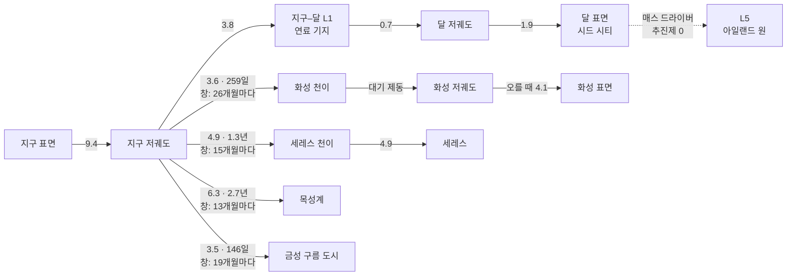

# 04. 항성계 레이어 — 시대 1

## 1. 개요

도시 여러 개를 하나의 경제로 묶는 레이어다. 질문은 둘이다. **"어디서 캐서 어떻게 옮길까?"** 그리고 **"누가 우주를 다스리는가?"**

| 항목 | 내용 |
|---|---|
| 열리는 때 | 시대 0 후반에 '지구–달계' 소지도, 시대 1에 태양계 전체 |
| 플레이어가 하는 일 | 새 부지 개척, 항로 계약과 함선 배치, 산업 배치, 메가프로젝트, 지구와의 협상 |
| 아래 레이어 | 도시는 운영 방침 하나(성장·안정·수출·절전)로 자동 운영. 위기 때만 줌인을 권한다 |
| 시간 | 1일 틱, 1× = 1주 8초 ([02 §4](02-structure-progression.md#4-시간-시스템)) |
| 인구 단위 | 1 pop = 1,000명 |

## 2. 지도 — Δv 지하철 지도

태양계를 축척대로 그리지 않고, **장소(노드)와 기동(선)**으로 그린다. 선에는 Δv(km/s)와 이동 시간이 붙는다.
노드의 높이는 중력 우물의 깊이다 — 아래로 깊을수록 떠나기 비싸다. 발사 창이 열린 선은 밝게 빛난다.

### 주요 구간 (게임 기본값, 공개된 태양계 Δv 지도와 호만 전이 계산의 근사)

| 구간 | Δv (km/s) | 이동 시간 | 발사 창 주기 |
|---|---|---|---|
| 지구 표면 → 저궤도 | 9.4 | 수 분 | 상시 |
| 저궤도 → 지구–달 L1 | 3.8 | 약 3일 | 상시 |
| 달 표면 ↔ 달 저궤도 | 1.9 | 수 분 | 상시 |
| 달 표면 → L5 (매스 드라이버) | 추진제 0 (전력만) | 수일 | 상시 |
| 저궤도 → 화성 천이 | 3.6 | 259일 | 25.6개월 |
| 화성 저궤도 ↔ 화성 표면 | 오를 때 4.1 / 내릴 때 대기 제동 | | 상시 |
| 저궤도 → 금성 천이 | 3.5 | 146일 | 19.2개월 |
| 저궤도 → 세레스 천이 / 세레스 도착 | 4.9 / 4.9 | 472일 | 15.3개월 |
| 저궤도 → 목성 천이 | 6.3 | 998일 | 13.1개월 |
| 저궤도 → 토성 천이 | 7.3 | 6.1년 | 12.4개월 |
| 저궤도 → 수성 천이 | 5.5 (+ 도착 감속이 크다) | 105일 | 3.8개월 |

- 호만 전이가 기본이다. 기술이 오르면 '빠른 전이'(Δv를 더 써서 시간을 줄임)와 '중력 도움'(시간을 더 써서 Δv를 줄임)이 열린다.
- 대기가 있는 곳(지구·화성·금성·타이탄)은 대기 제동으로 도착 Δv를 크게 줄인다. 대신 열 차폐가 든다.

## 3. 부지

시대 1의 부지는 도시 레이어 규칙을 그대로 쓰고, 부지마다 **보정값**이 붙는다. 후보는 [카탈로그 03 §1](../concept/03-content-samples.md#1-태양계-도시-부지)의 15곳이다.

| 보정 | 내용 | 예 |
|---|---|---|
| 중력 | 건설 작업량, 저중력 건강, 이륙 Δv | 세레스 0.03 g — 건설 쉬움, 골밀도 위험 큼 |
| 햇빛 | 태양광 출력 = 1/거리² | 화성 43%, 세레스 13%, 목성 3.7%, 수성 약 670% |
| 낮과 밤 | 일조 모델 교체 | 화성 24시간 39분, 달 적도 14일 밤 |
| 방사선 | 만성 선량, 폭풍 빈도 | 칼리스토 하루 약 0.1 mSv, 유로파 약 5.4 Sv |
| 현지 자원 | 얼음, CO₂ 대기, 질소, 금속, He-3 | 화성 CO₂ → 산소, 타이탄 질소·탄화수소 |
| 고유 규칙 | 부지만의 퍼즐 | 금성: 거주구 자체가 풍선 / 타이탄: 여압복 불필요 / 화성: 먼지 폭풍이 태양광을 몇 주씩 가림 |

### 프로토타입의 부지 18곳 ([city_sites.json](data/city_sites.json))

시대 0 빌드에서 먼저 돌려 본다. 보정은 도시 상수에 덮어쓰는 값(일조 모델·선량·폭풍·지구 보급·시작 비축)과 규칙 계수(1이면 달과 같다)다.
파이썬 밸런스 시뮬레이터(`--site`)와 게임 시뮬레이터가 부지마다 하루 단위로 같은 결과를 낸다 (부지 18곳 × 시드 2061·1000, 3년).
후보 부지는 같은 천체의 기본 부지(`base`)를 물려받고 다른 값만 적는다.

**천체마다 기본 도시 하나로 시작한다.** 달 섀클턴이 고향(플레이어가 운영)이고, 다른 천체의 기본 도시는 시드가 자동 운영한다 —
고르면 넘겨받는다. 천체마다 후보 부지가 2~3곳 더 있어 원정대로 도시를 더 세운다.

| 기본 도시 | 햇빛 | 낮과 밤 | 규칙 계수 | 3년 추천 운영 (시드 2061) |
|---|---|---|---|---|
| 섀클턴 (달 남극, 고향) | 능선 일조 | 그림자 일정, 겨울 최대 90시간 | — | 인구 312 |
| 헬라스 분지 (화성) | 36% | 1솔 24시간 39분 | 얼음 ×1.2, 방열 ×1.15, 교신 사기 ×0.5, 대기 CO₂로 사바티에, 먼지 폭풍(해마다 0.6번, 15~50일, 햇빛 25%) | 인구 88 |
| 프로코피예프 (수성 북극) | 450% | 능선 일조 (태양일 176일) | 방열 ×0.5 | 인구 136 |
| 오카토르 (세레스) | 13% | 9시간 4분 | 얼음 ×2, 로봇 작업 ×1.25 | 인구 62 |
| 발할라 (칼리스토) | 3.7% | 16.7일 | 얼음 ×2.5, 원자로로 산다 | 인구 62 |
| 아디리 (타이탄) | 0.1% | 16일 | 방열 ×2.5, 원자로로 산다, 보급 길이 6년 | 인구 24 |
| 나로 우주항 (지구) | 약 50% (구름·밤) | 24시간 | 바깥 공기(산소·CO₂ 걱정 없음), 보급 30일치, 방열 ×2, 건설 ×1.4 | 인구 880 |

| 후보 부지 | 바탕 부지와 다른 점 | 3년 (시드 2061) |
|---|---|---|
| 피어리 (달 북극) | 북극 능선 — 겨울 그림자가 연초에 온다 | 인구 246 |
| 마리우스 언덕 용암동굴 (달 적도) | 14일 낮·14일 밤, 얼음 ×0.4 | 인구 246 |
| 예제로 크레이터 (화성) | 햇빛 40%, 얼음 ×0.8 | 인구 78 |
| 아르카디아 평원 (화성) | 햇빛 32%, 얼음 ×2 (얕은 지하 얼음) | 인구 78 |
| 차오멍푸 (수성 남극) | 프로코피예프와 같은 규칙 | 인구 78 |
| 아후나 산 (세레스) | 얼음 ×2.5 | 인구 56 |
| 아스가르드 (칼리스토) | 발할라와 같은 규칙 | 인구 56 |
| 크라켄 해 연안 (타이탄) | 북극권 — 계절에 따라 긴 밤, 얼음 ×1.2, 방열 ×2.7 | 인구 20 |
| 셀크 크레이터 (타이탄) | 아디리와 같은 규칙 | 인구 20 |
| 쿠루 적도 우주항 (지구) | 햇빛 55% | 인구 780 |
| 바이코누르 우주항 (지구) | 햇빛 55%, 방열 ×1.6 | 인구 780 |

- **같은 천체로**: 그 천체에서 가장 큰 도시가 떠나고 비용을 낸다. 로버 행렬(지구는 비행편)이 준비 2~3일 + 대원 거리 ÷ 하루 이동
  (달 500 km, 화성·수성·칼리스토 400 km, 세레스·타이탄 600 km, 지구 8,000 km) 만에 닿는다. 비용은 부품 120~220, 지구 지원 200~300.
- **도시가 없는 천체로** (기본 도시를 잃었을 때): 고향에서 원정선이 간다 — 필요 기술(시드 분산 처리 + 극저온 추진제·메가와트급 원자로·궤도 조립),
  고향의 부품·금속·지구 지원, 그리고 **발사 창**. 전이는 화성 259일, 수성 105일, 세레스 472일, 칼리스토 998일, 타이탄 6.1년.
- **발사 창**: 지구와 목적지(위성은 모행성)의 실제 위치로 정한다 — 태양 중심 경도 차가 호만 위상각 φ = 180° − (목적지 평균 운동 × 전이 일수)인 날(화성 약 44°)을 가운데로, 회합 주기의 4%(6~21일) 앞뒤가 열린다.
- **지구**: 바깥 공기로 숨 쉬므로 산소를 쓰지 않고 CO₂는 내보낸다 (생명유지·대피소를 짓지 않고, 정원이 이산화탄소 제거기에 묶이지 않는다).
  물·식량·산소는 보급이 늘 30일치를 채운다. 도착한 정착민은 지구에서 바로 온다.
- **긴 밤**: 밤이 72시간보다 긴 부지(달 적도의 14일 밤, 칼리스토·타이탄)는 태양광 타워 대신 원자로와 축전으로 밤을 넘기고, 축전 목표는 max(48시간, 밤 길이)다.
- **함께 흐르는 식민지**: 모든 식민지가 같은 시계로 한 시간씩 흐르고, 기술은 하루에 한 번 모두가 나눠 갖는다. 고향을 잃으면 게임이 끝나고, 다른 식민지는 잃으면 그 부지로 다시 원정할 수 있다.
- **도시 단위 확대**: 3D 세계는 고른 식민지 하나만 자세히 그린다 ([08 §2](08-ux-art-audio.md#3d-세계--기지에서-이웃-별까지-한-화면)).

### 지구의 대도시 ([earth_cities.json](data/earth_cities.json))

2061년의 지구에는 이미 대도시가 있다. 프로토타입은 26곳을 그린다 — 서울·부산·도쿄·오사카·베이징·상하이·홍콩·싱가포르·방콕·자카르타·뭄바이·델리·두바이·
이스탄불·카이로·라고스·모스크바·런던·파리·베를린·뉴욕·시카고·로스앤젤레스·멕시코시티·상파울루·시드니.
시뮬레이션하는 식민지가 아니라 **우주항에 사람과 물자를 보내는 곳**이고, 가까이 가면 실제 축척으로 보이는 도시다.

| 무엇 | 내용 |
|---|---|
| 자료 | 도심 위치, 도시권 인구(2020년대 추정), 시가지 반지름, 시가지 모양, 가장 높은 건물, 큰길 방향, 도심·부도심(이름·위치·무게), 공원·산, 강(Natural Earth 강 이름과 폭) |
| 항공편 | 가장 가까운 지구 도시(우주항)로 하루 한 편 — 우주항에 빈 주거가 있으면 정착민(한 편 40명까지), 부품이 모자라면 부품(30)을 싣는다. 대도시끼리는 가까운 두 도시와 국제선 23개가 승객을 나른다. 우주항을 더 세우면(쿠루·바이코누르) 가까운 대도시의 항공편이 그리로 옮겨 간다 |
| 3D 지도 | 지구가 화면에서 커지면 점·이름 (더 가까이서는 도시권 인구), 누르면 그 도시 위로 날아가 비스듬히 내려앉는다. 밤에는 시가지가 도심일수록 밝게 빛난다 |
| 시가지 바닥 | 시가지 반지름 안은 지붕·포장의 회색(가장자리는 들쭉날쭉) — 블록마다 3~6줄의 필지에 들어앉은 지붕과 마당. 가까이서는 블록 격자의 골목과 다섯 블록마다 큰길(차선·중앙선·하나 걸러 가운데 화단·보도·횡단보도), 블록 안의 좁은 길. 공원·산은 잔디·숲·산책로. 강은 물로 흐른다 |
| 물가 | 시가지 안의 물가는 지도의 선 그대로 곧은 호안이다 (시가지 밖은 잔 굴곡에 모래·자갈). 물에서 땅 쪽으로 호안 5 m → 강변 공원 22~56 m(잔디·숲·자전거길·산책길, 곳에 따라 광장) → 덤불 3 m → 강변 도로 24 m(왕복 6차로·분리대, 밤에 가로등) → 보도와 가로수 8 m. 바다 해안(전체 지도에서도 해안이 1.5 km 안)은 곳에 따라 공원 자리가 모래사장이나 부두가 된다. 강·항만의 물은 짙은 청록 회색, 넓은 바다는 지구 구의 색. 건물은 물가에서 100 m(`MetroCity.SHORE_M`) 너머에 선다 |
| 다리 | 큰길(다섯 블록) 줄 가운데 약 1.6 km 간격인 줄들이 물을 건너는 곳(물 위 60~1,500 m — 1.2 km가 넘으면 드문드문, 시가지 안, 양쪽 땅이 넉넉할 때) — 물 위 10~22 m의 상판(폭 26 m, 아스팔트와 보도), 양쪽 땅으로 5.5% 접속 경사로, 85 m쯤마다 교각, 350 m가 넘는 다리 셋 중 하나쯤은 주탑 한 쌍. 도시마다 80개까지. 밤에는 다리 길이 빛난다 |
| 실제 축척 건물 | 고도 400 km 아래로 내려가면 그 도시의 지형 조각(반지름 60 km)과 건물이 선다 — 바닥의 길과 같은 블록 격자 위에, 도심에서 바깥으로 도심·부도심일수록 높게 짓고 물·공원에는 짓지 않는다 (PC 2만 6천 채, 휴대폰 9천 채까지). 무게 1인 도심에는 가장 높은 건물(서울 555 m, 상하이 632 m, 두바이 828 m)이 선다. 셰이더가 층·창·유리 외벽을 그리고 밤에는 창이 켜진다 |
| 시가지 모양 | 아파트 단지(길이 60~90 m의 판상 동이 줄지어 — 서울·부산·모스크바), 빽빽한 시가지(도쿄·오사카·뭄바이·이스탄불·카이로), 고층 시가지(상하이·홍콩·싱가포르·방콕·자카르타·상파울루), 격자(뉴욕·시카고·베이징), 옛 시가지(파리·베를린 — 중정형 블록), 연립(런던), 넓게 퍼진 시가지(로스앤젤레스·멕시코시티·델리·라고스·시드니), 사막의 신도시(두바이) |
| 시가지 지도 | `game/art/planets/earth_coast_metro_<id>.png` — 도심 둘레 (반지름 + 10 km) × 2의 접평면, 1024²: R = 해안·강까지의 거리(±2 km), B = R의 자투리(둘을 더해 약 6 cm 단위 — 셰이더와 `MetroCity`는 이웃 네 칸을 직접 섞어 읽는다), G = 공원(둥근 것은 반지름을 물결로 흔든 덩어리). Natural Earth 1:10m의 땅·호수·강 중심선에서 `earth_coast.py --only-metros`가 4배 고운 격자로 만든다 — 해안 다각형과 강 중심선은 차이킨 다듬기로 둥글린다 |

#### 대도시의 도시 기능 — 우주 시설 ([earth_cities.json](data/earth_cities.json)의 `functions`, [metro_functions.gd](../../game/ui/metro_functions.gd))

대도시는 식민지처럼 시뮬레이션하지 않지만, 플레이어가 **우주 시설**을 지어 우주 계획에 쓸 수 있다. 대도시 위로 가면
(위쪽 경로의 '지구 ▾'에서 고르거나, 3D 지도의 이름을 누르거나, 교통 탭의 단추, 또는 그 시가지 위 400 km 아래로 내려가면)
오른쪽 위에 **대도시 카드**가 뜬다 — 인구·시가지 모양·강점, 우주항 항공편(어디까지 · 몇 시간마다 · 어제 더 실은 것), 시설 다섯의 단계와 몫,
짓기·올리기 단추. 지원은 **고른 식민지**의 지구 지원 점수로 내고, 짓는 동안(15~60일) 3D 시가지에서 시설 자리에 주황 빛기둥이 깜박인다.

| 시설 | 1단계 (지원 · 날) | 2단계 | 3단계 | 몫 |
|---|---|---|---|---|
| 우주 산업 단지 | 150 · 20일 | 320 · 40일 | 650 · 60일 | 우주항 항공편이 날마다 부품을 더 싣는다 — 하루 4 / 10 / 20 (모자라지 않아도) |
| 이주 지원 센터 | 120 · 15일 | 260 · 30일 | 520 · 45일 | 항공편 한 번에 정착민 +20 / 50 / 100명 (우주항에 빈 주거가 있을 때) |
| 우주 연구소 | 200 · 30일 | 420 · 45일 | 850 · 60일 | 지원을 낸 식민지에 연구 점수 하루 +4 / 10 / 22 (기술은 모든 도시가 나눈다) |
| 우주 홍보관 | 100 · 15일 | 220 · 30일 | 450 · 45일 | 지원을 낸 식민지에 지구 지원 하루 +0.4 / 0.9 / 1.8 |
| 공항 화물 터미널 | 180 · 20일 | 360 · 35일 | 700 · 50일 | 우주항 항공편이 16 / 12 / 8시간마다 (기본 24시간) |

- 몫은 **도시권 인구**로 키운다: √(인구 / 1000만)을 0.6~1.8로 자른 배수 (도쿄·자카르타·델리 1.8, 서울 1.6, 파리 1.06, 부산 0.6).
- 도시마다 **강점**(카드에 ★)이 있어 그 시설의 몫이 1.5배 — 서울·도쿄·오사카·상하이·베를린은 우주 산업, 베이징·모스크바·런던·파리는 연구,
  자카르타·뭄바이·델리·카이로·라고스·멕시코시티·상파울루는 이주, 방콕·이스탄불·뉴욕·로스앤젤레스·시드니는 홍보, 부산·홍콩·싱가포르·두바이·시카고는 공항.
- 부품·정착민은 그 대도시의 우주항 항공편이 싣는다 — 지구에 우주항 도시가 없으면 오지 않는다 (연구·지원의 몫은 들어온다).
  지원을 낸 식민지가 없어지면 몫은 고향으로 간다.
- 3D 시가지: 시설마다 도심에서 시가지 반지름의 20%(1.8~4.5 km) 떨어진 땅(물·공원 밖)에 그 시설 색의 단지 —
  우주 산업 단지는 공장동과 조립탑, 이주 지원 센터는 큰 홀과 숙소동, 우주 연구소는 둥글게 선 연구동과 탑, 우주 홍보관은 전망탑과 전시관,
  공항 화물 터미널은 격납고와 관제탑 — 가 단계마다 커지고, 그 위로 빛기둥(밤에 더 밝다)과 이름표(이름 · 단계 또는 짓는 몫)가 선다.
- 교통 탭의 '대도시 · 우주 시설 · 운영 방식'에 시설·운영 방식·계약이 있는 대도시마다 단계, 운영 방식과 운영비·상태, 상점가·채권·펀드,
  어제의 몫이 있고, 그 위에 동맹·비상 창고·우주 산업 지수·첨단 산업 지역의 요약, 아래에 26곳으로 가는 단추(◎ = 운영 방식)가 있다.
- 시뮬레이션(CitySim) 밖의 규칙이다 (교통처럼 비축·연구·지원에 더할 뿐) — 파이썬 시뮬레이터와의 일치 시험에 들지 않는다. 저장된다.

#### 대도시 운영 방식 — ① 우주 산업 수도 · ③ 연구 동맹 · ⑤ 비상 보급 기지 ([earth_cities.json](data/earth_cities.json)의 `modes`·`mode_rules`·`alliance`, [metro_modes.gd](../../game/ui/metro_modes.gd))

대도시 카드의 **운영** 탭에서 대도시마다 운영 방식 하나를 고르면 그 도시가 **운영비**로 스스로 일한다 (다섯 후보 가운데 ①③⑤를 만들었다).
고른 식민지가 **후원**하고, 운영비는 후원 식민지의 지구 지원에서 맡긴다 (100 · 500 단추, 또는 **자동 채움** — 후원 식민지의 지원이
화물선·유인선 비용 + 100을 넘을 때만 하루 20씩, 운영비 1,000까지). 고르고 **3일**은 준비 중이다.

| 공통 규칙 | 내용 |
|---|---|
| 운영비 | 날마다 ① 0.5 · ③ 0.6 · ⑤ 1.0 (협력 지역이 있으면 +0.2). 모자라면 **쉰다** (방식의 일을 하지 않는다) — 하루 운영비의 3배가 차면 다시 움직인다 |
| 자동 증설 | 방식이 정한 시설(① 우주 산업 단지·공항 화물 터미널, ③ 우주 연구소, ⑤ 공항 화물 터미널) 가운데 가장 낮은 단계부터 하나씩 운영비로 짓는다 — 다른 시설을 짓는 중이 아니고, 내고도 운영비가 하루 운영비 × 20 (⑤는 +60) 남을 때 |
| 바꾸기·멈추기 | 다른 방식으로 바꾸면 운영비는 남고 3일 다시 준비한다. '직접'으로 돌리면 남은 운영비와 비상 창고(반값)가 후원 식민지로 돌아온다 |
| 자동으로 한 일 | 카드에 마지막 12줄 (시각과 일). 후원 식민지를 잃으면 고향이 잇는다 |

**① 우주 산업 수도** — 우주항 항공편이 우주 산업 단지의 부품을 **1.5배** 싣는다 (× (1 + 협력 지역의 몫)). 날마다 우주 식민지의 부품을 세어
(목표 = 300과 자동 운영이 남기는 부품 + 150 가운데 큰 것, 오는 중인 것 포함) **달 식민지에 50개 넘게 모자라고 정기 셔틀이 이틀 넘게 남았으면**
우주항에 쌓인 부품(200은 남기고 250까지)을 **부품 급송 셔틀**로 바로 보낸다 (주 1회, 운임은 운영비). 먼 행성으로 가는 행성간 수송선이 떠날 때는
그 천체에 모자란 부품을 400까지 **사서 더 싣는다** (부품 하나 0.5, 운영비). 대신 그 도시 **우주 홍보관의 지원은 들어오지 않는다**.

**③ 연구 동맹** — 이 방식이고 **우주 연구소가 있는** 대도시들이 회원이다. 회원 연구소의 연구 점수는 식민지 대신 동맹의 **과제 하나**에 모인다
(회원이 n곳이면 × (1 + 0.15 (n − 1)), 1.6배까지; 협력 지역의 몫만큼 더). 과제는 카드에서 고르거나 (식민지 기술은 **15% 싸게**), 자동이면
고향 식민지의 연구 순서에서 열 수 있는 첫 기술 → 가장 싼 기술 → 동맹 기술. 마치면 **모든 식민지가 그 기술을 안다**. 동맹만 여는 기술 다섯:

| 동맹 기술 | 점수 | 효과 |
|---|---|---|
| 고밀도 화물 포장 | 2,500 | 운영 방식의 운임(급송 셔틀·비상편·수송선 부품)이 20% 싸진다 |
| 위기 예측망 | 3,000 | 비상 보급 기지가 위급을 이틀 일찍 알아챈다 |
| 시드 학습 데이터 | 4,000 | 동맹이 모으는 연구 점수 +15% |
| 칩 신속 생산 라인 | 5,000 | 모든 대도시 우주 산업 단지의 부품 +25% |
| 공동 발사 계약 | 6,000 | 대도시의 우주 시설을 짓는 날 −25% |

3D 시가지에는 시설 단지 사이에 운영 방식의 단지가 선다 — ① 물류 센터(긴 창고 둘과 관제탑), ③ 동맹 연구탑(높은 유리 탑과 둘레의 연구동 넷),
⑤ 비상 창고(창고 셋과 탱크 여섯) — 그 방식 색의 빛기둥(준비 중이거나 쉬면 깜박인다)과 이름표 '운영: 방식 · 한 줄 상태'. 3D 지도의 대도시 이름 아래에도 방식이 뜬다.

**⑤ 비상 보급 기지** — 날마다 우주항 옆 **비상 창고**에 산소·식량·물·부품을 운영비로 사 모은다 (하루 300 · 400 · 400 kg · 8개, 창고 4,000 ·
6,000 · 6,000 kg · 100개 — 공항 화물 터미널 단계마다 50%씩 크다). **3시간마다** 우주 식민지를 살펴 위급하면 곧바로 **비상편**을 띄운다:

| 위급 | 기준 (위기 예측망·협력 지역의 데이터센터만큼 며칠 일찍) | 보내는 것 |
|---|---|---|
| 산소 · 식량 · 물 | 6 · 8 · 5일치 아래 (식량은 식민지가 스스로 급송선을 부를 수 있으면 맡긴다) | 15 · 20 · 12일치까지 (오는 중인 것 빼고, 저장 한도 안) |
| 전력 | 전기가 모자라 끊고 축전이 15% 아래 | 부품 60 (부품이 300 아래면) · 비상 전지 600 kWh (1 kWh = 5 kg, 닿으면 축전을 채운다) |

달은 지구 우주항에서 **셔틀로 72시간** (우주항이 아닌 달 도시는 + 거리/2,400 + 3시간) — 창고가 가장 넉넉한 기지가 창고에서 싣고 모자란 것은
두 배 값에 사서, 운영비로 100 + 운임을 낸다. 다른 천체는 **같은 천체의 바로 이어진 이웃 도시**가 남는 것을 나눈다 (운영비 40).
같은 도시에는 72시간에 한 번. 길이나 운영비가 없으면 그 식민지에 알린다 (열흘에 한 번).

#### 실제 도시의 상업·금융 ([earth_cities.json](data/earth_cities.json)의 `economy`와 도시마다 `districts`, [metro_economy.gd](../../game/ui/metro_economy.gd))

대도시마다 실제 **상권**과 **금융가**(이름·위치·무게)가 있다 — 서울 여의도(금융)·강남·명동, 도쿄 마루노우치·긴자·신주쿠, 뉴욕 월가·미드타운·소호,
런던 시티 오브 런던·카나리 워프·웨스트엔드, 상하이 루자쭈이·와이탄·난징루, 싱가포르 래플스 플레이스·마리나 베이·오차드 … (26곳에 76곳).
대도시 카드의 **경제** 탭에서 고른 식민지의 지구 지원으로 계약한다.

| 무엇 | 규칙 |
|---|---|
| 상업 지수 · 금융 지수 | 상권 무게의 합 × 도시권 인구 배수 (도쿄 3.1 · 서울 2.3 · 뉴욕 2.0 · 부산 0.5) · 금융가 무게의 합 (런던·싱가포르 1.85, 상하이 1.7, 뉴욕·도쿄·홍콩 1.0, 서울 0.8) |
| 우주 상점가 | 계약 100 + 50 × 상업 지수 (한 번 — 서울 약 215, 도쿄 약 255: 수입으로 넉 달쯤에 갚는다). 날마다 상업 지수 × (0.2 + 0.25 × 어제 그 도시에 닿은 국제선 승객 천 명, 3까지) × 우주 화제 × 요일(일 1.3 · 월 0.9 · 화수 0.85 · 목 0.9 · 금 1.05 · 토 1.35) × 달(11월·1월 1.1, 12월 1.35) |
| 우주 채권 | 120 + 200 × 금융 지수 (100~600)를 빌려 180일 동안 날마다 갚는다 — 이자(총) 14% − 5% × 금융 지수 (4~14%: 런던 4.75%, 뉴욕 9%). 갚을 돈은 그 식민지의 화물선·유인선 비용 아래로 내려가며 빼지 않는다 — 모자라면 **밀리고**, 밀린 동안은 새로 빌리거나 펀드에 넣거나 운영비를 맡기지 못한다 (상점가 수입이 먼저 갚는다). 식민지마다 3건까지 |
| 우주 펀드 | 100 · 250씩, 한 도시 1,500까지. 날마다 **우주 산업 지수**를 따라 오르내린다 (기대 하루 +0.03%, 출렁임 0.9%, 기술 +0.3% · 새 도시 +1% · 사망 사고 −1.5%; 날마다 0.12%의 확률로 6일 동안 하루 −1.5%씩 **폭락**) + 도시마다의 출렁임 (금융 지수가 클수록 작다). 넣은 돈의 20% 아래로는 떨어지지 않는다. 찾을 때 수수료 1% |
| 빌려서 굴리기 | 폭락까지 셈한 펀드의 기대 수익은 해마다 약 7% (180일 약 3.5%, 수수료를 빼면 2.5%) — 가장 싼 채권 이자(180일 4%)보다 낮아 빌려서 굴려 벌 수는 없다 (smoke가 확인한다) |
| 우주 화제 | 0.5~1.5, 날마다 1로 3%씩 돌아가고 기술 하나 +0.04 · 새 도시 +0.1 · 비상 구조 +0.02 · 사망 사고 −0.2 |

지수·펀드의 오르내림은 **게임 씨앗**으로 정해진다 (시뮬레이션의 난수를 쓰지 않는다 — 같은 씨앗이면 같다). 3D 시가지에서는 상점가를 연 도시의
가장 큰 상권에 호박색, 채권·펀드가 있는 도시의 가장 큰 금융가에 청록 빛기둥이 서고, 상권·금융가마다 이름표(금융 지구 · 상업 지구)가 뜬다.

#### 반도체·AI 데이터센터 지역 ([earth_cities.json](data/earth_cities.json)의 `tech_regions`·`tech_kinds`·`tech_bonus`)

실제로 반도체 공장·AI 데이터센터가 모인 지역 24곳 — 평택·기흥/화성·이천, 신주·타이난, 구마모토·욧카이치, 인자이, 상하이 장장, 선전,
싱가포르 북부, 조호르, 페낭, 벵갈루루, 아부다비, 드레스덴, 에인트호번, 더블린, 슬라우, 피닉스, 오스틴·테일러, 힐스버러, 실리콘밸리, 애슈번
(지명만 — 회사 이름은 쓰지 않는다). 종류: 메모리 · 파운드리 · 반도체 공장 · 패키징·시험 (칩), 칩 설계·연구, AI 데이터센터 · 데이터센터 허브.

| 무엇 | 내용 |
|---|---|
| 3D 지도 | ◆ 표시와 이름 (가까이서는 종류), 위쪽 경로의 '지구 ▾'의 '첨단 산업 지역'. 고르면 그 단지 위로 내려앉는다. 상하이 장장·싱가포르 북부는 대도시 시가지 안이라 그 도시의 땅에 단지가 서고, 나머지 22곳은 저마다의 땅(해안 지도 `earth_coast_tech_<id>.png`, 512², `earth_coast.py --only-regions`)에 선다 |
| 단지 | 단지 지름 3 km마다 묶음 하나 (2~8곳 — 가운데 하나와 둘레 고리, 묶음끼리 1.2 km 넘게, 물가를 피해), 지역의 종류를 돌아가며. 묶음마다 땅을 골라 밝은 콘크리트 마당(가장 높은 땅 높이 — 비탈이면 낮은 쪽이 옹벽, 밤에는 마당 조명)을 만들고 그 위에 — 반도체 공장(메모리·파운드리): 넓고 낮은 흰 공정동(팹) 두세 동, 지붕의 배기 설비 줄, 배기탑, 유틸리티동, 가스·약품 탱크 마당, 유리 사옥, 주차장 · 패키징·시험: 중간 크기 공장동 여럿과 창고 · 칩 설계·연구: 유리 사옥 여러 동과 잔디 마당 · 데이터센터: 긴 전산동 줄, 지붕 냉각기 격자, 비상 발전기 마당, 변전소. 공장·전산동은 밤에 은은한 보안등, 사옥은 창이 켜진다. 가운데에 지역 색의 빛기둥, 종류마다 이름표 하나 (메모리 반도체 공장 · 파운드리 공장 · AI 데이터센터 …) |
| 지역 카드 | 종류·실제 모습·단지 크기·비중·가장 가까운 대도시, 운영 방식마다의 몫, 협력 중인 대도시, 운영 방식이 있는 대도시와 협력하는 단추 (가까운 넷) |
| 협력 | 운영 방식이 있는 대도시가 지역 하나와 계약한다 (운영비 80 × 비중, 150 km 안이면 반값; 하루 운영비 +0.2). ① 칩 종류마다 부품 몫 +12% × 비중 (50%까지), ③ AI 데이터센터 +20% · 데이터센터 허브 +10% · 칩 설계 +15% × 비중 (50%까지), ⑤ 데이터센터 종류마다 경보 하루 일찍 (이틀까지), 반도체 공장·패키징이면 비상 창고의 부품 1.5배 |
| 견학 | 처음 찾아간 지역은 고른 식민지에 연구 +30 (게임마다 지역마다 한 번) |

## 4. 항로와 함선

### 운송비

**추진제(t) = 화물(t) × (exp(Δv / (Isp · g₀)) − 1) × (1 + 구조 계수 0.1)**

| 함선 등급 | 추진 | 비추력 | 쓰임 | 특징 |
|---|---|---|---|---|
| 화학 셔틀 | 액체 산소·수소 / 메탄 | 450 / 360 s | 지표 ↔ 궤도 | 고추력. 중력 우물을 오르는 유일한 수단 (매스 드라이버 제외) |
| 핵열 화물선 | 핵열 추진 | 900 s | 행성 간 수송 | 시대 1의 주력 |
| 전기 추진 화물선 | 이온·홀 | 3,000 s | 느린 대량 화물 | 추력이 약해 이동 시간 ×3, 대신 추진제가 아주 적다 |
| 매스 드라이버 + 포획기 | 전자기 가속 | – | 달 → L5·L1 | 추진제 0. 전력 1 t당 최소 0.79 MWh |
| 사이클러 | 순환 궤도 정거장 | – | 지구–화성 정기 노선 | 한 번 궤도에 올리면 거의 공짜로 오간다 (1985년 버즈 올드린의 제안) |

같은 화물 100 t을 옮길 때 필요한 추진제

| 구간 | 화학 (450 s) | 핵열 (900 s) | 전기 (3,000 s) |
|---|---|---|---|
| 저궤도 → 화성 천이 (3.6) | 139 t | 55 t | 14 t (시간 ×3) |
| 저궤도 → 세레스 도착 (4.9 + 4.9) | 903 t | 224 t | 43 t |
| 달 표면 → 달 저궤도 (1.9) | 59 t | 26 t | 쓸 수 없음 (추력 부족) |

> 계산: 질량비 exp(Δv/(Isp·g₀)) − 1에 구조 계수 1.1을 곱한 값. 저궤도 → 화성 화학: (e^(3.6/4.41) − 1) × 1.1 × 100 ≈ 139 t.

### 연료 기지

추진제는 어디서 넣느냐가 전부다. 지구–달 L1, 화성 저궤도, 세레스에 **연료 기지**를 두면 그곳에서 다시 채우고 출발한다.
달의 물로 만든 추진제를 L1에 쌓는 것이 시대 1 경제의 첫 고리다.

## 5. 물류 — 계약과 흐름

플레이어는 배를 하나하나 몰지 않는다. **계약**을 맺는다.

| 계약 예 | 내용 |
|---|---|
| 세레스 물 → 화성 저궤도 | 연 2만 t. 창이 열릴 때마다 출발 |
| 달 추진제 → L1 연료 기지 | 상시 월 500 t |
| 지구 사람 → L5 | 유인선 분기마다 200명 |

- 시뮬레이션이 함선 배정, 발사 창, 추진제 소비, 도착 지연을 처리한다. 병목(함선 부족, 연료 부족, 창 대기)은 지도 위에서 붉게 표시된다.
- 지도에는 흐름의 굵기로 물동량이 보인다. 이동 중인 화물은 '떠 있는 재고'로 잡혀, 화성에는 8개월 남짓 뒤에야 도착한다.

### 프로토타입의 도시 사이 교통 ([transport.json](data/transport.json))

시대 0 빌드에서는 계약 대신 **자동 노선**이 돈다. 도시가 생기거나 없어질 때마다 노선을 다시 짜고(이어지는 노선은 일정·누계를 지킨다),
모든 도시가 함께 흐르는 시계로 떠나고 닿는다. **교통** 탭에서 전체와 노선 하나하나를 켜고 끈다 (처음엔 모두 켜져 있다).

| 노선 | 잇는 곳 | 탈것 |
|---|---|---|
| 천체 안 | 같은 천체의 도시를 잇는 가장 짧은 그물 (최소 신장 나무) | 달·수성·칼리스토: 로버 화물 열차 (달 500 km, 수성·칼리스토 300 km보다 멀면 로켓 호퍼), 화성: 열차 · 400 km 넘으면 화성 수송기, 세레스: 호퍼, 타이탄: 회전익기, 지구: 여객기 |
| 지구-달 셔틀 | 지구의 기본 도시(우주항) ↔ 달 고향 | 지구-달 셔틀: 3.5일 길, 양쪽에서 한 주에 한 편 |
| 행성간 수송선 | 달 고향 ↔ 다른 천체의 기본 도시 | 발사 창의 가운데 날 떠난다. 돌아오는 길은 거꾸로 셈한 창이다 (화성 → 지구: 떠날 때 지구가 화성보다 약 75° 뒤) |
| 대도시 항공편 | 지구의 대도시 → 가장 가까운 지구 도시, 대도시끼리 | 여객기 |

| 탈것 | 속력 | 화물 | 사람 | 한쪽에서 떠나는 간격 |
|---|---|---|---|---|
| 로버 화물 열차 | 30 km/h | 40 t | 12 | 48시간 |
| 로켓 호퍼 | 2,400 km/h | 6 t | 8 | 72시간 |
| 화성 수송기 | 360 km/h | 4 t | 6 | 48시간 |
| 타이탄 회전익기 | 110 km/h | 5 t | 8 | 48시간 |
| 여객기 | 850 km/h | 20 t | 220 | 12시간 (대도시 → 우주항은 24시간) |
| 지구-달 셔틀 | 72시간 | 25 t | 30 | 1주 |
| 행성간 수송선 | 전이 일수 (화성 259일 … 타이탄 6.1년) | 300 t | 120 | 발사 창마다 |

- **싣기**: 떠날 때 받는 도시에 모자란 비축을 이 차례로 싣는다 — 식량(60일치), 산소(30일치, 바깥 공기를 마시는 도시는 0), 물(20일치), 부품(300), 금속(20 t).
  보내는 도시는 그 바람의 1.5배(부품·금속은 2배)를 넘는 몫만 보내고, 시장이 채우는 지구 도시는 시장에서 사서 보낸다.
  받는 도시의 저장 한도와 이미 그리로 가는 중인 짐은 빼고 싣는다. 실은 짐은 가는 동안 탈것에 있다 ('떠 있는 재고').
- **정착민**: 받는 도시에 주거(5%는 비워 둔다)와 CO₂ 제거 여유가 있고 식량·산소가 30일치 넘으면 탄다. 지구 도시는 한 번에 인구의 15%까지,
  다른 도시는 주거가 95% 넘게 찼을 때 넘치는 사람만 보낸다. 한 번에 받는 도시 인구의 10%까지. 선량 한도에 닿아 귀환을 기다리는 사람은 타지 않고,
  탄 사람은 쌓인 선량을 지니고 간다.
- **운임**: 지구에서 달로, 행성 사이로 올리는 화물은 보내는 도시가 1 t에 지원 점수 7.5를 낸다 (화물선 운임과 같은 값). 모자라면 낼 수 있는 만큼만 싣는다.
- **기록**: 도시마다 일주일에 한 번 들고 난 화물·정착민을 기록에 남기고, 행성간 수송선은 떠나고 닿을 때마다 남긴다. 받을 도시가 그사이 없어지면 짐과 사람은 떠난 도시로 돌아온다.
- **보이기**: 3D 지도에 노선(땅길은 땅에 붙고, 하늘길·호퍼는 거리만큼 솟는 호, 지구-달 셔틀 길, 가는 중인 배의 전이 궤도)과 움직이는 탈것(비행기 세모, 열차 네모, 호퍼 동그라미, 셔틀·배 마름모).
  교통 탭의 '보기'는 노선 전체가 보이게 날아가 그 노선을 잠깐 밝힌다. 기지에서는 땅길 노선마다 그 도시 쪽으로 고속도로가 뻗어 열차가 드나들고, 호퍼·회전익기는 그쪽 하늘에서 날아들며,
  셔틀·수송선의 착륙선은 교통 착륙장에 내린다. 지구·화성 기지에는 활주로가 있어 비행기가 내리고 뜬다.
- **정기 교역** ([city_routes.gd](../../game/ui/city_routes.gd)): 자동 노선이 모자란 것을 채우는 것과 따로, 플레이어가 "어느 도시에서 어느 도시로
  무엇을 얼마만큼 며칠마다"를 정한다 — **교통** 탭의 '정기 교역'. 같은 천체의 도시끼리(두 도시를 바로 잇는 노선이 없으면 받을 도시 쪽 노선의 탈것이
  두 도시 사이 거리만큼 간다)와 지구 우주항 ↔ 달 고향 셔틀로만 — 행성 사이는 수송선이 발사 창마다 모자란 것을 나르므로 없다.
  물건은 물·산소·식량(t)·부품(개)·금속(t). 날이 되면 정한 양과 **남는 몫**(비축 − 남길 양: 수출 계약과 같은 셈 — 정착민의 40·30·60일치, 부품 200,
  금속 20 t) 가운데 작은 것을 탈것의 적재 한도까지 실어 그 노선의 특별편으로 보낸다 (정기편의 일정은 그대로). 남는 몫이 정한 양의 10%도 안 되면
  그날은 건너뛴다. 셔틀은 보내는 도시가 운임(1 t에 지원 7.5, 연구 동맹의 고밀도 화물 포장으로 20% 싸진다)을 내고, 모자라면 건너뛴다. 떠날 때와 닿을 때
  기록에 남고, 정기 교역마다 보낸 번 수·옮긴 양·다음 날·지난 번이 보인다. 켜고 끄고 지운다. 정기 교역은 저장된다.
- **저장 판 3**: 노선의 일정·누계, 가는 중인 짐·사람을 함께 저장한다 (판 2 저장은 노선을 새로 짠다).

## 6. 산업 — 추상화

보고 있지 않은 도시는 집계 모델로 돈다 ([카탈로그 04 §3](../concept/04-architecture-roadmap.md#3-틱스케줄러lod)).
항성계 레이어에서는 도시마다 **산업 슬롯**으로 생산을 정한다.

| 상품 | 주요 산지 | 쓰임 |
|---|---|---|
| 물·휘발성 | 달 극지, 세레스, 얼음 위성 | 생명유지, 추진제 |
| 추진제 | 물이 있는 곳 | 모든 운송 |
| 금속·합금 | 달, 소행성, 16 프시케 | 건설, 함선 |
| 전자부품 | 지구 → 이후 궤도 공장 | 모든 모듈 |
| 질소 | 타이탄, 화성 대기 | 거주구 공기 (산소만으로는 숨을 쉴 수 없다) |
| He-3 | 달 레골리스, 가스 행성 대기 | D-He3 핵융합 (시대 2) |
| 희귀원소 | 소행성 | 전자부품, 촉매 |
| 식량 | 모든 도시 | |
| 사람 | 지구, 큰 도시 | 노동력, 연구 |

## 7. 메가프로젝트

메가프로젝트는 여러 단계로 나뉜 장기 건설이다. 단계마다 자재·전력·로봇·시간이 들고, 단계 사이에 이벤트가 끼어든다.

| 프로젝트 | 시대 | 규모 | 결과 | 현실성 |
|---|---|---|---|---|
| 매스 드라이버 | 0 후반 | 1 GW급 | 달 물자를 추진제 없이 궤도로 | 공학적 |
| 아일랜드 원 | 0 → 1 | 지름 약 500 m, 1만 명 | 첫 회전 거주구 — 시대 1 진입 | 공학적 |
| 스탠퍼드 토러스 | 1 | 지름 1.8 km, 1만 명 | 지구 궤도 산업 거점 | 공학적 |
| 달 우주 엘리베이터 | 1 | 달 표면 ~ L1 | 달 화물 비용 급감 | 공학적 (지구용은 이론적) |
| 사이클러 함대 | 1 | 지구–화성 | 정기 노선, 이민 물결 | 공학적 |
| 화성 테라포밍 1단계 | 1~3 | 수백 년 | 온난화 시작 | 이론적 |
| 오닐 실린더 | 1 후반 | 지름 8 km, 수백만 명 | 우주 인구 급증 | 공학적 |
| 성간 탐사 계획 | 1 → 2 | 100 GW급 레이저 + 그램급 돛 | 프록시마 탐사선 — 시대 2 진입 | 공학적~이론적 |
| 다이슨 스웜 | 2~3 | 수집기 묶음 1,000개 — 자기 복제 공장이 늘수록 뒤 묶음이 커진다 | K 1.16(첫 묶음, 2300년 무렵) → 2.06(완성) | 이론적 |

### 예 — 아일랜드 원

| 단계 | 내용 | 주요 자재 | 대표 이벤트 |
|---|---|---|---|
| 1 골조 | 구형 골조와 회전축 | 금속 수만 t (달) | 매스 드라이버 정비 중단 |
| 2 차폐 | 레골리스 차폐층 | 레골리스 수백만 t (달) | 포획기 오조준 — 파편 위험 |
| 3 공기와 흙 | 공기·물·토양 | 질소 수입(지구 → 이후 타이탄), 물(달) | 질소 가격 폭등 |
| 4 스핀업 | 분당 약 1.9회전까지 가속 | 전력 | 진동 공명 — 감속 후 재가속 |
| 5 점등 | 첫 입주 | 사람 | 창밖으로 지구와 달이 지나간다 — 시대 1 컷신 |

## 8. 지구 정치

시대 1의 지구는 **고객이자 후견인이자 경쟁자**다. 지구 관계는 '협력 ↔ 긴장' 막대 하나로 보인다.

| 국면 | 시기 | 지구가 원하는 것 | 지구가 주는 것 | 대표 사건 |
|---|---|---|---|---|
| 의존 | 시대 0 | 과학 성과, 안전 기록 | 화물·사람·예산 | 컨소시엄 감사 |
| 협력 | 시대 1 초반 | 추진제, 궤도 태양광 송전, He-3 | 사람, 전자부품, 정당성 | 궤도 연료 시장 |
| 긴장 | 시대 1 중반 | 통제권, 세금, 귀환 의무 | 시장 접근 | 궤도 자치 헌장, 발사 금지 조치 |
| 역전 | 2190년대 무렵 | 에너지 의존을 줄일 보장 | 문화, 인구 | 우주 에너지가 지구를 넘는 날 |
| 재정의 | 시대 1 후반 | 동반자 조약 | 공동 성간 계획 | 협정 / 분리 / 경제적 우위 중 선택 |

**역전**은 시대 1의 클라이맥스다. 플레이어의 선택지는 셋이다.

| 선택 | 내용 | 결과 |
|---|---|---|
| 동반자 협정 | 궤도 태양광을 지구로 송전하고 공동 의회를 만든다 | 지구 신뢰 상승, 성간 계획 공동 출자. 결정이 느려진다 |
| 경제적 우위 | 에너지·자원 가격으로 지구 정책을 움직인다 | 빠른 성장. 지구 내 반우주 운동, 신뢰의 세력별 분열 |
| 분리 | 우주 정부를 따로 세운다 | 자율 최대. 지구 이민 단절, 문화 거리 급증 |

## 9. 사회 — 태양계 안의 거리

- 태양계 안에서는 광속 지연이 분~시간 단위다 (지구–화성 3~22분, 지구–목성 33~54분). 명령은 거의 실시간이지만 **대화는 아니다** — 화성과의 화상 회의는 불가능하다.
- 문화 거리는 지연보다 **환경과 고립**에서 생긴다. 화성의 하루, 저중력의 몸, 지구를 본 적 없는 2세대가 '화성인' 정체성을 만든다.
- 저중력 아종: 달·화성·세레스 태생은 지구 중력에서 오래 살기 어렵다 — '지구 귀환 불가자' 문제와 귀환 의무 법령의 충돌.

## 10. 시드 분산 — 나는 하나인가

'시드 분산 처리' 이후 시드는 거점마다 하나씩 돈다. 태양계 안에서는 몇 분~몇 시간마다 동기화되지만, 그 사이 판단이 조금씩 다를 수 있다.

| 장치 | 내용 |
|---|---|
| 동기화 대역폭 | 중계 위성망이 넓을수록 거점 시드들의 판단 차이가 줄어든다 |
| 일관성 지수 | 거점 시드끼리 같은 상황에 같은 결정을 내리는 비율 (보통 99% 이상) |
| '나는 하나인가' 이벤트 | 일관성이 떨어진 순간 두 거점이 서로 다른 결정을 내리고, 플레이어는 어느 쪽이 '나'인지 정한다 |

이 장치는 시대 2의 '딸 시드 논쟁'과 시대 3의 '다른 시드'를 위한 예고편이다.
