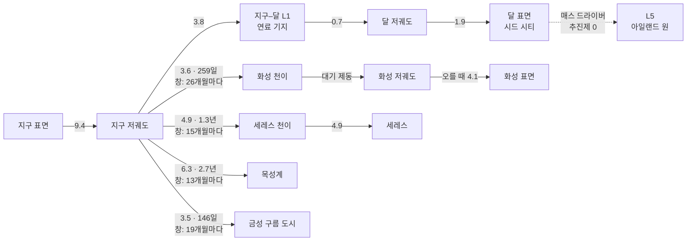

# 04. 항성계 레이어 — 시대 1

## 1. 개요

도시 여러 개를 하나의 경제로 묶는 레이어다. 질문은 둘이다. **"어디서 캐서 어떻게 옮길까?"** 그리고 **"누가 우주를 다스리는가?"**

| 항목 | 내용 |
|---|---|
| 열리는 때 | 시대 0 후반에 '지구–달계' 소지도, 시대 1에 태양계 전체 |
| 플레이어가 하는 일 | 새 부지 개척, 항로 계약과 함선 배치, 산업 배치, 메가프로젝트, 지구와의 협상 |
| 아래 레이어 | 도시는 운영 방침 하나(성장·안정·수출·절전)로 자동 운영. 위기 때만 줌인을 권한다 |
| 시간 | 1일 틱, 1× = 1주 8초 ([02 §4](02-structure-progression.md#4-시간-시스템)) |
| 인구 단위 | 1 pop = 1,000명 |

## 2. 지도 — Δv 지하철 지도

태양계를 축척대로 그리지 않고, **장소(노드)와 기동(선)**으로 그린다. 선에는 Δv(km/s)와 이동 시간이 붙는다.
노드의 높이는 중력 우물의 깊이다 — 아래로 깊을수록 떠나기 비싸다. 발사 창이 열린 선은 밝게 빛난다.

### 주요 구간 (게임 기본값, 공개된 태양계 Δv 지도와 호만 전이 계산의 근사)

| 구간 | Δv (km/s) | 이동 시간 | 발사 창 주기 |
|---|---|---|---|
| 지구 표면 → 저궤도 | 9.4 | 수 분 | 상시 |
| 저궤도 → 지구–달 L1 | 3.8 | 약 3일 | 상시 |
| 달 표면 ↔ 달 저궤도 | 1.9 | 수 분 | 상시 |
| 달 표면 → L5 (매스 드라이버) | 추진제 0 (전력만) | 수일 | 상시 |
| 저궤도 → 화성 천이 | 3.6 | 259일 | 25.6개월 |
| 화성 저궤도 ↔ 화성 표면 | 오를 때 4.1 / 내릴 때 대기 제동 | | 상시 |
| 저궤도 → 금성 천이 | 3.5 | 146일 | 19.2개월 |
| 저궤도 → 세레스 천이 / 세레스 도착 | 4.9 / 4.9 | 472일 | 15.3개월 |
| 저궤도 → 목성 천이 | 6.3 | 998일 | 13.1개월 |
| 저궤도 → 토성 천이 | 7.3 | 6.1년 | 12.4개월 |
| 저궤도 → 수성 천이 | 5.5 (+ 도착 감속이 크다) | 105일 | 3.8개월 |

- 호만 전이가 기본이다. 기술이 오르면 '빠른 전이'(Δv를 더 써서 시간을 줄임)와 '중력 도움'(시간을 더 써서 Δv를 줄임)이 열린다.
- 대기가 있는 곳(지구·화성·금성·타이탄)은 대기 제동으로 도착 Δv를 크게 줄인다. 대신 열 차폐가 든다.

## 3. 부지

시대 1의 부지는 도시 레이어 규칙을 그대로 쓰고, 부지마다 **보정값**이 붙는다. 후보는 [카탈로그 03 §1](../concept/03-content-samples.md#1-태양계-도시-부지)의 15곳이다.

| 보정 | 내용 | 예 |
|---|---|---|
| 중력 | 건설 작업량, 저중력 건강, 이륙 Δv | 세레스 0.03 g — 건설 쉬움, 골밀도 위험 큼 |
| 햇빛 | 태양광 출력 = 1/거리² | 화성 43%, 세레스 13%, 목성 3.7%, 수성 약 670% |
| 낮과 밤 | 일조 모델 교체 | 화성 24시간 39분, 달 적도 14일 밤 |
| 방사선 | 만성 선량, 폭풍 빈도 | 칼리스토 하루 약 0.1 mSv, 유로파 약 5.4 Sv |
| 현지 자원 | 얼음, CO₂ 대기, 질소, 금속, He-3 | 화성 CO₂ → 산소, 타이탄 질소·탄화수소 |
| 고유 규칙 | 부지만의 퍼즐 | 금성: 거주구 자체가 풍선 / 타이탄: 여압복 불필요 / 화성: 먼지 폭풍이 태양광을 몇 주씩 가림 |

### 프로토타입에 넣은 부지 6곳 ([city_sites.json](data/city_sites.json))

시대 0 빌드에서 먼저 돌려 본다. 보정은 도시 상수에 덮어쓰는 값(일조 모델·선량·폭풍·지구 보급·시작 비축)과 규칙 계수(1이면 달과 같다)다.
파이썬 밸런스 시뮬레이터(`--site`)와 게임 시뮬레이터가 부지마다 하루 단위로 같은 결과를 낸다.

| 부지 | 햇빛 | 낮과 밤 | 규칙 계수 | 원정: 필요 기술 · 비용(고향) · 전이 | 3년 추천 운영 (시드 2061) |
|---|---|---|---|---|---|
| 섀클턴 (달 남극, 시작) | 능선 일조 | 그림자 일정, 겨울 최대 90시간 | — | — | 인구 312 |
| 헬라스 분지 (화성) | 36% | 1솔 24시간 39분 | 얼음 ×1.2, 방열 ×1.15, 교신 사기 ×0.5, 대기 CO₂로 사바티에, 먼지 폭풍(해마다 0.6번, 15~50일, 햇빛 25%) | 시드 분산 처리·극저온 추진제 · 부품 200, 지구 지원 600 · 259일 | 인구 88 |
| 프로코피예프 (수성 북극) | 450% | 능선 일조 (태양일 176일) | 방열 ×0.5 | 시드 분산 처리·극저온 추진제 · 부품 250, 지원 700 · 105일 | 인구 136 |
| 오카토르 (세레스) | 13% | 9시간 4분 | 얼음 ×2, 로봇 작업 ×1.25 | 시드 분산 처리·극저온 추진제 · 부품 300, 금속 5 t, 지원 800 · 472일 | 인구 62 |
| 발할라 (칼리스토) | 3.7% | 16.7일 | 얼음 ×2.5, 원자로로 산다 | 시드 분산 처리·메가와트급 원자로 · 부품 400, 금속 10 t, 지원 1,000 · 998일 | 인구 62 |
| 아디리 (타이탄) | 0.1% | 16일 | 방열 ×2.5, 원자로로 산다, 보급 길이 6년 | 시드 분산 처리·궤도 조립 · 부품 500, 금속 15 t, 지원 1,200 · 6.1년 | 인구 24 |

- **원정**: 고향에서 떠나고 비용도 고향이 낸다. 정착민과 초기 비축은 지구에서 온다. 도착하면 시드가 자동 운영으로 기지를 세우고, 플레이어가 그 식민지를 골라 넘겨받을 수 있다.
- **발사 창**: 지구와 목적지(위성은 모행성)의 실제 위치로 정한다 — 태양 중심 경도 차가 호만 위상각 φ = 180° − (목적지 평균 운동 × 전이 일수)인 날(화성 약 44°)을 가운데로, 회합 주기의 4%(6~21일) 앞뒤가 열린다.
- **함께 흐르는 식민지**: 모든 식민지가 같은 시계로 한 시간씩 흐르고, 기술은 하루에 한 번 모두가 나눠 갖는다. 고향을 잃으면 게임이 끝나고, 다른 식민지는 잃으면 그 부지로 다시 원정할 수 있다.
- **도시 단위 확대**: 3D 세계는 고른 식민지 하나만 자세히 그린다 ([08 §2](08-ux-art-audio.md#3d-세계--기지에서-이웃-별까지-한-화면)).

## 4. 항로와 함선

### 운송비

**추진제(t) = 화물(t) × (exp(Δv / (Isp · g₀)) − 1) × (1 + 구조 계수 0.1)**

| 함선 등급 | 추진 | 비추력 | 쓰임 | 특징 |
|---|---|---|---|---|
| 화학 셔틀 | 액체 산소·수소 / 메탄 | 450 / 360 s | 지표 ↔ 궤도 | 고추력. 중력 우물을 오르는 유일한 수단 (매스 드라이버 제외) |
| 핵열 화물선 | 핵열 추진 | 900 s | 행성 간 수송 | 시대 1의 주력 |
| 전기 추진 화물선 | 이온·홀 | 3,000 s | 느린 대량 화물 | 추력이 약해 이동 시간 ×3, 대신 추진제가 아주 적다 |
| 매스 드라이버 + 포획기 | 전자기 가속 | – | 달 → L5·L1 | 추진제 0. 전력 1 t당 최소 0.79 MWh |
| 사이클러 | 순환 궤도 정거장 | – | 지구–화성 정기 노선 | 한 번 궤도에 올리면 거의 공짜로 오간다 (1985년 버즈 올드린의 제안) |

같은 화물 100 t을 옮길 때 필요한 추진제

| 구간 | 화학 (450 s) | 핵열 (900 s) | 전기 (3,000 s) |
|---|---|---|---|
| 저궤도 → 화성 천이 (3.6) | 139 t | 55 t | 14 t (시간 ×3) |
| 저궤도 → 세레스 도착 (4.9 + 4.9) | 903 t | 224 t | 43 t |
| 달 표면 → 달 저궤도 (1.9) | 59 t | 26 t | 쓸 수 없음 (추력 부족) |

> 계산: 질량비 exp(Δv/(Isp·g₀)) − 1에 구조 계수 1.1을 곱한 값. 저궤도 → 화성 화학: (e^(3.6/4.41) − 1) × 1.1 × 100 ≈ 139 t.

### 연료 기지

추진제는 어디서 넣느냐가 전부다. 지구–달 L1, 화성 저궤도, 세레스에 **연료 기지**를 두면 그곳에서 다시 채우고 출발한다.
달의 물로 만든 추진제를 L1에 쌓는 것이 시대 1 경제의 첫 고리다.

## 5. 물류 — 계약과 흐름

플레이어는 배를 하나하나 몰지 않는다. **계약**을 맺는다.

| 계약 예 | 내용 |
|---|---|
| 세레스 물 → 화성 저궤도 | 연 2만 t. 창이 열릴 때마다 출발 |
| 달 추진제 → L1 연료 기지 | 상시 월 500 t |
| 지구 사람 → L5 | 유인선 분기마다 200명 |

- 시뮬레이션이 함선 배정, 발사 창, 추진제 소비, 도착 지연을 처리한다. 병목(함선 부족, 연료 부족, 창 대기)은 지도 위에서 붉게 표시된다.
- 지도에는 흐름의 굵기로 물동량이 보인다. 이동 중인 화물은 '떠 있는 재고'로 잡혀, 화성에는 8개월 남짓 뒤에야 도착한다.

## 6. 산업 — 추상화

보고 있지 않은 도시는 집계 모델로 돈다 ([카탈로그 04 §3](../concept/04-architecture-roadmap.md#3-틱스케줄러lod)).
항성계 레이어에서는 도시마다 **산업 슬롯**으로 생산을 정한다.

| 상품 | 주요 산지 | 쓰임 |
|---|---|---|
| 물·휘발성 | 달 극지, 세레스, 얼음 위성 | 생명유지, 추진제 |
| 추진제 | 물이 있는 곳 | 모든 운송 |
| 금속·합금 | 달, 소행성, 16 프시케 | 건설, 함선 |
| 전자부품 | 지구 → 이후 궤도 공장 | 모든 모듈 |
| 질소 | 타이탄, 화성 대기 | 거주구 공기 (산소만으로는 숨을 쉴 수 없다) |
| He-3 | 달 레골리스, 가스 행성 대기 | D-He3 핵융합 (시대 2) |
| 희귀원소 | 소행성 | 전자부품, 촉매 |
| 식량 | 모든 도시 | |
| 사람 | 지구, 큰 도시 | 노동력, 연구 |

## 7. 메가프로젝트

메가프로젝트는 여러 단계로 나뉜 장기 건설이다. 단계마다 자재·전력·로봇·시간이 들고, 단계 사이에 이벤트가 끼어든다.

| 프로젝트 | 시대 | 규모 | 결과 | 현실성 |
|---|---|---|---|---|
| 매스 드라이버 | 0 후반 | 1 GW급 | 달 물자를 추진제 없이 궤도로 | 공학적 |
| 아일랜드 원 | 0 → 1 | 지름 약 500 m, 1만 명 | 첫 회전 거주구 — 시대 1 진입 | 공학적 |
| 스탠퍼드 토러스 | 1 | 지름 1.8 km, 1만 명 | 지구 궤도 산업 거점 | 공학적 |
| 달 우주 엘리베이터 | 1 | 달 표면 ~ L1 | 달 화물 비용 급감 | 공학적 (지구용은 이론적) |
| 사이클러 함대 | 1 | 지구–화성 | 정기 노선, 이민 물결 | 공학적 |
| 화성 테라포밍 1단계 | 1~3 | 수백 년 | 온난화 시작 | 이론적 |
| 오닐 실린더 | 1 후반 | 지름 8 km, 수백만 명 | 우주 인구 급증 | 공학적 |
| 성간 탐사 계획 | 1 → 2 | 100 GW급 레이저 + 그램급 돛 | 프록시마 탐사선 — 시대 2 진입 | 공학적~이론적 |
| 다이슨 스웜 | 2~3 | 수집기 묶음 1,000개 — 자기 복제 공장이 늘수록 뒤 묶음이 커진다 | K 1.16(첫 묶음, 2300년 무렵) → 2.06(완성) | 이론적 |

### 예 — 아일랜드 원

| 단계 | 내용 | 주요 자재 | 대표 이벤트 |
|---|---|---|---|
| 1 골조 | 구형 골조와 회전축 | 금속 수만 t (달) | 매스 드라이버 정비 중단 |
| 2 차폐 | 레골리스 차폐층 | 레골리스 수백만 t (달) | 포획기 오조준 — 파편 위험 |
| 3 공기와 흙 | 공기·물·토양 | 질소 수입(지구 → 이후 타이탄), 물(달) | 질소 가격 폭등 |
| 4 스핀업 | 분당 약 1.9회전까지 가속 | 전력 | 진동 공명 — 감속 후 재가속 |
| 5 점등 | 첫 입주 | 사람 | 창밖으로 지구와 달이 지나간다 — 시대 1 컷신 |

## 8. 지구 정치

시대 1의 지구는 **고객이자 후견인이자 경쟁자**다. 지구 관계는 '협력 ↔ 긴장' 막대 하나로 보인다.

| 국면 | 시기 | 지구가 원하는 것 | 지구가 주는 것 | 대표 사건 |
|---|---|---|---|---|
| 의존 | 시대 0 | 과학 성과, 안전 기록 | 화물·사람·예산 | 컨소시엄 감사 |
| 협력 | 시대 1 초반 | 추진제, 궤도 태양광 송전, He-3 | 사람, 전자부품, 정당성 | 궤도 연료 시장 |
| 긴장 | 시대 1 중반 | 통제권, 세금, 귀환 의무 | 시장 접근 | 궤도 자치 헌장, 발사 금지 조치 |
| 역전 | 2190년대 무렵 | 에너지 의존을 줄일 보장 | 문화, 인구 | 우주 에너지가 지구를 넘는 날 |
| 재정의 | 시대 1 후반 | 동반자 조약 | 공동 성간 계획 | 협정 / 분리 / 경제적 우위 중 선택 |

**역전**은 시대 1의 클라이맥스다. 플레이어의 선택지는 셋이다.

| 선택 | 내용 | 결과 |
|---|---|---|
| 동반자 협정 | 궤도 태양광을 지구로 송전하고 공동 의회를 만든다 | 지구 신뢰 상승, 성간 계획 공동 출자. 결정이 느려진다 |
| 경제적 우위 | 에너지·자원 가격으로 지구 정책을 움직인다 | 빠른 성장. 지구 내 반우주 운동, 신뢰의 세력별 분열 |
| 분리 | 우주 정부를 따로 세운다 | 자율 최대. 지구 이민 단절, 문화 거리 급증 |

## 9. 사회 — 태양계 안의 거리

- 태양계 안에서는 광속 지연이 분~시간 단위다 (지구–화성 3~22분, 지구–목성 33~54분). 명령은 거의 실시간이지만 **대화는 아니다** — 화성과의 화상 회의는 불가능하다.
- 문화 거리는 지연보다 **환경과 고립**에서 생긴다. 화성의 하루, 저중력의 몸, 지구를 본 적 없는 2세대가 '화성인' 정체성을 만든다.
- 저중력 아종: 달·화성·세레스 태생은 지구 중력에서 오래 살기 어렵다 — '지구 귀환 불가자' 문제와 귀환 의무 법령의 충돌.

## 10. 시드 분산 — 나는 하나인가

'시드 분산 처리' 이후 시드는 거점마다 하나씩 돈다. 태양계 안에서는 몇 분~몇 시간마다 동기화되지만, 그 사이 판단이 조금씩 다를 수 있다.

| 장치 | 내용 |
|---|---|
| 동기화 대역폭 | 중계 위성망이 넓을수록 거점 시드들의 판단 차이가 줄어든다 |
| 일관성 지수 | 거점 시드끼리 같은 상황에 같은 결정을 내리는 비율 (보통 99% 이상) |
| '나는 하나인가' 이벤트 | 일관성이 떨어진 순간 두 거점이 서로 다른 결정을 내리고, 플레이어는 어느 쪽이 '나'인지 정한다 |

이 장치는 시대 2의 '딸 시드 논쟁'과 시대 3의 '다른 시드'를 위한 예고편이다.
