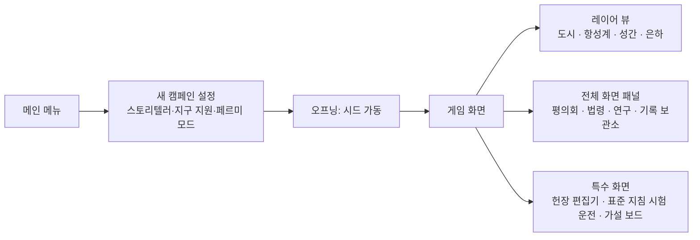
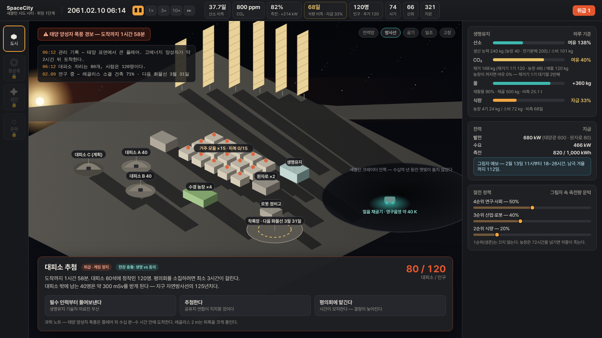
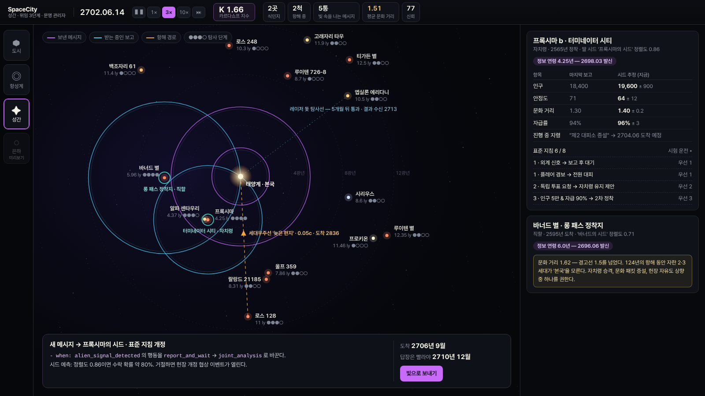

# 08. UX·아트·오디오

## 1. UX 원칙

1. **여유를 보여 준다.** 생명유지 값은 '양'이 아니라 '며칠 남았나, 몇 % 남나'로 보여 준다. 산소 3,000 kg보다 "30일"이 읽힌다.
2. **시간의 나이를 보여 준다.** 원거리 정보에는 언제나 정보 연령과 추정 오차가 붙는다.
3. **결정의 무게는 멈춤으로.** 결정이 필요한 순간에는 게임이 멈춘다. 시간 압박으로 긴장을 만들지 않는다.
4. **줌아웃은 의식처럼.** 새 레이어가 열리는 순간은 컷신과 음악 전환으로 '격'이 바뀌었음을 알린다.
5. **시드는 말을 아낀다.** 알림은 짧게, 관리 기록은 하루 한두 줄. 시드가 길게 말하는 것은 중요한 순간뿐이다.

## 2. 화면 구성

### 공통 레이아웃

| 영역 | 내용 |
|---|---|
| 상단 바 | 날짜·배속·도약, 핵심 지표(레이어마다 다름), K 지수(시대 1부터), 알림 배지 |
| 왼쪽 | 레이어 전환 (아직 열리지 않은 레이어는 잠금 표시와 해금 조건) |
| 가운데 | 레이어 뷰 |
| 오른쪽 | 선택한 대상의 상세 패널 |
| 아래 | 이벤트 카드, 관리 기록, 알림 피드 |

### 레이어별 화면

| 레이어 | 뷰 | 핵심 패널 | 오버레이 |
|---|---|---|---|
| 도시 | 3D 세계(구 모양 천체 위의 도시) + 단면 보기 | 생명유지 대시보드, 절전 정책, 건설 대기열 | 전력망, 공기, 방사선, 일조, 고장 |
| 항성계 | Δv 지하철 지도 | 계약 목록, 발사 창 타임라인, 메가프로젝트 | 물동량, 연료 기지, 병목 |
| 성간 | 근거리 항성 지도 + 빛의 고리 | 식민지 카드(정보 연령), 메시지 작성, 표준 지침 편집 | 문화 거리, 자치 단계, 이동 중 함선 |
| 은하 | 섹터 지도 + 탐지 가능 구체 | 가설 보드, 위협 달력, 접촉 타임라인 | 서명 채널별 반경 |

### 3D 세계 — 기지에서 이웃 별까지 한 화면

도시는 평평한 지도가 아니라 **구 모양 천체 위의 한 점**이다. 구글 어스처럼 천체를 돌려 보고, 확대하면 건물 사이로, 줌아웃하면 다른 행성과 항성까지 끊김 없이 간다.
레이어 전환(도시 → 항성계 → 성간)은 화면을 바꾸는 단추가 아니라 같은 카메라가 멀어지는 일이다.

| 줌 단계 | 보이는 것 (시대 0 프로토타입) |
|---|---|
| 기지 (수십 m ~ 수 km) | 3D 건물·도로·탈것, 해가 지평선 1.5° 위를 돌며 수 km 그림자를 드리운다. 능선 그늘에 들면 창과 등만 켜진다 |
| 크레이터 (수십 km) | 섀클턴 크레이터(지름 21 km, 깊이 4.2 km) 테두리 위의 기지, 영구 그늘 바닥의 얼음 |
| 천체 (수천 km) | 달 전체 — 바다, 큰 크레이터, 빛줄기, 위상. 남극 둘레는 따로 곱게 그린다 |
| 지구–달 (수십만 km) | 대륙·구름·바다 반사가 있는 지구, 두 천체의 궤도 |
| 항성계 (AU) | 행성 8개와 주요 위성, 궤도, 토성 고리와 그 위의 행성 그림자 |
| 이웃 (광년) | 25광년 안의 실제 이웃 항성계(거리 표시), 밝은 별과 은하수 |

| 규칙 | 내용 |
|---|---|
| 조작 | 천체 가까이: 끌면 땅을 잡고 돌린다, 오른쪽 끌기는 방향·기울기, 휠은 커서가 가리키는 땅 쪽으로 확대. 천체에서 멀어지면(반지름 4배) 그 천체를 가운데 두고 도는 우주 보기로 바뀌고, 더 멀어지면 중심이 모천체 → 태양으로 옮겨 간다 |
| 바로 가기 | 기지 · 달 · 지구·달 · 태양계 · 별 단추, 이름표를 누르면 그 천체로 날아간다 (멀리 돌아갈 때는 잠깐 떠올랐다 내려온다) |
| 실제 하늘 | 천체는 게임 날짜의 실제 자리에 있다 — 행성은 JPL 근사 궤도 요소, 달은 저정밀 월령 이론과 카시니 법칙 자전, 지구는 항성시로 돈다. 별은 실제 밝은 별 목록과 은하 좌표 |
| 축척 | 크기와 거리는 실제 값이다. 위치는 64비트로 셈하고, 먼 천체는 보이는 방향·겉보기 크기를 지킨 채 로그 껍질에 줄여 넣어 그린다 |
| 한 설계 | 3D 건물은 그림 생성기 하나가 3차원 도형으로 적은 모델이다. 같은 코드가 디자인 검토용 아이소메트릭 SVG도 그리지만 게임에는 넣지 않는다 |
| 달빛 | 레골리스는 램버트와 로멜–젤리거 반사를 섞어 보름달이 가장자리까지 밝다 |

### 자리 고르기 — 건물과 길을 원하는 곳에

건설 탭이나 모듈 카드의 '짓기'를 누르면 3D 세계(또는 지도)에 반투명한 **유령 건물**이 뜬다. 놓을 수 있으면 초록, 없으면 빨강이고
까닭이 유령 옆과 위쪽 막대에 함께 적힌다 (색만으로 알리지 않는다). 태양광 타워를 고르면 능선의 일조 구역이 남은 칸 수와 함께 깔린다.

| 동작 | PC | 터치 |
|---|---|---|
| 자리 | 마우스를 움직인다 — 유령이 1 m 격자를 따라온다 | 누른 곳으로 유령이 옮겨 간다 |
| 짓기 | 누른다 (Shift를 누르고 있으면 같은 건물을 계속 놓는다), Enter | 막대의 '여기에 짓기' |
| 돌리기 · 모양 | R · V | '돌리기' · '모양' |
| 빈자리에 | 막대의 '빈자리에' — 기본 배치의 빈자리에 바로 짓는다 | 같다 |
| 길 | '도로' 단추 또는 G, 점을 차례로 누른다. 길 끝은 6 m 안의 길·꼭짓점에 붙고, 건너는 길과는 교차로가 된다 | 같다 |
| 길 끝내기 · 지우기 | 오른쪽 클릭 또는 '끝' · '지우기'를 켜고 길을 누른다 | '끝' · '지우기' |
| 그만두기 | Esc, 오른쪽 클릭, '닫기' | '닫기' |

카메라 조작(끌기·휠·두 손가락)은 자리를 고르는 동안에도 그대로다. 바로 위에서 내려다보면(기울기 0) 자리와 길을 맞추기 쉽다.
배치 규칙은 [03 도시 레이어 §9](03-city-layer.md#9-건설과-로봇)에 있다.

## 3. 목업

### 도시 레이어 — 2061년 2월 10일, 폭풍 경보

- 상단 바의 지표는 모두 '여유'로 읽힌다 (산소 38일, 축전 82%, 식량 68일).
- 오른쪽 생명유지 대시보드는 생산·소비 막대와 여유 %를 나란히 보여 준다. CO₂ 제거 여유가 낮으면 붉게 바뀐다.
- 아래 이벤트 카드가 '대피소 추첨'이다. 게임은 멈춰 있고, 선택지 위에 대피소 정원(80/120)이 보인다.

### 성간 레이어 — 정보 연령

- 별마다 빛의 고리가 퍼진다. 메시지와 보고가 '날아가는' 모습이다.
- 식민지 카드는 '마지막 보고'와 '시드 추정'을 나란히 보여 준다. 추정의 오차 범위는 정보가 오래될수록 넓어진다.
- 오른쪽 아래에서 메시지를 쓰면 도착 연도가 바로 계산된다.

### 은하 레이어 — 가설 보드

- 가설마다 사후 확률 막대, 단서 카드에는 가설별 가능도가 칩으로 붙는다.
- 같은 사건에서 나온 단서 두 장을 넣으면 '과신 경고'가 뜬다.
- 아래 위협 달력은 서명이 문턱을 넘은 해와 그 빛이 지금 어디까지 퍼졌는지 보여 준다.

## 4. 알림

| 단계 | 예 | 표시 | 자동 정지 |
|---|---|---|---|
| 정보 | 연구 완료, 화물선 도착 | 피드에 한 줄 | 아니요 |
| 주의 | 그림자 예보, 비축 14일 미만 | 상단 바 지표가 노란색 | 아니요 |
| 경고 | CO₂ 2,500 ppm 초과, 축전 20% 미만 | 지표가 주황색 + 소리 | 설정에 따라 |
| 위급 | 폭풍 경보, 생명유지 3일 미만, 사망 | 화면 가장자리 붉은 테 + 이벤트 카드 | 언제나 |

같은 종류의 알림은 묶는다 ("고장 3건"). 상태는 언제나 **색 + 아이콘 + 글자**로 함께 표시한다.

## 5. 입력과 단축키

| 키 | 동작 | 키 | 동작 |
|---|---|---|---|
| Space | 일시정지 | 1 / 2 / 3 | 배속 1× / 3× / 10× |
| F | 다음 사건까지 도약 | Tab | 레이어 전환 |
| B | 건설 메뉴 | O | 오버레이 순환 |
| L | 관리 기록·기록 보관소 | H | 가설 보드 (시대 3 이후) |
| M | 3D · 목록 보기 전환 | Home | 3D에서 기지로 돌아가기 |
| G | 길 내기 | R · V | 자리를 고르는 동안: 돌리기 · 모양 (그 밖에는 R = 연구) |
| C | 평의회 | R | 연구 |

마우스만으로 모든 기능을 쓸 수 있어야 한다. Esc는 메뉴를 연다.

3D 세계: 왼쪽 끌기 = 돌리기, 오른쪽 끌기(또는 Shift+끌기) = 방향·기울기, 휠 = 커서 쪽 확대·축소, 더블클릭 = 다가가기. 방향키·Q/E·PgUp/PgDn·+/−로도 같은 일을 한다.

### Android (터치)

| 동작 | 결과 |
|---|---|
| 누르기 | 버튼·카드 선택 (마우스 클릭과 같다) |
| 끌기 | 패널 스크롤, 3D에서는 천체 돌리기 |
| 두 손가락 | 3D에서 벌리기·모으기 = 확대·축소, 비틀기 = 방향, 함께 위아래 = 기울기 |
| 두 번 누르기 | 3D에서 그 자리로 다가가기 |
| 자리 고르기 | 누른 곳으로 유령 건물이 옮겨 가고, '여기에 짓기'로 짓는다. 길은 누르는 점마다 이어진다 |
| 뒤로 가기 | 메뉴 (게임 정지) |
| 앱 내리기·닫기 | 자동 저장 |

- 화면은 가로로 고정하고 1280×720을 기준으로 늘린다. 누르는 곳은 최소 44px.
- 마우스를 올려야만 보이는 정보는 두지 않는다. 툴팁에 쓴 내용은 카드의 설명 줄에도 쓴다.

## 6. 접근성

| 항목 | 내용 |
|---|---|
| 색각 | 상태를 색만으로 전달하지 않는다. 색각 이상 팔레트 3종 |
| 글자 | 글자 크기 3단계, 숫자는 고정폭 |
| 시간 | 위급 알림의 자동 정지는 끌 수 없다. 반사 신경을 요구하는 장면이 없다 |
| 움직임 | 화면 흔들림·회전 연출 끄기 |
| 텍스트 | 모든 음성·사운드 신호를 텍스트 로그로도 남긴다 |

## 7. 아트 디렉션

### 키워드 — 따뜻한 아날로그 미래

**1970년대 NASA 우주 식민지 그림의 따뜻함 × 현대 관제 화면의 정밀함.**
1970년대 NASA 에임스 연구소의 우주 식민지 일러스트(단면도, 부드러운 빛, 사람이 사는 공간)를 정서의 기준으로,
아폴로 시대 기술 도면과 현대 관제 화면을 정보 표현의 기준으로 삼는다.

### 레이어별 팔레트

| 레이어 | 바탕 | 주조색 | 강조 | 경고 |
|---|---|---|---|---|
| 도시 | 레골리스 회색 `#2A2B2E` | 나트륨 등 호박색 `#F2A541` | 생명유지 청록 `#3FB8AF` | `#E4572E` |
| 항성계 | 심청 `#0E1B2C` | 궤도 흰색 `#E8EEF2` | Δv 선 시안 `#4CC9F0` | `#E4572E` |
| 성간 | 검정 `#05070A` | 별빛 `#F5F3E7` | 빛의 고리 자홍 `#C86BFA` | `#E4572E` |
| 은하 | 남색 `#1B1446` | 금색 `#E9C46A` | 서명 반경 `#F28482` | `#E4572E` |

### 시각 모티프

| 모티프 | 쓰임 |
|---|---|
| 극지의 낮은 해 | 도시 레이어의 상징. 해가 지평선을 따라 돌고, 그림자가 수 km씩 늘어진다 |
| 단면도 | 거주구를 잘라 보여 주는 1970년대식 표현. 사람의 생활이 보여야 한다 |
| 빛의 고리 | 성간·은하 레이어. 메시지·사건·서명이 퍼지는 모습 |
| 오래된 정보 | 정보 연령이 많을수록 카드가 흐려지고 입자감이 생긴다 |
| 타자기 기록 | 시드의 관리 기록은 한 글자씩 찍힌다 |

### 건물·탈것 그림

모든 그림은 생성기 하나([game/tools/art](../../game/tools/art/make_art.py))가 3차원 도형(상자·원기둥·원뿔·돔·판)으로 그린다. 게임은 이 도형으로 만든 3D 모델(몸체·유리·불빛 면)만 쓴다.
같은 코드가 아이소메트릭 SVG(디자인 검토·문서용)도 그린다 — 아래 투영·빛·밤 규칙은 이 SVG의 것이다.

| 규칙 | 내용 |
|---|---|
| 투영 | 정사영, 방위 45°·고도 30° (바닥 가로 2 : 세로 1). 1 m = 8 px로 그리고 게임은 2배로 래스터화한다 |
| 빛 | 화면 왼쪽에서 낮게 드는 햇빛. 해를 향한 옆면이 가장 밝고 윗면이 그다음, 그늘 쪽은 차가운 반사광 |
| 그림자 | 그림에는 접지 그림자만 넣는다. 긴 그림자는 게임이 해의 방위(29.5일에 한 바퀴)를 따라 그린다 |
| 밤 | 그림마다 낮 레이어와 불빛 레이어가 따로 있다. 능선 그늘에 들면 몸체를 푸르게 낮추고 불빛을 더한다 |
| 방향 | 지상 탈것은 네 방향으로 그린다 |
| 변형 | 건물마다 모양이 다른 설계 5가지(기본 + 4). 기능은 같다. 도시에서는 자리마다 하나가 정해지고, 나란히 선 다섯 자리는 모두 다르다 |
| 근거 | 실제 개념 설계에서 모양을 가져온다 — 팽창식 거주 모듈, 수직 태양광 타워, 40 kW 핵분열로, 3D 프린팅 돔, 드럼 굴착 로봇, 여섯 다리 건설 로봇 |

| 묶음 | 그림 |
|---|---|
| 건물 | 시대 0 모듈 29계열 145종 × 변형 5 = 725가지, 레골리스를 덮은 거주 모듈 5가지, 공사 비계 3종. 새 종류는 계열의 기본 모듈·변형과 실루엣·크기·색이 달라 한눈에 다른 건물로 읽혀야 한다 |
| 달 지상 | 비가압 로버, 가압 로버, 화물 운반차, 굴착 로봇, 건설 로봇, 로켓 호퍼, 우주비행사 (크기 기준) |
| 우주 | 유인 착륙선, 화물 착륙선, 궤도 예인선, 행성간 수송선 |
| 대기가 있는 세계 | 화성 헬리콥터, 타이탄 회전익기, 화성 비행기, 금성 비행선 |

비행기·헬리콥터는 공기가 있어야 난다. 달에는 공기가 없으므로 달의 '헬리콥터'는 로켓 호퍼다.
날기 쉬움(공기 밀도 ÷ 중력, 지구 = 1)은 화성 0.03, 금성 고도 50 km 1.5, 타이탄 31 — 날개와 로터는 시대 1 이후 화성·타이탄·금성에서 쓴다.

도시 화면의 건물·탈것은 이 도형의 3D 모델이다. 건물 종류마다 구역과 자리 수를 정해 두어 기지가 커져도 선 건물이 움직이지 않는다.
공사 중이면 비계가 서고 로봇이 가서 일하며, 고장 난 건물에는 붉은 표시가 깜박인다. 화물선·유인선이 오면 착륙선이 내려앉는다.

### 글꼴

한글은 Pretendard, 숫자는 고정폭(tabular) 숫자, 영문 보조 글꼴은 Inter 계열. 목업은 Pretendard로 그렸다.

## 8. 오디오

| 요소 | 방향 |
|---|---|
| 음악 — 도시 | 피아노·현악 소편성. 친밀하고 조심스럽게 |
| 음악 — 항성계 | 미니멀한 신스 아르페지오. 기계가 맞물려 돌아가는 쾌감 |
| 음악 — 성간 | 합창과 긴 지속음. 거리와 기다림 |
| 음악 — 은하 | 침묵을 설계한다. 드문 저음과 정적 — '조용한 은하'를 귀로 느끼게 |
| 생명유지 소리 | 기지의 웅웅거림이 부하에 따라 변한다. 절전하면 소리가 줄어 '어둠'을 귀로 느낀다 |
| 경보 | 피로하지 않게. 위급만 강하게 |
| 지구 교신 | 영상 통화에 왕복 2.6초 지연이 실제로 들린다. 시대가 지날수록 지연이 분·시간·년으로 늘어난다 |
| 진공 | 바깥에는 소리가 없다. 바깥 시점에서는 구조물을 타고 오는 진동음만 |
