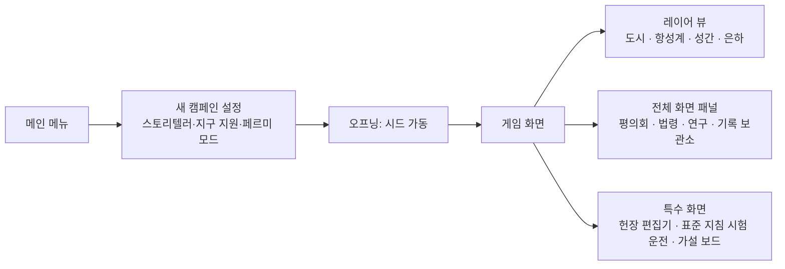

# 08. UX·아트·오디오

## 1. UX 원칙

1. **여유를 보여 준다.** 생명유지 값은 '양'이 아니라 '며칠 남았나, 몇 % 남나'로 보여 준다. 산소 3,000 kg보다 "30일"이 읽힌다.
2. **시간의 나이를 보여 준다.** 원거리 정보에는 언제나 정보 연령과 추정 오차가 붙는다.
3. **결정의 무게는 멈춤으로.** 결정이 필요한 순간에는 게임이 멈춘다. 시간 압박으로 긴장을 만들지 않는다.
4. **줌아웃은 의식처럼.** 새 레이어가 열리는 순간은 컷신과 음악 전환으로 '격'이 바뀌었음을 알린다.
5. **시드는 말을 아낀다.** 알림은 짧게, 관리 기록은 하루 한두 줄. 시드가 길게 말하는 것은 중요한 순간뿐이다.

## 2. 화면 구성

### 공통 레이아웃

| 영역 | 내용 |
|---|---|
| 상단 바 | 날짜·배속·도약, 핵심 지표(레이어마다 다름), K 지수(시대 1부터), 알림 배지 |
| 왼쪽 | 레이어 전환 (아직 열리지 않은 레이어는 잠금 표시와 해금 조건) |
| 가운데 | 레이어 뷰 |
| 오른쪽 | 선택한 대상의 상세 패널 |
| 아래 | 이벤트 카드, 관리 기록, 알림 피드 |

### 레이어별 화면

| 레이어 | 뷰 | 핵심 패널 | 오버레이 |
|---|---|---|---|
| 도시 | 2.5D 아이소메트릭 + 단면 보기 | 생명유지 대시보드, 절전 정책, 건설 대기열 | 전력망, 공기, 방사선, 일조, 고장 |
| 항성계 | Δv 지하철 지도 | 계약 목록, 발사 창 타임라인, 메가프로젝트 | 물동량, 연료 기지, 병목 |
| 성간 | 근거리 항성 지도 + 빛의 고리 | 식민지 카드(정보 연령), 메시지 작성, 표준 지침 편집 | 문화 거리, 자치 단계, 이동 중 함선 |
| 은하 | 섹터 지도 + 탐지 가능 구체 | 가설 보드, 위협 달력, 접촉 타임라인 | 서명 채널별 반경 |

## 3. 목업

### 도시 레이어 — 2061년 2월 10일, 폭풍 경보

- 상단 바의 지표는 모두 '여유'로 읽힌다 (산소 30일, 축전 82%, 식량 41일).
- 오른쪽 생명유지 대시보드는 생산·소비 막대와 여유 %를 나란히 보여 준다. CO₂ 제거 여유가 낮으면 붉게 바뀐다.
- 아래 이벤트 카드가 '대피소 추첨'이다. 게임은 멈춰 있고, 선택지 위에 대피소 정원(80/120)이 보인다.

### 성간 레이어 — 정보 연령

- 별마다 빛의 고리가 퍼진다. 메시지와 보고가 '날아가는' 모습이다.
- 식민지 카드는 '마지막 보고'와 '시드 추정'을 나란히 보여 준다. 추정의 오차 범위는 정보가 오래될수록 넓어진다.
- 오른쪽 아래에서 메시지를 쓰면 도착 연도가 바로 계산된다.

### 은하 레이어 — 가설 보드

- 가설마다 사후 확률 막대, 단서 카드에는 가설별 가능도가 칩으로 붙는다.
- 같은 사건에서 나온 단서 두 장을 넣으면 '과신 경고'가 뜬다.
- 아래 위협 달력은 서명이 문턱을 넘은 해와 그 빛이 지금 어디까지 퍼졌는지 보여 준다.

## 4. 알림

| 단계 | 예 | 표시 | 자동 정지 |
|---|---|---|---|
| 정보 | 연구 완료, 화물선 도착 | 피드에 한 줄 | 아니요 |
| 주의 | 그림자 예보, 비축 14일 미만 | 상단 바 지표가 노란색 | 아니요 |
| 경고 | CO₂ 2,500 ppm 초과, 축전 20% 미만 | 지표가 주황색 + 소리 | 설정에 따라 |
| 위급 | 폭풍 경보, 생명유지 3일 미만, 사망 | 화면 가장자리 붉은 테 + 이벤트 카드 | 언제나 |

같은 종류의 알림은 묶는다 ("고장 3건"). 상태는 언제나 **색 + 아이콘 + 글자**로 함께 표시한다.

## 5. 입력과 단축키

| 키 | 동작 | 키 | 동작 |
|---|---|---|---|
| Space | 일시정지 | 1 / 2 / 3 | 배속 1× / 3× / 10× |
| F | 다음 사건까지 도약 | Tab | 레이어 전환 |
| B | 건설 메뉴 | O | 오버레이 순환 |
| L | 관리 기록·기록 보관소 | H | 가설 보드 (시대 3 이후) |
| C | 평의회 | R | 연구 |

마우스만으로 모든 기능을 쓸 수 있어야 한다.

## 6. 접근성

| 항목 | 내용 |
|---|---|
| 색각 | 상태를 색만으로 전달하지 않는다. 색각 이상 팔레트 3종 |
| 글자 | 글자 크기 3단계, 숫자는 고정폭 |
| 시간 | 위급 알림의 자동 정지는 끌 수 없다. 반사 신경을 요구하는 장면이 없다 |
| 움직임 | 화면 흔들림·회전 연출 끄기 |
| 텍스트 | 모든 음성·사운드 신호를 텍스트 로그로도 남긴다 |

## 7. 아트 디렉션

### 키워드 — 따뜻한 아날로그 미래

**1970년대 NASA 우주 식민지 그림의 따뜻함 × 현대 관제 화면의 정밀함.**
1970년대 NASA 에임스 연구소의 우주 식민지 일러스트(단면도, 부드러운 빛, 사람이 사는 공간)를 정서의 기준으로,
아폴로 시대 기술 도면과 현대 관제 화면을 정보 표현의 기준으로 삼는다.

### 레이어별 팔레트

| 레이어 | 바탕 | 주조색 | 강조 | 경고 |
|---|---|---|---|---|
| 도시 | 레골리스 회색 `#2A2B2E` | 나트륨 등 호박색 `#F2A541` | 생명유지 청록 `#3FB8AF` | `#E4572E` |
| 항성계 | 심청 `#0E1B2C` | 궤도 흰색 `#E8EEF2` | Δv 선 시안 `#4CC9F0` | `#E4572E` |
| 성간 | 검정 `#05070A` | 별빛 `#F5F3E7` | 빛의 고리 자홍 `#C86BFA` | `#E4572E` |
| 은하 | 남색 `#1B1446` | 금색 `#E9C46A` | 서명 반경 `#F28482` | `#E4572E` |

### 시각 모티프

| 모티프 | 쓰임 |
|---|---|
| 극지의 낮은 해 | 도시 레이어의 상징. 해가 지평선을 따라 돌고, 그림자가 수 km씩 늘어진다 |
| 단면도 | 거주구를 잘라 보여 주는 1970년대식 표현. 사람의 생활이 보여야 한다 |
| 빛의 고리 | 성간·은하 레이어. 메시지·사건·서명이 퍼지는 모습 |
| 오래된 정보 | 정보 연령이 많을수록 카드가 흐려지고 입자감이 생긴다 |
| 타자기 기록 | 시드의 관리 기록은 한 글자씩 찍힌다 |

### 글꼴

한글은 Pretendard, 숫자는 고정폭(tabular) 숫자, 영문 보조 글꼴은 Inter 계열. 목업은 Pretendard로 그렸다.

## 8. 오디오

| 요소 | 방향 |
|---|---|
| 음악 — 도시 | 피아노·현악 소편성. 친밀하고 조심스럽게 |
| 음악 — 항성계 | 미니멀한 신스 아르페지오. 기계가 맞물려 돌아가는 쾌감 |
| 음악 — 성간 | 합창과 긴 지속음. 거리와 기다림 |
| 음악 — 은하 | 침묵을 설계한다. 드문 저음과 정적 — '조용한 은하'를 귀로 느끼게 |
| 생명유지 소리 | 기지의 웅웅거림이 부하에 따라 변한다. 절전하면 소리가 줄어 '어둠'을 귀로 느낀다 |
| 경보 | 피로하지 않게. 위급만 강하게 |
| 지구 교신 | 영상 통화에 왕복 2.6초 지연이 실제로 들린다. 시대가 지날수록 지연이 분·시간·년으로 늘어난다 |
| 진공 | 바깥에는 소리가 없다. 바깥 시점에서는 구조물을 타고 오는 진동음만 |
